# MI Fundamental Model - Agent/Model Interface Draft

- domain: gas
- status: draft
- owner: platform BE
- updated at: 2026-09-15 (output/intermediate 다운로드 metadata 계약 동기화)
- role: MI Fundamental Model 기능에서 platform과 model 파트 사이에 사전 합의가 필요한 연동 포인트를 정리하는 인터페이스 협의 초안

## 문서 목적

- MI Fundamental Model 실행에서 platform이 Kubernetes Job을 생성하고 model pod가 platform에 callback하는 연동 포인트를 분리해 정리한다.
- 현재 단계에서는 implementation-ready contract보다 협의 포인트와 기본 방향을 맞추는 데 집중한다.
- platform 내부 workflow semantics는 [scenario-case-execution-workflow-design-draft.md](scenario-case-execution-workflow-design-draft.md) 를 따른다.
- model→platform callback API 계약은 [fundamental-model-run-callback-spec.md](fundamental-model-run-callback-spec.md) 에 확정되어 있다.

## 대상 기능

| 기능 | platform 역할 | model 역할 |
|---|---|---|
| `MI Fundamental Model 실행` | 파일 업로드/저장, 복호화 호출 연계, Kubernetes Job 생성, 상태/결과/output/중간파일 조회 제공 | Dockerfile 기반 모델 이미지 제공, pod 내부 모델 실행, output 생성, 중간파일 업로드 및 `tcm_filel` 적재, backend callback 호출 |

## 1. MI Fundamental Model 실행

### 상위 흐름

```mermaid
flowchart LR
    A["엑셀 3개 업로드"] --> B["Platform 파일 저장"]
    B --> C["복호화 API 호출"]
    C --> C2["복호화 파일 S3 업로드 + tcm_filel 저장 (file_rel_obj_spt_cd=SCNRCASE, file_rel_obj_dstg_no=case_id)"]
    C2 --> D["Run Id 생성"]
    D --> E["Platform -> Kubernetes Job 생성 (S3 경로 3개를 Job args로 전달)"]
    E --> F["Job이 model image pod 실행"]
    F --> F2["pod가 S3에서 복호화 파일 다운로드"]
    F2 --> G["pod 내부 python engine/run_all_parallel.py 실행"]
    G --> H["pod가 storage에 결과 저장"]
    H --> I["pod 또는 실행 프로세스가 backend callback 호출"]
    I --> J["Job/pod 종료"]
```

### Platform이 확인해야 할 질문

- platform이 생성한 `runId` (`yyyymmdd_hhmmss_XXXX`)를 Job/pod가 그대로 보존하고 callback path에 사용할 수 있는지
- Kubernetes Job 생성 시 전달해야 하는 필드
  - `runId`
  - 복호화 결과 파일 S3 경로 3개 (model INPUT — python 스크립트의 입력값)
  - output storage prefix (model OUTPUT — python 스크립트 실행으로 생성되는 결과 파일 저장 위치)
  - callback URL/auth 정보
  - 실행 옵션
- output storage prefix (python 스크립트 실행 결과 파일 저장 위치. 복호화 결과 파일과 별개)

### 초안 권장안

| 항목 | 권장안 |
|---|---|
| 복호화 주체 | platform이 복호화 API를 호출 후 S3에 업로드. S3 경로 3개를 Job args로 전달. 파일 정보를 `tcm_filel` 테이블에 저장. model pod는 S3 경로로 복호화 파일을 직접 다운로드하여 실행 |
| 실행 방식 | 비동기 (Kubernetes Job + model pod callback). HTTP 연결 유지 불필요 |
| 상태 모델 | `PENDING / RUNNING / COMPLETED / FAILED` |
| 추적 키 | `runId` 단일화 권장. platform 생성 포맷은 `yyyymmdd_hhmmss_XXXX` |
| output 저장 책임 | **확정**: model(pod)이 output 파일을 저장하고 `tcm_filel`에 연결한다. platform의 상세 응답 metadata 계약은 [canonical feature spec](../../feature-specs/mi-fundamental-model-mock-api-feature-spec.md)을 따른다 |
| 모델 산출물 | 모델팀은 `engine/run_all_parallel.py` 실행 환경과 backend callback 호출 로직을 포함한 Dockerfile/model image를 제공 |
| 동시성 | 동일 case active `RUNNING` 1건은 기존 확정 제약. direct Python 실행에서 나온 global single thread 논의는 운영 검토 항목이며, k8s Job 방식에서는 cluster/pod resource 기준 동시 Job 수 제한을 별도 검토 |

### 실행 중간파일 적재 계약 (2026-09-07 확정)

model pod 가 중간파일을 `tcm_filel` 에 직접 INSERT 할 때 아래 값을 지켜야 한다. 하나라도 어긋나면 오류 없이 상세 조회 목록에서 누락된다.

| 컬럼 | 요구값 |
|---|---|
| `file_rel_obj_spt_cd` | `'SCNRCASEHI'` (정확히 일치. output 은 기존대로 `'SCNRCASEH'`) |
| `file_rel_obj_dstg_no` | Job arg `--run-seq` 값 |
| `del_yn` | `'N'` |
| `file_vald_end_dt` | `NULL` 또는 `'99991231'` (과거 일자면 조회에서 제외됨) |
| `img_conv_cmpt_yn` | `'N'` (NOT NULL) |
| `org_file_nm` | 화면 표시 파일명, 100자 이내 |
| `strg_path_nm` | `https://{host}/{bucket}/{path}/{file}` 전체 URL, 100자 이내 |
| `file_size` | 실제 byte 수 (다운로드 시 검증에 사용) |
| `mime_type_nm`, `filex_nm` | 실제 값 |
| `crt_dtm`, `mod_dtm`, `crt_usr_logn_id`, `mod_usr_logn_id` | NOT NULL |

- 개수 제한 없음(n개). 실행 중 순차 업로드 허용.
- 재실행 시 이전 run 의 중간파일은 다른 `run_seq` 에 붙으므로 덮어쓰지 않는다.
- 파일명은 상세 조회 응답에 그대로 노출된다. 고객사명·내부 경로 등 민감 정보를 파일명에 넣지 않는다.
- 전체 계약과 배경은 [mi-fundamental-model-intermediate-file-design.md](mi-fundamental-model-intermediate-file-design.md) 가 canonical 이다.

### Kubernetes model container resource 결정

| 구분 | 결정 |
|---|---|
| `resources.requests.cpu` | **확정**: `1500m` |
| `resources.requests.memory` | **확정**: `1Gi` |
| `resources.limits` | **미확정**: 현재 Job에는 설정하지 않음 |

- 적용 대상은 platform이 생성하는 모델 실행 Kubernetes Job Pod template의 `fundamental-model` 컨테이너다. `permission-test` 컨테이너에는 적용하지 않는다.
- source: Notion issue #105 (`https://app.notion.com/p/3a5263ff004c81d98c6ad6f5c6a89efa`), synced at 2026-07-23.

## 2. 협의 포인트 표

| 구분 | 확인 항목 | 이유 |
|---|---|---|
| 복호화 주체 | **확정**: platform이 복호화 API 호출 후 S3에 업로드. S3 경로 3개를 Job args로 전달. 파일 정보를 `tcm_filel` 테이블에 저장 | platform 파일 전처리 흐름 설계에 영향 |
| Job 생성 필드 | Kubernetes Job args/env로 전달할 필드 목록 (`runId`, 복호화 결과 파일 S3 경로 3개(INPUT), output storage prefix(OUTPUT), callback URL/auth, 실행 옵션 등) | platform→model 계약 확정 필요 |
| 모델 이미지 산출물 | Dockerfile, image registry/tag, `engine/run_all_parallel.py`, callback client 포함 범위 | backend Job 생성과 모델팀 배포 책임 경계 확정 |
| Job 운영 정책 | image name/tag, namespace, service account/RBAC, resource limits, retry/backoff, TTL cleanup. resource requests는 위 확정 결정을 따름 | 운영 배포 안정성 |
| timeout | model 실행 최대 소요 시간 | scheduler timeout 임계값 결정 |
| 상태 값 | 대기/실행중/완료/실패 표현 | DB/UI 상태 정렬 |
| 실패 응답 | 실패 사유 구조 | 사용자 메시지와 운영 추적 |
| 결과 보관 | **확정**: model(pod)이 output 파일 저장. 저장 위치를 callback으로 platform에 전달 | platform DB/storage 설계 영향 |
| 실행 중간파일 | **확정 (2026-09-07)**: model(pod)이 중간파일 n개를 object storage에 업로드하고 `tcm_filel`에 직접 INSERT한다. `file_rel_obj_spt_cd = 'SCNRCASEHI'`, `file_rel_obj_dstg_no` = Job arg `--run-seq` 값. output(`SCNRCASEH`)과 같은 `run_seq`를 쓰되 코드로 구분한다. 추가 Job arg는 필요 없다 | 상세 응답이 output/intermediate 다운로드 metadata를 제공하며 필드 계약은 [canonical feature spec](../../feature-specs/mi-fundamental-model-mock-api-feature-spec.md)을 따른다 |
| 복호화 파일 보관 | **확정**: platform이 복호화 후 S3에 업로드. S3 경로 3개를 Job args로 전달. 파일 정보를 `tcm_filel` 테이블에 저장 (`file_rel_obj_spt_cd = 'SCNRCASE'`, `file_rel_obj_dstg_no = case_id`). model pod는 S3 경로로 직접 다운로드하여 사용 | storage 설계 영향 |
| 재시도 | 중복 실행 방지 및 재실행 정책 | run 이력 관리 |

## 3. 추천 인터페이스 결정 순서

1. ~~복호화 API 호출 주체 결정~~ → **완료**: platform이 호출
2. Kubernetes Job 생성 필드 확정 (`runId`, 복호화 결과 파일 S3 경로 3개(INPUT), output storage prefix(OUTPUT), callback URL/auth, 실행 옵션)
3. Job image/namespace/RBAC/resource limits/TTL/retry 정책 합의 (resource requests는 확정 완료)
4. 상태 값과 상태 조회 방법 합의
5. ~~output 저장 책임과 다운로드 연계 결정~~ → **완료**: model이 저장하고 `tcm_filel`에 연결하며, platform은 상세 응답 metadata를 기존 공통 File API 요청에 사용하도록 제공
6. 실패 응답 구조 확정

## 4. Open Questions

- Kubernetes Job args/env 필드 목록 확정
- model Dockerfile/image name/tag와 배포 주체 확정
- model image 안에 backend callback 호출 로직을 포함할 위치와 실패/재시도 방식 확정
- Job namespace, service account/RBAC, resource limits, retry/backoff, TTL cleanup 정책 확정 (`resources.requests`는 CPU `1500m`, Memory `1Gi`로 확정 완료)
