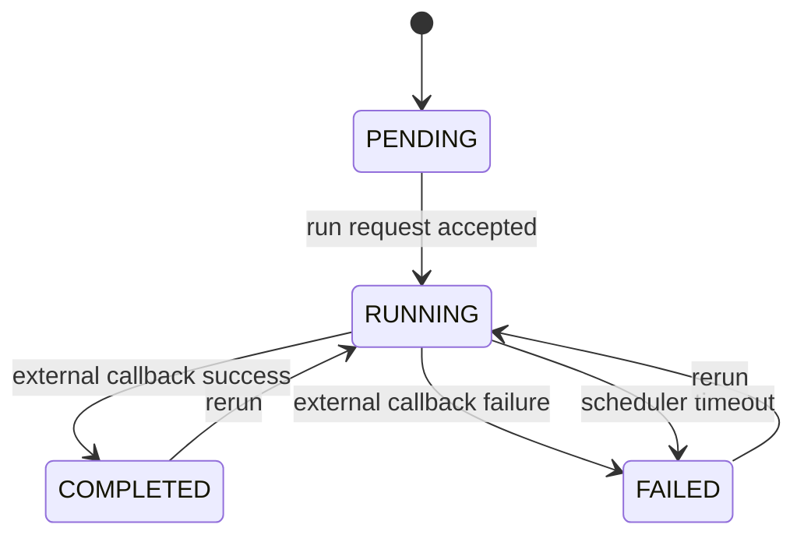
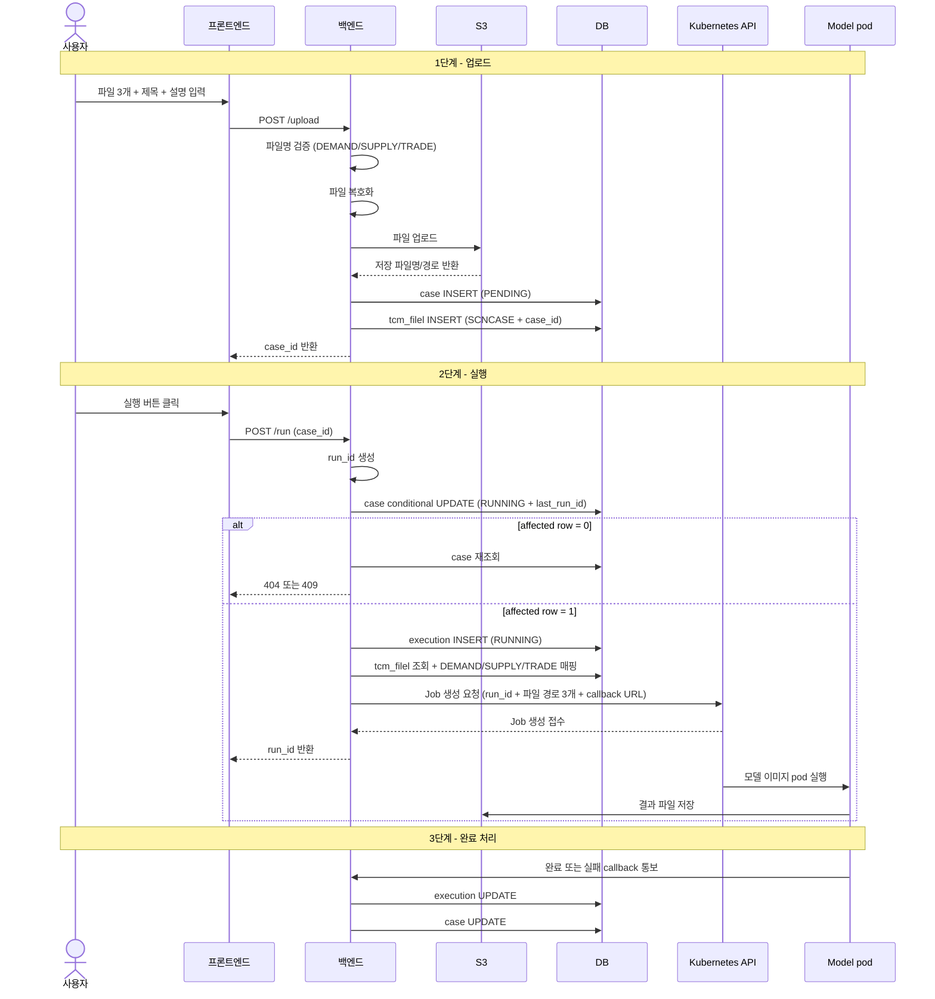
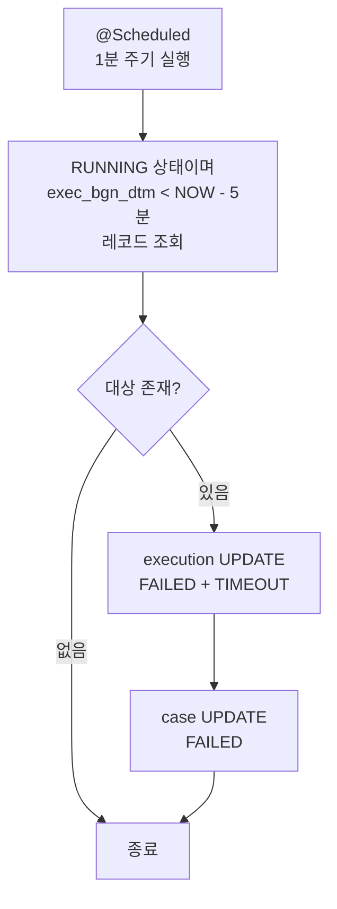
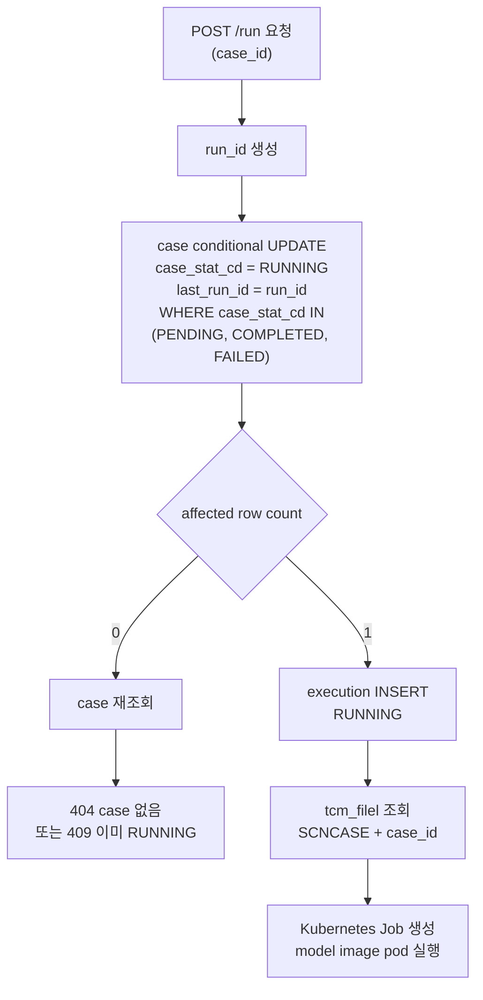

# Scenario Case Execution Workflow Design Draft

- domain: gas
- status: draft
- owner: platform BE
- updated at: 2026-06-05 (createCase 파일 귀속/보상 처리 결정 반영)
- role: Scenario Case 업로드, 비동기 실행, 상태 추적, timeout 처리의 backend workflow와 persistence 초안을 정리하는 설계 문서

> 빠른 진입점:
> - 이 문서는 `Scenario Case -> Execution History -> run_id/status` 흐름의 workflow/domain semantics source로 사용한다.

## 문서 목적

- Scenario Case 업로드 이후 Kubernetes Job으로 모델 pod를 실행하고 상태를 추적하는 backend 기준 workflow를 정리한다.
- work note에 머물던 DB/상태/흐름 초안을 실행 기록과 분리해 장기 참조 가능한 design artifact로 옮긴다.
- 이 문서는 endpoint path/request/response field contract를 확정하지 않는다. MI Fundamental Model 1차 mock API의 canonical endpoint 계약은 [mi-fundamental-model-mock-api-feature-spec.md](../../feature-specs/mi-fundamental-model-mock-api-feature-spec.md) 를 따른다.
- 이 문서는 DB rollout-ready SQL을 확정하지 않는다. final physical schema rollout은 별도 DDL/DBA review artifact에서 다룬다.

## 현재 canonical artifact

- MI Fundamental Model 1차 mock API endpoint/path/request/response canonical source는 [mi-fundamental-model-mock-api-feature-spec.md](../../feature-specs/mi-fundamental-model-mock-api-feature-spec.md) 다.
- 1차 mock API의 초기 응답 데이터 source는 `src/main/resources/mock/fundamental-model/fundamental-model-cases.json` 이다. API 호출 중 생성/실행/callback으로 바뀌는 상태는 메모리 store에만 반영하고, reset은 이 seed json을 다시 읽어 초기 상태로 복원한다.
- 이 workflow draft는 Scenario Case aggregate, 상태 전이, callback/timeout semantics, future persistence rationale의 source다.
- MI Fundamental Model은 MI Scenario Workbench와 동급 메뉴다. `Scenario Case` 명칭은 현업 용어로 유지하지만, API parent가 `Scenario` 또는 Scenario Workbench라는 뜻은 아니다.
- canonical API path family는 `/api/v1/mi/fundamental-model/**` 이다. 기존 `/api/v1/mi/scenario-workbench/**/fundamental-*` 및 `/api/v1/mi/scenario-workbench/scenarios/{scenarioId}/fundamental-model-cases/**` 형태는 superseded contract이며 이 문서의 workflow는 해당 hierarchy를 전제로 하지 않는다.
- 상위 도메인 흐름은 [gas-event-scenario-supply-model-linkage.md](gas-event-scenario-supply-model-linkage.md) 를 따른다.
- DB rollout SQL 초안은 [scenario-case-execution-erd-ddl-draft.md](scenario-case-execution-erd-ddl-draft.md) 에서 관리한다. 현재는 template / not rollout-ready 상태이며, `scenario_id` 전제는 proposed model에서 제거되었다. 과거 전제는 change note로만 유지하고 ownership/permission scope와 list index 선택은 후속 ERD/DBA review에서 확정한다.
- 실행 이력과 검증 기록은 [2026-04-28-scenario-case-execution-db-design.md](../../work-notes/2026/2026-04-28-scenario-case-execution-db-design.md) 에 남긴다.

## 범위

### In Scope

- Scenario Case 업로드 단위와 실행 이력 단위 분리
- `run_id` 기반 비동기 실행 추적
- `caseId` 또는 `runId` 단독 식별 기준의 실행/조회/callback workflow
- case 상세 조회 aggregate projection semantics
- case metadata 수정 semantics
- case soft delete semantics
- 상태 모델과 상태 전이 규칙
- timeout 처리와 중복 실행 방지 정책
- platform 저장 테이블 초안과 인덱스 초안

### Out of Scope

- 실제 API request/response field contract
- model pod callback payload 상세
- canonical DDL/ERD 확정본
- 결과 파일 다운로드 및 결과 파일 물리 관리 (결과 데이터 조회 API인 `GET /cases/{caseId}/volumes`, `GET /cases/{caseId}/price`는 1차 mock scope에 포함되었으며 feature spec이 계약을 관리한다)
- Scenario Workbench 하위 resource path 또는 `scenarioId` 기반 API scope

## 도메인 구조

```text
MI Fundamental Model (Scenario Workbench와 동급 메뉴)
    └── Scenario Case aggregate (현업 용어)
            └── 1:N
                └── tmd_scncasem (Scenario Case Master)
                        └── 1:N
                            └── tmd_scncaseh (Scenario Case History)

tcm_filel (공통 파일 내역)
    └── file_rel_obj_spt_cd = 'SCNCASE'
    └── file_rel_obj_dstg_no = tmd_scncasem.case_id
```

- `Scenario Case`는 현업 용어다. API hierarchy상 `Scenario` 또는 Scenario Workbench 하위 resource라는 의미가 아니다.
- 2026-05-20 canonical feature spec 기준으로 1차 mock API는 `scenarioId` path/query/body/response 필드를 사용하지 않는다.
- 업로드 요청 단위의 case는 `caseId`로 식별하고, 실행 요청 단위의 execution history는 `runId`로 식별한다.
- case 1개는 실행 요청 단위의 execution history를 여러 개 가질 수 있다.
- case에 연결된 업로드 파일은 `tmd_scncasem` 의 반복 컬럼이 아니라 기존 공통 파일 테이블 `tcm_filel` 에 저장한다.
- 현재 제품 요구는 사실상 `case:execution = 1:1`에 가깝지만, 재실행 가능성을 고려해 물리적으로는 분리한다.
- `tmd_scncasem` 은 `case_id`를 primary identity로 갖는 독립 aggregate다. `tmm_scenariom` parent FK/논리참조와 `scenario_id` 컬럼 전제는 현재 proposed model에서 제거한다.
- ownership scope는 `usr_no`(업로더/소유자) only로 확정한다.

## Boundary Against Existing ScenarioModelExecution API

기존 `ScenarioModelExecution` API는 Scenario Workbench의 parameter 기반 MI 수급모델 실행 리소스를 다룬다. 이 문서의 `Scenario Case` workflow는 파일 3개 업로드를 기준으로 생성되는 MI Fundamental Model aggregate와 실행 이력을 다루며, 기존 `model-executions` resource와 별개 기능이다.

따라서 기존 Scenario Workbench API와 상태/실행 개념이 유사하더라도, 1차 mock canonical API는 `/api/v1/mi/fundamental-model/**` path family와 `caseId`/`runId` 식별 기준을 따른다.

## Actor

| Actor | 설명 | 주요 액션 |
|---|---|---|
| `User` | MI Fundamental Model 화면 사용자 | 목록 조회, 파일 업로드, 실행 요청, 상태 조회 |
| `Platform BE` | 업로드/저장/상태 관리 주체 | case 생성, execution 생성, 상태 갱신 |
| `Kubernetes Job / model pod` | 실제 모델 실행 수행 주체 | 모델 이미지 pod 실행, `engine/run_all_parallel.py` 실행, storage 결과 저장, 완료/실패 callback 통보 |
| `Scheduler` | timeout 감시 주체 | 장시간 RUNNING 건 실패 전환 |

## 상태 정의

### case 상태 (`case_stat_cd`)

| 상태 | 의미 | 진입 조건 | 종료 조건 |
|---|---|---|---|
| `PENDING` | 업로드 완료, 실행 대기 | case 생성 완료 | 실행 시작 |
| `RUNNING` | 실행 중 | execution 생성 + Kubernetes Job 생성 요청 성공 직전/직후 | 완료, 실패 |
| `COMPLETED` | 최신 실행 성공 | model pod 또는 pod 내부 실행 프로세스 callback 통보 | 재실행 시 RUNNING |
| `FAILED` | 최신 실행 실패 | Job 생성 실패, model pod 실패 callback, 또는 timeout | 재실행 시 RUNNING |

### execution 상태 (`exec_stat_cd`)

| 상태 | 의미 | 진입 조건 | 종료 조건 |
|---|---|---|---|
| `RUNNING` | Kubernetes Job dispatch 후 처리 중 | execution row 생성 | 완료, 실패 |
| `COMPLETED` | 실행 완료 | 완료 콜백/상태 동기화 | terminal |
| `FAILED` | 실행 실패 | 실패 응답 또는 timeout | terminal |

### 실패 사유 (`fail_rsn_cd`)

| 코드 | 의미 |
|---|---|
| `TIMEOUT` | 허용 시간 초과 |
| `EXTERNAL_ERROR` | 외부 API 오류 응답 |
| `UNKNOWN` | 분류되지 않은 실패 |

## Fixed Decisions / 핵심 설계 결정

### 1. aggregate 분리

- 업로드 단위 metadata와 실행 단위 status/history는 분리한다.
- 이유:
  - 파일 3개와 사용자 입력 제목/설명은 업로드 시점에 확정된다.
  - 실행은 재시도/재실행 가능성이 있어 별도 lifecycle을 가진다.

### 2. 최신 상태의 이중 보관

- `tmd_scncasem.case_stat_cd` 에 최신 상태를 둔다.
- `tmd_scncasem.last_run_id` 에 최신 실행 `run_id` pointer를 둔다. `tmd_scncaseh.run_id` 에 대한 application-validated 논리 참조이며 물리 FK 는 걸지 않는다.
- 상세 실행 기록은 `tmd_scncaseh` 에 남긴다.
- 이유:
  - 프론트 목록/상세 조회 시 최신 상태와 최신 실행을 단일 row 조회로 단순화할 수 있다.
  - 이력은 별도 테이블에 남겨 재실행/운영 추적을 지원할 수 있다.
- invariant: `case_stat_cd` 와 `last_run_id` 가 가리키는 `tmd_scncaseh.exec_stat_cd` 는 항상 같은 terminal/RUNNING 상태여야 한다. 갱신 순서는 execution → case 또는 conditional case update 후 execution insert 로 한 transaction 안에서 보장한다.

### 3. `run_id`의 역할

- `run_id` 는 model pod와 platform이 공유하는 비동기 실행 추적 키다.
- backend가 `yyyymmdd_hhmmss_XXXX` 포맷의 값을 생성해 Kubernetes Job/pod에 전달하는 것으로 확정한다.
- `yyyymmdd_hhmmss` 는 실행 요청 시각 기준이며, `XXXX` 는 같은 초 안의 충돌을 방지하기 위한 4자리 suffix다.
- 예: `20260521_143500_a1b2`
- `run_id` 는 `tmd_scncaseh` 에 unique로 저장한다.

### 4. Kubernetes Job 실행 및 완료 동기화 방식

- backend는 Kubernetes API로 1회성 Job 생성을 요청한다.
- Job은 MI Fundamental Model 모델 이미지를 사용해 pod를 실행한다.
- 모델 이미지는 모델팀이 Dockerfile 기반으로 제공하며, `engine/run_all_parallel.py` 실행 환경과 backend callback 호출 로직을 포함해야 한다.
- pod 내부 command는 `python engine/run_all_parallel.py` 실행을 기본으로 한다.
- backend는 Job 생성 요청에 `run_id`, `run_seq`, 입력 파일 storage path 3개, backend callback URL을 전달한다. callback URL은 `--callback-url` Job arg로 전달하며, run_id를 포함한 전체 URL을 backend가 생성해 주입한다. `run_seq`는 pod가 output 파일을 `tcm_filel`에 INSERT할 때 사용한다.
- Job 생성 요청 성공은 모델 실행 완료가 아니라 dispatch 접수 성공으로만 판단한다.
- Job 생성 요청이 실패하면 execution/case 상태를 `FAILED` 로 전환하고 클라이언트에는 실패 응답을 반환한다.
- pod 내부 Python 실행이 완료되거나 실패하면 pod 또는 실행 프로세스가 backend callback API를 호출해 terminal 상태를 통보한다.
- 결과 파일 자체는 pod가 S3/object storage에 저장한다.
- backend가 pod 내부 Python 완료 여부를 주기적으로 polling 하는 방식은 채택하지 않는다.
- FE는 backend 상태 조회 API를 polling 할 수 있지만, 이는 backend와 model pod 사이의 polling이 아니다.
- `ProcessBuilder` 로 backend JVM에서 Python 스크립트를 직접 실행하는 방안에서는 backend resource 보호를 위해 전체 실행 직렬화 논의가 나올 수 있다. 이 논의는 문서상 확정된 요구사항이 아니라, direct process execution 방식의 운영 위험을 줄이기 위한 검토 항목이다.
- 2026-05-22 기준 실행 주체는 Kubernetes Job/model pod로 분리한다. k8s Job 방식에서 backend는 Job 생성 요청 후 비동기 접수 응답을 반환하므로 장시간 모델 실행 동안 backend request thread를 점유하지 않는 방향으로 설계한다.
- 다만 k8s Job 방식에서도 무제한 병렬 실행을 의미하지 않는다. cluster quota, namespace resource, 모델 pod CPU/memory, Python 내부 병렬도, storage/API 부하를 기준으로 동시 Job 수 제한이 필요한지는 별도 운영 설계에서 검토한다.
- 기존 설계의 확정 동시성 제약은 동일 case에 대해서만 active `RUNNING` 실행을 하나만 허용하는 것이다.

### 5. 중복 실행 방지

- 동일 case에 대해 `RUNNING` 상태가 있으면 새 실행을 차단한다.
- DB-backed 구현 권장안은 `tmd_scncasem` conditional update를 먼저 성공시킨 뒤, 같은 transaction에서 `tmd_scncaseh` row를 insert하는 방식이다.
- `run_id` 는 실행 요청마다 새로 생성되는 unique key이므로, `run_id + exec_stat_cd` 조합만으로는 동일 case에 서로 다른 `run_id` 를 가진 `RUNNING` row 2개가 생기는 것을 막을 수 없다.
- `UNIQUE (case_id, exec_stat_cd)` 는 `RUNNING` 중복은 막을 수 있지만 과거 `COMPLETED`/`FAILED` 이력도 case당 1건으로 제한하므로 이력 테이블에는 부적합하다.
- 권장 선점 update 예시는 다음과 같다.

```sql
UPDATE tmd_scncasem
SET case_stat_cd = 'RUNNING',
    last_run_id = :run_id,
    mod_dtm = NOW(),
    mod_usr_logn_id = :actor
WHERE case_id = :case_id
  AND del_yn = 'N'
  AND case_stat_cd IN ('PENDING', 'COMPLETED', 'FAILED');
```

- affected row count가 `1` 이면 해당 요청이 실행을 선점한 것이므로 `tmd_scncaseh` 에 `RUNNING` row를 insert한다.
- affected row count가 `0` 이면 case 없음 또는 이미 `RUNNING` 인 상태이므로 `caseId` 단독 재조회 후 `404` 또는 `409` 로 분기한다.
- `last_run_id` 는 late callback이 이전 실행의 결과로 case 최신 상태를 덮어쓰지 않도록 하는 latest execution pointer로 사용한다.
- `SELECT ... FOR UPDATE` 와 nullable `actv_exec_token` unique 방식은 대안으로 남기되, 현재 권장안은 conditional master update다.

### 6. timeout 처리

- scheduler가 주기적으로 `RUNNING` 이면서 시작 시각이 임계치를 넘긴 실행을 찾아 `FAILED/TIMEOUT` 으로 전환한다.
- 아직 구현된 scheduler query는 없으며, 아래 인덱스/EXPLAIN 검토는 expected query shape 기준의 DB-backed rollout 검증 항목이다.
- timeout 기준은 현재 문서에서는 5분 가정으로 두되, 운영 설정값화 여부는 open question으로 유지한다.

### 7. 파일 저장은 `tcm_filel` 재사용

- `tmd_scncasem` 에 `file_path_1`, `file_path_2`, `file_path_3` 같은 반복 파일 경로 컬럼을 두지 않는다.
- 업로드 파일은 기존 기능과 동일하게 `tcm_filel` 에 저장한다.
- case와 파일의 연결은 다음 값으로 표현한다.
  - `tcm_filel.file_rel_obj_spt_cd = 'SCNCASE'`
  - `tcm_filel.file_rel_obj_dstg_no = tmd_scncasem.case_id`
- `tcm_filel.file_rel_obj_dstg_no` 가 `INT UNSIGNED` 이므로 `tmd_scncasem.case_id` 도 `INT UNSIGNED` 로 맞추는 안을 기본으로 둔다.
- `SCNCASE` 코드는 `file_rel_obj_spt_cd` 공통코드에 등록해야 한다.
- 2026-05-19 확인 기준으로 target 공통코드에는 `SCNCASE` 중복 등록이 없다.
- DB-backed `createCase()` 구현에서는 공용 `FileService`의 기본 `TEMP/0` 임시 업로드 흐름을 표준 경로로 사용하지 않는다. case row 생성으로 `case_id`를 먼저 확보한 뒤, 업로드 파일 3개를 `SCNCASE + case_id` relation으로 직접 저장하는 전용 업로드 메서드를 사용한다.
- 업로드 3개는 하나의 case aggregate를 구성하므로 all-or-nothing으로 처리한다. 3개 중 1개라도 실패하면 API 전체를 실패로 보고, 이미 성공한 업로드 분은 service 계층이 보상 삭제를 호출해 정리한다.
- 보상 삭제 orchestration 책임은 `createCase()` application service에 둔다. `FileService`는 relation-aware upload/delete primitive만 제공하고, 어떤 업로드를 되돌릴지 판단하는 aggregate 문맥은 갖지 않는다.

## Backend Workflow

### Stage 1. 업로드

1. 사용자가 파일 3개와 제목/설명을 입력한다.
2. backend는 파일 3개의 파일명을 검증한다. `DEMAND`, `SUPPLY`, `TRADE` 키워드가 각각 정확히 1개씩 포함되어야 한다. 키워드 비교는 대소문자 무관. 조건 불충족 시 `400` 반환.
3. backend는 필요 시 파일 복호화를 수행한다.
4. backend는 `tmd_scncasem` 에 `PENDING` case row를 먼저 생성해 `case_id`를 확보한다.
5. 확보한 `case_id`를 사용해 파일 3개를 object storage와 `tcm_filel`에 업로드한다. 이때 각 file row는 생성 시점부터 `file_rel_obj_spt_cd = 'SCNCASE'`, `file_rel_obj_dstg_no = case_id` 로 직접 저장한다.
6. 파일 3개 중 하나라도 업로드 또는 `tcm_filel` 저장에 실패하면 API 전체를 실패로 처리한다. 이미 성공한 업로드가 있으면 `createCase()` service가 성공분 file primitive를 호출해 보상 삭제를 수행한 뒤 예외를 재던진다.
7. 생성 직후 case 상태는 `PENDING` 이다.

### Stage 2. 실행 요청

1. 사용자가 특정 case 실행을 요청한다.
2. backend는 `run_id` 를 먼저 생성한다.
3. 같은 transaction에서 `tmd_scncasem` conditional update를 수행해 실행 권한을 선점한다.
   - 조건: `case_id`, `del_yn = 'N'`, `case_stat_cd IN ('PENDING', 'COMPLETED', 'FAILED')`
   - update 값: `case_stat_cd = 'RUNNING'`, `last_run_id = :run_id`
4. affected row count가 `0` 이면 case 없음 또는 이미 `RUNNING` 인 상태이므로 `caseId` 단독 재조회 후 `404` 또는 `409` 로 분기한다.
5. affected row count가 `1` 이면 해당 요청이 실행을 선점한 것이므로 `tmd_scncaseh` 에 `RUNNING` 상태 row를 생성한다.
6. `tcm_filel` 에서 case에 연결된 파일 정보를 조회하고, 파일명의 `DEMAND`/`SUPPLY`/`TRADE` 키워드로 각 파일 경로를 매핑한다.
7. Kubernetes Job을 생성한다. Job pod의 기본 실행 command는 아래와 같다.
   ```
   python engine/run_all_parallel.py \
     --run-id {run_id} \
     --run-seq {run_seq} \
     --demand-excel-path {demand 파일 경로} \
     --supply-excel-path {supply 파일 경로} \
     --trade-excel-path {trade 파일 경로} \
     --callback-url {backend_host}/api/v1/mi/fundamental-model/runs/{run_id}/callback
   ```
   - callback URL은 `--callback-url` arg로 전달하며, backend가 `run_id`를 포함한 전체 URL을 생성해 Job 생성 시점에 주입한다.
   - `--run-seq`는 `tmd_scncaseh.run_seq` 값이다. pod가 실행 완료 후 output 파일을 S3에 업로드하고 `tcm_filel`에 직접 INSERT할 때 `file_rel_obj_spt_cd = 'SCNCASEH'`, `file_rel_obj_dstg_no = run_seq`로 사용한다. pod는 이미 DB 접근 권한을 가지며, arg로 받아 추가 조회 없이 사용한다.
   - 모델 이미지는 모델팀이 Dockerfile 기반으로 제공하며, 위 스크립트, 실행 의존성, backend callback 호출 로직을 포함해야 한다.
   - pod stdout/stderr는 Kubernetes log로 남기며 backend application log 직접 소비는 필수 전제가 아니다.
8. Job 생성 요청에 성공하면 backend는 클라이언트에 `202 Accepted` 수준의 비동기 시작 응답을 반환한다.
9. Job 생성 요청에 실패하면 execution/case 상태를 `FAILED` 로 전환하고 실패 응답을 반환한다.

### Stage 3. 완료/실패 callback 동기화

1. pod 또는 pod 내부 Python 프로세스가 실행을 완료하거나 실패하면 backend callback API를 호출한다.
2. backend는 `run_id` 로 execution row를 찾는다.
3. execution이 아직 `RUNNING` 인 경우에만 compare-and-set 조건으로 terminal 상태와 종료 시각, 실패 사유/오류 메시지를 갱신한다.
4. case 최신 상태는 callback 대상 execution이 현재 case의 latest/active execution과 일치할 때만 (`tmd_scncasem.last_run_id = :run_id` 조건) 반영한다. `last_run_id` 자체는 변경하지 않고 그대로 두어 terminal 결과가 어느 run의 결과인지 보존한다.
5. 이미 terminal 상태인 execution에 도착한 callback은 상태를 덮어쓰지 않고 idempotent no-op으로 처리한다.
6. timeout 또는 재실행 이후 늦게 도착한 이전 `run_id` callback은 case 최신 상태를 바꾸지 않고 성공 ack와 로그만 남긴다.

### Stage 4. 상태 조회

1. 프론트는 canonical 1차 mock API 기준으로 `caseId` 상태 조회 endpoint를 폴링한다.
2. backend는 case 최신 상태와 latest run projection을 조회해 상태/시작/종료 시각을 반환한다.
3. 결과 파일 자체는 model pod가 S3/object storage에 저장/관리한다.
4. backend는 결과 파일 download URL 또는 결과 파일 pointer/reference를 저장하지 않는다. 결과 데이터 조회(Volumes/Price 수치 데이터)는 `GET /cases/{caseId}/volumes`, `GET /cases/{caseId}/price` API로 분리되어 제공한다. 1차 mock은 json seed 기반 고정 데이터를 반환하며, DB-backed 전환 시 별도 테이블 설계가 필요하다.
5. `runId` 단독 조회는 후속 이력 조회 계약에서 별도로 검토한다.

### Stage 4a. 상세 조회

1. 프론트가 case 상세 화면에 진입하면 `caseId` 기준 상세 조회 endpoint를 호출한다.
2. backend는 case metadata, 업로드 파일 metadata, latest run projection을 한 번에 반환한다.
3. 상세 조회는 화면 rendering용 aggregate snapshot이다. FE polling loop는 `GET /cases/{caseId}/status`를 사용하고, 상세 조회를 polling용 API로 반복 호출하지 않는다.
4. 상세 조회는 full run history를 반환하지 않는다. case의 전체 실행 이력은 별도 runs API가 정의될 때까지 이 workflow의 phase-1 범위에 포함하지 않는다.
5. 상세 조회는 result payload, result file reference, download URL/path를 반환하지 않는다. 결과 수치 데이터(Volumes/Price)는 `GET /cases/{caseId}/volumes`, `GET /cases/{caseId}/price` API로 분리 제공하며, 결과 파일 다운로드는 별도 API 계약과 persistence 검토가 필요하다.
6. phase-1 mock 구현은 기존 in-memory case aggregate와 run store의 `latestRunId` pointer를 사용해 이 projection을 만든다. DB-backed 전환 시에는 master case, `tcm_filel`, latest execution row를 같은 ownership/permission scope에서 조회해야 한다.
7. soft-deleted case는 active resource가 아니므로 상세 조회에서 `404 RSC_NOT_FOUND`로 처리한다.

### Stage 4b. Case metadata 수정

1. 사용자가 case 상세 화면에서 제목 또는 설명을 수정한다.
2. backend는 `caseId` 기준 active case를 조회한다.
3. 수정 대상은 `tmd_scncasem.case_titl_nm`, `tmd_scncasem.case_expn`에 해당하는 metadata뿐이다.
4. `title`은 trim 후 1-200자 필수로 검증한다.
5. `description`은 nullable/optional로 받고 `case_expn`에 반영한다.
6. files, latestRun pointer, execution history, status, result payload/download 정보는 수정하지 않는다.
7. 수정 응답은 상세 조회와 동일한 aggregate projection을 반환한다.
8. soft-deleted case는 active resource가 아니므로 수정에서 `404 RSC_NOT_FOUND`로 처리한다.

DB-backed 전환 시 권장 update shape:

```sql
UPDATE tmd_scncasem
SET case_titl_nm = :title,
    case_expn = :description,
    mod_dtm = NOW(),
    mod_usr_logn_id = :actor
WHERE case_id = :case_id
  AND usr_no = :usr_no
  AND del_yn = 'N';
```

affected row count가 `0`이면 case 없음, ownership 불일치, 또는 이미 삭제된 case로 보고 active resource 관점의 `404 RSC_NOT_FOUND`로 처리한다.

### Stage 4c. Case soft delete

1. 사용자가 case 삭제를 요청한다.
2. backend는 `caseId` 기준 active case를 조회한다.
3. 삭제는 physical delete가 아니라 `tmd_scncasem.del_yn = 'Y'` soft delete다.
4. 삭제 시 `tcm_filel` 업로드 파일, `tmd_scncaseh` 실행 이력, latestRun/result payload는 물리 삭제하지 않는다.
5. 삭제된 case는 list에서 제외된다.
6. 삭제된 case는 detail/status/run/update/delete에서 active resource가 아니므로 `404 RSC_NOT_FOUND`로 처리한다.
7. 반복 delete도 active resource가 아니므로 `404 RSC_NOT_FOUND`로 처리한다.

DB-backed 전환 시 권장 delete shape:

```sql
UPDATE tmd_scncasem
SET del_yn = 'Y',
    mod_dtm = NOW(),
    mod_usr_logn_id = :actor
WHERE case_id = :case_id
  AND usr_no = :usr_no
  AND del_yn = 'N';
```

affected row count가 `0`이면 case 없음, ownership 불일치, 또는 이미 삭제된 case로 보고 active resource 관점의 `404 RSC_NOT_FOUND`로 처리한다.

### Stage 5. timeout 정리

1. scheduler가 주기적으로 장시간 `RUNNING` execution을 조회한다.
2. 임계치 초과 건은 execution을 `FAILED` 로 전환한다.
3. `fail_rsn_cd = TIMEOUT` 과 `exec_end_dtm` 을 함께 기록한다.
4. `tmd_scncasem.case_stat_cd` 를 `FAILED` 로 동기화한다. `last_run_id` 는 그대로 두어 어떤 run이 timeout 되었는지 추적할 수 있게 한다. case update 는 callback 흐름과 동일하게 `last_run_id = :run_id` 조건을 사용해, 사용자가 이미 재실행한 경우에는 case 최신 상태를 덮어쓰지 않는다.

## 상태 전이



## Callback Idempotency / Late Callback 처리

이 섹션은 [mi-scenario-generation-request-workflow-design.md](mi-scenario-generation-request-workflow-design.md) 의 `Callback Idempotency 최소 제약` 과 `timeout 후 late callback 처리 규칙`을 Scenario Case 실행 흐름에 맞게 적용한 기준이다.

### 1. terminal overwrite 방지

- callback update는 DB `CHECK` 보다 application compare-and-set update condition이 핵심이다.
- success callback은 대상 execution이 아직 `RUNNING` 일 때만 terminal 전이를 허용한다.
  - 예: `WHERE run_id = ? AND exec_stat_cd = 'RUNNING'`
- failure callback도 대상 execution이 아직 `RUNNING` 일 때만 terminal 전이를 허용한다.
  - 예: `WHERE run_id = ? AND exec_stat_cd = 'RUNNING'`
- 이미 `COMPLETED` 또는 `FAILED` 인 execution은 callback payload로 overwrite하지 않는다.

### 2. case 최신 상태 보호

- `tmd_scncasem.case_stat_cd` 는 latest execution projection cache이므로, history update와 같은 transaction 안에서 갱신한다.
- 단, callback 대상 execution이 해당 case의 현재 latest/active execution일 때만 case 최신 상태를 바꾼다.
- latest execution pointer는 `tmd_scncasem.last_run_id VARCHAR(20)` 로 둔다.
- `last_run_id` 는 `tmd_scncaseh.run_id` 에 FK를 걸지 않는 application-validated pointer로 관리한다.
  - 이유: 현재 권장 실행 선점 흐름은 case master의 `last_run_id` 를 먼저 갱신한 뒤 history row를 insert하므로 FK를 걸면 생성 순서가 불필요하게 복잡해진다.
- callback 대상이 case 최신 실행인지 확인할 때 case update 조건은 callback `run_id` 와 `last_run_id` 가 일치해야 한다.
  - 예: `WHERE case_id = ? AND last_run_id = ?`
- `last_run_id` 없이 최신 실행을 판정하려면 더 복잡한 latest execution query가 필요하므로 race condition과 late callback 방어가 약해진다.

### 3. terminal callback 재전송

- 동일 terminal callback 재전송은 상태 변경 없이 no-op 또는 기존 terminal 결과와 동일한 응답으로 처리한다.
- 이미 terminal 상태인데 다른 payload가 재전송되면 상태를 바꾸지 않고 mismatch 로그를 남긴다.
- "동일/상이" 판정 비교 키는 `status`, `failureReason`, `errorMessage` 세 필드를 사용한다. `finishedAt` 은 model pod callback 재시도마다 다를 수 있어 비교 대상에서 제외한다. `runId` 는 path/body 일치 검증에서 이미 확인되므로 비교 키에 포함하지 않는다.
- 응답 코드는 model pod 재시도 폭주를 줄이기 위해 동일/late callback은 `200 OK` ack를 기본 후보로 두되, 상이 payload conflict의 정확한 응답 코드는 callback feature spec에서 확정한다.

### 4. timeout 후 late callback

- timeout scheduler가 execution을 `FAILED/TIMEOUT` 으로 전이한 뒤 도착한 late success callback은 `FAILED -> COMPLETED` 로 되돌리지 않는다.
- 해당 late callback이 이전 `run_id` 에 대한 것이고 사용자가 이미 재실행해 새 execution이 latest가 된 경우에도 `tmd_scncasem.case_stat_cd` 를 바꾸지 않는다.
- 운영 추적을 위해 애플리케이션 로그에 `LATE_CALLBACK_IGNORED` 성격의 이벤트를 남긴다.
- 이 처리는 상태 전이가 아니며, `exec_stat_cd`, `case_stat_cd`, `exec_end_dtm` 을 변경하지 않는다.

## 처리 흐름

### 전체 시퀀스



### timeout 처리



### 중복 실행 방지



## Candidate DDL - Not Rollout SQL / Persistence 영향 초안

이 섹션의 SQL은 workflow와 future DB mapping 검토를 위한 candidate DDL이다. DBA rollout 가능한 canonical SQL은 [scenario-case-execution-erd-ddl-draft.md](scenario-case-execution-erd-ddl-draft.md) 에서 별도 관리한다.

구현자는 이 섹션의 SQL을 운영 DB 적용 스크립트로 복사하지 않는다.

2026-05-20 정합성 메모:

- MI Fundamental Model 1차 mock API canonical contract에는 `scenarioId`가 없다.
- 이 섹션의 candidate DDL은 `scenario_id` 컬럼/인덱스/목록 query shape를 포함하지 않는다.
- 기존 `scenario_id` 전제는 "Scenario Workbench 하위 리소스" 해석에서 출발한 superseded 가정이며, 본 문서는 독립 Scenario Case aggregate 모델로 정리한다.

### 테이블 역할

| 테이블 | 역할 | 핵심 보관 값 |
|---|---|---|
| `tmd_scncasem` | 업로드 단위 aggregate | `usr_no`, 제목/설명, 최신 상태, `last_run_id` |
| `tmd_scncaseh` | 실행 단위 history | `run_id` (PK), `run_seq` (UNIQUE, tcm_filel output 연결용), `case_id`, 실행 상태, 실패 사유, 오류 메시지, 시작/종료 시각 |
| `tcm_filel` | 기존 공통 파일 내역 | 원본/저장 파일명, 저장 경로, 파일 크기, MIME, 관계 객체 구분/식별 번호 |

### 물리 모델 초안

주의:
- 아래 DDL은 design draft다.
- DBA rollout 가능한 canonical DDL은 [scenario-case-execution-erd-ddl-draft.md](scenario-case-execution-erd-ddl-draft.md) 에서 별도 관리한다.
- 결과 payload/pointer 저장은 phase 1 scope에서 제외하기로 결정했다. 결과 조회 spec이 별도로 확정되면 그때 재도입을 검토한다.
- ownership scope는 `usr_no` only로 확정하며, 본 모델에는 조직/부서/tenant 정책 키를 추가하지 않는다.
- change note: v0.2.5 검토 시점의 `tmm_scenariom` parent 전제 및 `scenario_id` 단일 FK 검토는 superseded 이력으로만 유지한다.

#### `tmd_scncasem`

```sql
CREATE TABLE tmd_scncasem
(
    case_id          INT UNSIGNED AUTO_INCREMENT COMMENT '시나리오케이스ID'
        PRIMARY KEY,
    crt_usr_logn_id  VARCHAR(50) DEFAULT 'SYSTEM'          NOT NULL COMMENT '생성사용자로그인ID',
    crt_dtm          DATETIME    DEFAULT CURRENT_TIMESTAMP NOT NULL COMMENT '생성일시',
    mod_usr_logn_id  VARCHAR(50) DEFAULT 'SYSTEM'          NOT NULL COMMENT '수정사용자로그인ID',
    mod_dtm          DATETIME    DEFAULT CURRENT_TIMESTAMP NOT NULL COMMENT '수정일시',
    del_yn           CHAR(1)     DEFAULT 'N'               NOT NULL COMMENT '삭제여부',

    usr_no           INT UNSIGNED                          NOT NULL COMMENT '사용자번호',
    case_titl_nm     VARCHAR(200)                          NOT NULL COMMENT '케이스제목명',
    case_expn        TEXT                                  NULL     COMMENT '케이스설명',
    case_stat_cd     VARCHAR(20) DEFAULT 'PENDING'         NOT NULL COMMENT '케이스상태코드',
    last_run_id      VARCHAR(20)                           NULL     COMMENT '최신실행ID (tmd_scncaseh.run_id 논리참조, 물리 FK 없음)'

)
    COMMENT 'TMD_시나리오케이스마스터';

CREATE INDEX tmd_scncasem_ix01
    ON tmd_scncasem (del_yn, crt_dtm);

-- Feature spec canonical 목록 계약(1차 mock): no scenarioId, optional searchType/keyword pair, ORDER BY createdAt DESC
-- 목록 API는 전체 목록을 반환하며 usr_no 필터를 사용하지 않는다.
-- usr_no는 assigneeName 표시용 tmd_usrm JOIN 전용이며 WHERE 조건에 포함되지 않는다.
-- DB-backed 목록 query 후보 (기본 목록)
-- WHERE del_yn = 'N'
-- ORDER BY crt_dtm DESC
-- -> ix01 사용
-- 상태 탭/필터 인덱스(del_yn, case_stat_cd, crt_dtm)는 1차 API 목록 계약에 해당 필터가 없으므로 미포함. 추후 필터 추가 시 재검토.
```

#### `tmd_scncaseh`

```sql
CREATE TABLE tmd_scncaseh
(
    crt_usr_logn_id  VARCHAR(50) DEFAULT 'SYSTEM'          NOT NULL COMMENT '생성사용자로그인ID',
    crt_dtm          DATETIME    DEFAULT CURRENT_TIMESTAMP NOT NULL COMMENT '생성일시',
    mod_usr_logn_id  VARCHAR(50) DEFAULT 'SYSTEM'          NOT NULL COMMENT '수정사용자로그인ID',
    mod_dtm          DATETIME    DEFAULT CURRENT_TIMESTAMP NOT NULL COMMENT '수정일시',
    del_yn           CHAR(1)     DEFAULT 'N'               NOT NULL COMMENT '삭제여부',

    run_id           VARCHAR(20)                           NOT NULL COMMENT '실행ID (yyyymmdd_hhmmss_XXXX)'
        PRIMARY KEY,
    run_seq          BIGINT UNSIGNED                       NOT NULL AUTO_INCREMENT UNIQUE COMMENT '실행순번 (tcm_filel output 파일 연결용 INT 식별자)',
    case_id          INT UNSIGNED                          NOT NULL COMMENT '시나리오케이스ID',
    exec_stat_cd     VARCHAR(20) DEFAULT 'RUNNING'         NOT NULL COMMENT '실행상태코드',
    fail_rsn_cd      VARCHAR(20)                           NULL     COMMENT '실패사유코드',
    err_msg_cntt     VARCHAR(2000)                         NULL     COMMENT '오류메시지내용',
    exec_bgn_dtm     DATETIME                              NULL     COMMENT '실행시작일시',
    exec_end_dtm     DATETIME                              NULL     COMMENT '실행종료일시',

    CONSTRAINT tmd_scncaseh_fk01
        FOREIGN KEY (case_id) REFERENCES tmd_scncasem (case_id)
)
    COMMENT 'TMD_시나리오케이스이력';

CREATE INDEX tmd_scncaseh_ix01
    ON tmd_scncaseh (exec_stat_cd, exec_bgn_dtm);
```

`tmd_scncaseh_ix01` 은 아직 구현된 scheduler SQL에 대한 확정 인덱스가 아니라, 아래 예상 조회 조건을 기준으로 둔 후보 인덱스다. DB-backed timeout scheduler 구현 시 실제 SQL에 `EXPLAIN` 을 수행해 `key = tmd_scncaseh_ix01` 사용 여부와 full scan 여부를 검증한다.

`(case_id, exec_stat_cd)` 인덱스는 1차 phase에 runs history 목록 API가 없으므로 미포함. runs list API 추가 시 함께 검토한다.

```sql
SELECT exec_id, case_id, run_id
FROM tmd_scncaseh
WHERE exec_stat_cd = 'RUNNING'
  AND exec_bgn_dtm < DATE_SUB(NOW(), INTERVAL 5 MINUTE);
```

#### `tcm_filel` 연결 방식

`tcm_filel` 은 기존 공통 파일 테이블이므로 새로 만들지 않는다. 파일 종류별 연결 기준은 아래와 같다.

| 구분 | `file_rel_obj_spt_cd` | `file_rel_obj_dstg_no` | 설명 |
|---|---|---|---|
| 업로드 입력 파일 | `SCNCASE` | `tmd_scncasem.case_id` | DEMAND/SUPPLY/TRADE 파일 3개 |
| 모델 실행 output 파일 | `SCNCASEH` | `tmd_scncaseh.run_seq` | run 단위 결과 파일, callback 수신 후 backend가 insert |

```sql
-- 업로드 입력 파일 조회
SELECT *
FROM tcm_filel
WHERE del_yn = 'N'
  AND file_rel_obj_spt_cd = 'SCNCASE'
  AND file_rel_obj_dstg_no = :case_id;

-- 특정 run의 output 파일 조회
SELECT *
FROM tcm_filel
WHERE del_yn = 'N'
  AND file_rel_obj_spt_cd = 'SCNCASEH'
  AND file_rel_obj_dstg_no = :run_seq;
```

- output 파일은 model pod가 S3에 저장한 뒤 backend callback API를 호출하면, backend가 callback payload의 결과 파일 경로를 받아 `tcm_filel`에 insert한다.
- output 파일은 `run_seq`에 귀속되므로 재실행 시 이전 run의 output 파일과 독립적으로 존재한다. soft-delete 없이 run별로 결과 파일 추적이 가능하다.
- `run_seq`는 `file_rel_obj_dstg_no`(`INT UNSIGNED` 계열) 저장 요건을 충족하기 위한 surrogate key다. `run_id`(`VARCHAR(20)`)는 model pod 연동 키로 그대로 유지한다.

공통코드 등록 초안:

```sql
-- 업로드 입력 파일 코드
INSERT INTO tcm_commcdd (
    cd_grp_id, cd_id, cd_nm, cd_rnk, cd_expn,
    use_bgn_dt, use_end_dt, use_yn, high_cd_grp_id, high_cd_id
)
VALUES (
    'file_rel_obj_spt_cd', 'SCNCASE', '시나리오 케이스', '5', '시나리오 케이스 업로드 파일',
    '20260518', '99991231', 'Y', NULL, NULL
);

-- 모델 실행 output 파일 코드
INSERT INTO tcm_commcdd (
    cd_grp_id, cd_id, cd_nm, cd_rnk, cd_expn,
    use_bgn_dt, use_end_dt, use_yn, high_cd_grp_id, high_cd_id
)
VALUES (
    'file_rel_obj_spt_cd', 'SCNCASEH', '시나리오 케이스 실행 이력', '6', '시나리오 케이스 모델 실행 output 파일',
    '20260518', '99991231', 'Y', NULL, NULL
);
```

## Validation / 운영 정책 초안

| 구분 | 규칙 | 메모 |
|---|---|---|
| 필수 파일 수 | 현재 UI는 3개 기준 | 파일 수 검증은 `tcm_filel` 연결 row 수로 판단 |
| 파일명 규칙 | `DEMAND`, `SUPPLY`, `TRADE` 키워드 각 1개씩 포함 | 업로드 시점 검증. 대소문자 무관(`toUpperCase` 비교). 조건 불충족 시 `400` 반환 |
| 파일 저장 | `tcm_filel` 재사용 | `file_rel_obj_spt_cd = 'SCNCASE'`, `file_rel_obj_dstg_no = case_id` |
| 중복 실행 | 동일 case의 `RUNNING` 차단 | 판단 키는 `case_stat_cd`. DB-backed 권장안은 conditional master update + affected-row check. `last_run_id` 는 차단 조건이 아닌 latest pointer 용도다 |
| 상태 정합성 | execution 완료/실패 시 case 최신 상태도 동기화 | callback 대상이 latest/active execution (`last_run_id = :run_id`) 일 때만 case 최신 상태 갱신 |
| `last_run_id` invariant | `case_stat_cd` 와 `last_run_id` 가 가리키는 `tmd_scncaseh.exec_stat_cd` 는 항상 같은 terminal/RUNNING 상태여야 한다 | 갱신은 한 transaction 안에서 수행. terminal/timeout 동기화 시 `last_run_id` 자체는 변경하지 않는다 |
| 실패 추적 | `fail_rsn_cd`, `err_msg_cntt` 기록 | 운영 추적 목적 |
| soft delete | case delete는 `tmd_scncasem.del_yn = 'Y'`만 갱신 | phase-1 및 future DB-backed 기본 semantics. `tmd_scncaseh` / `tcm_filel`은 물리 삭제하지 않는다 |

## Kubernetes Job 실행 설정

Kubernetes Job 생성에 필요한 값은 `application.yml` 또는 별도 운영 secret/config에서 관리한다.

```yaml
mi:
  fundamental-model:
    job:
      namespace: mi-model
      image: {registry}/mi-fundamental-model:{tag}
      command: ["python", "engine/run_all_parallel.py"]
      timeout-minutes: 5
      ttl-seconds-after-finished: 3600
```

- 세부 값은 운영 환경과 모델 이미지 배포 방식에 맞춰 조정한다.
- image pull secret, service account/RBAC, object storage credential, callback auth secret, resource requests/limits, retry/backoff, Job TTL은 운영 배포 전 별도 보안/운영 설계에서 확정한다.

## Open Questions

- 현재 문서 기준 테이블명은 `tmd_scncasem`, `tmd_scncaseh` 로 확정했다. 실제 배포 전 DBA 검토는 별도로 필요하다.
- `SCNCASE` 공통코드는 target 중복 없음이 확인되었다. 단, `cd_nm`, `cd_rnk`, `cd_expn` 최종 값은 운영 공통코드 관리 기준에 맞춰 DBA/공통코드 owner가 확정한다.
- timeout 5분을 고정값으로 둘지 운영 설정값으로 노출할지 미정이다.
- soft-deleted case의 보존 기간, audit 조회, 복구 정책은 정해지지 않았다.
- 재실행 시 별도 retry count 컬럼이 필요한지는 추후 운영 운영 모니터링/SLA 요구가 들어오면 재검토한다.

### Closed Decisions

- 결과 payload/pointer 저장 (2026-05-19): phase 1 scope에서 제외. `req_param_json`, `rslt_ref_json` 컬럼을 DDL에서 제거했다. 요청 정보는 case metadata + `tcm_filel`, 결과 payload/파일은 model pod가 S3/object storage에 저장/관리한다. 결과 조회/download spec이 별도로 확정되면 그때 재도입을 검토한다.
- run_id format (2026-05-21): backend 생성 포맷은 `yyyymmdd_hhmmss_XXXX` 로 확정한다. `tmd_scncaseh.run_id` 는 `VARCHAR(20) PRIMARY KEY` 로 사용하며, `tmd_scncasem.last_run_id` 는 `VARCHAR(20)` 기준으로 설계한다.
- run_seq surrogate key (2026-05-22): `tmd_scncaseh`에 `run_seq BIGINT UNSIGNED AUTO_INCREMENT UNIQUE` 를 추가한다. `file_rel_obj_dstg_no`가 `INT UNSIGNED` 계열이므로 `run_id`(`VARCHAR(20)`)를 직접 저장할 수 없는 제약을 해결하기 위한 surrogate key다. output 파일은 `SCNCASEH` / `run_seq` 로 `tcm_filel`에 연결한다. `run_id`는 model pod 연동 키로 그대로 유지한다. 이전 "surrogate key를 두지 않는다" 결정은 output 파일 run 단위 추적 요건으로 인해 superseded된다.
- latest execution pointer (2026-05-19, 2026-05-21 length updated): `tmd_scncasem.last_run_id VARCHAR(20) NULL` 컬럼으로 도입. `tmd_scncaseh.run_id` 에 대한 logical reference 이며 물리 FK 는 걸지 않고 애플리케이션이 갱신 순서와 invariant 를 보장한다.
- `run_id` callback 전달 방식 (2026-05-21): callback URL path에 `runId` 를 포함하는 방식으로 확정 (`POST /api/v1/mi/fundamental-model/runs/{runId}/callback`). payload에 별도로 포함하지 않는다.
- 실행 방식 (2026-05-21): 외부 model API 호출에서 Python `ProcessBuilder` 직접 실행으로 변경. 이 결정은 2026-05-22 k8s Job 방식으로 superseded 되었다.
- 실행 방식 (2026-05-22): backend는 Kubernetes Job 생성 요청으로 모델 이미지 pod를 실행한다. pod 내부에서 `python engine/run_all_parallel.py` 를 실행하고, 결과를 S3/object storage에 저장한 뒤 backend callback API를 호출한다.
- callback URL 전달 방식 (2026-05-22, updated 2026-05-22): callback URL은 `--callback-url` Job arg로 pod에 전달하는 방식으로 확정한다. backend가 `run_id`를 포함한 전체 callback URL(`{backend_host}/api/v1/mi/fundamental-model/runs/{run_id}/callback`)을 Job 생성 시점에 생성해 주입한다. auth header/signature 규격은 운영 연동 설계에서 확정한다.
- 파일 타입 구분 방식 (2026-05-21): `tcm_filel`에 별도 파일 타입 컬럼 없음. 파일명의 `DEMAND`/`SUPPLY`/`TRADE` 키워드로 구분. 업로드 시점 검증 추가.
- 외부 모델 완료 동기화 방식 (2026-05-19): polling 이 아니라 backend callback 호출 방식으로 확정. 자세한 흐름은 본문 §4 와 Callback Idempotency 섹션 참고.
- ownership scope (2026-05-20): `usr_no` only로 확정. 조직/부서/tenant 정책 키는 본 모델에 추가하지 않는다.
- `ASSIGNEE_NAME` JOIN boundary (2026-05-20): `tmd_scncasem.usr_no = tmd_usrm.usr_no`, 표시 컬럼은 `tmd_usrm.usr_nm`으로 확정.
- Volumes/Trade Flows/Price 결과 데이터 조회 API (2026-06-07): 결과 파일 다운로드와 분리하여 `GET /cases/{caseId}/volumes`, `GET /cases/{caseId}/volumes/trade`, `GET /cases/{caseId}/price`를 1차 mock scope에 포함. 상세 조회(`GET /cases/{caseId}`)는 metadata + files + latestRun만 반환하는 경계를 유지한다. 1차 mock은 json seed 기반 고정 데이터 반환. DB-backed 전환 시 parsed result table, key, partition/index, mock-to-real 경계는 [mi-fundamental-model-output-result-persistence-design.md](mi-fundamental-model-output-result-persistence-design.md)를 따른다.

## Completion Boundary

- 이 문서는 Scenario Case 실행 workflow와 persistence 초안까지만 다룬다.
- endpoint path, request/response field contract는 [mi-fundamental-model-mock-api-feature-spec.md](../../feature-specs/mi-fundamental-model-mock-api-feature-spec.md) 를 따른다.
- DBA rollout 가능한 DDL/ERD는 별도 artifact로 분리한다. `scenario_id` 전제는 제거되었고, ownership scope는 `usr_no` only로 확정했다. index 선택은 후속 ERD/DBA review 대상이다.
- model pod callback payload contract는 Python/model 팀과의 협의에서 확정한다.
