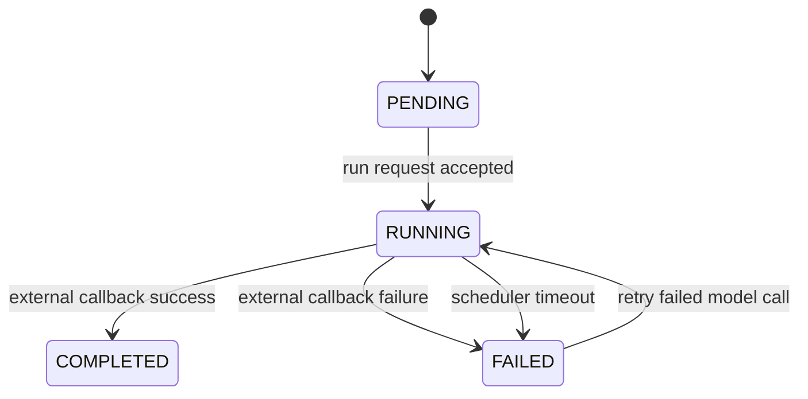
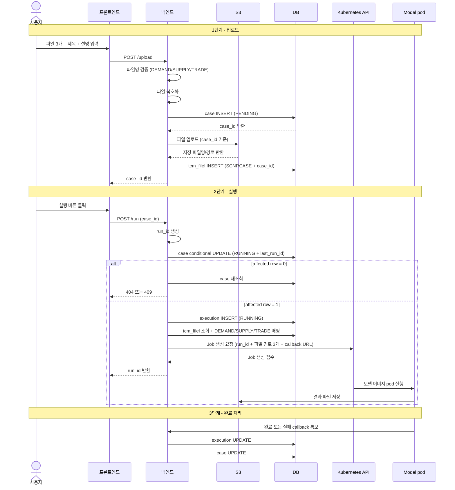
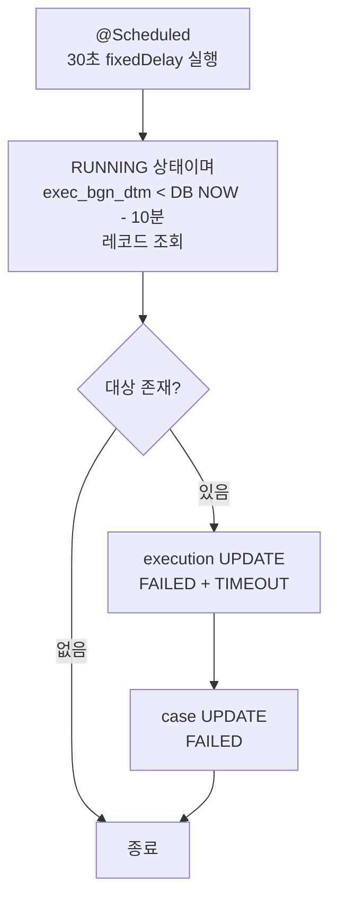
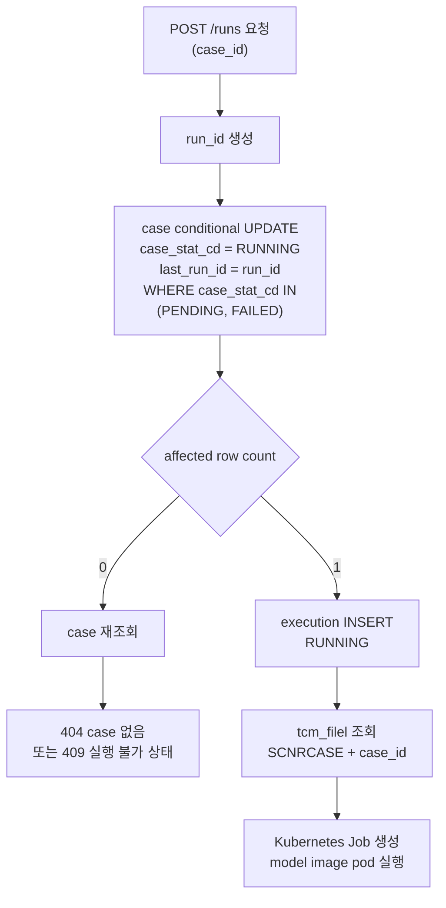

# Scenario Case Execution Workflow Design Draft

- domain: gas
- status: implemented (base workflow); Review (MI Base rollout pending)
- owner: platform BE
- updated at: 2026-09-15 (상세 output/intermediate 다운로드 metadata 계약 동기화)
- role: Scenario Case 업로드, 비동기 실행, 상태 추적, timeout 처리의 backend workflow와 persistence를 정리하는 설계 문서
- canonical for: shared Scenario Case/run lifecycle, callback idempotency, timeout and backend-forced terminal semantics
- upstream sources: `mi-scenario-workbench-backend-feature-spec.md`, `mi-scenario-model-execution-workflow-design.md`
- dependencies: canonical DDL draft, scheduler-enabled dedicated deployment, Kubernetes RBAC
- last sync date: 2026-09-15
- open questions: 없음. MI Base extension의 DBA 적용 상태는 canonical DDL draft에서 관리한다.

> 빠른 진입점:
> - 이 문서는 `Scenario Case -> Execution History -> run_id/status` 흐름의 workflow/domain semantics source로 사용한다.

## 문서 목적

- Scenario Case 업로드 이후 Kubernetes Job으로 모델 pod를 실행하고 상태를 추적하는 backend 기준 workflow를 정리한다.
- work note에 머물던 DB/상태/흐름 초안을 실행 기록과 분리해 장기 참조 가능한 design artifact로 옮긴다.
- 이 문서는 endpoint path/request/response field contract를 확정하지 않는다. MI Fundamental Model 1차 mock API의 canonical endpoint 계약은 [mi-fundamental-model-mock-api-feature-spec.md](../../feature-specs/mi-fundamental-model-mock-api-feature-spec.md) 를 따른다.
- 이 문서는 DB rollout-ready SQL을 확정하지 않는다. final physical schema rollout은 별도 DDL/DBA review artifact에서 다룬다.

## 현재 canonical artifact

- MI Fundamental Model 1차 API endpoint/path/request/response canonical source는 [mi-fundamental-model-mock-api-feature-spec.md](../../feature-specs/mi-fundamental-model-mock-api-feature-spec.md) 다.
- 1차 mock 단계에서는 `src/main/resources/mock/fundamental-model/fundamental-model-cases.json` seed 기반 in-memory store를 사용했다. 2026-06-05 ~ 2026-06-19 real DB 구현 완료로 현재는 `tmd_mdl_scnrcasem`/`tmd_mdl_scnrcaseh` 및 관련 결과 테이블에 상태를 영속한다. seed json/in-memory store는 로컬 demo 전용으로만 남아 있다.
- 이 workflow draft는 Scenario Case aggregate, 상태 전이, callback/timeout semantics, future persistence rationale의 source다.
- MI Fundamental Model은 MI Scenario Workbench와 동급 메뉴다. `Scenario Case` 명칭은 현업 용어로 유지하지만, API parent가 `Scenario` 또는 Scenario Workbench라는 뜻은 아니다.
- canonical API path family는 `/api/v1/mi/fundamental-model/**` 이다. 기존 `/api/v1/mi/scenario-workbench/**/fundamental-*` 및 `/api/v1/mi/scenario-workbench/scenarios/{scenarioId}/fundamental-model-cases/**` 형태는 superseded contract이며 이 문서의 workflow는 해당 hierarchy를 전제로 하지 않는다.
- 상위 도메인 흐름은 [gas-event-scenario-supply-model-linkage.md](gas-event-scenario-supply-model-linkage.md) 를 따른다.
- DB rollout SQL은 [scenario-case-execution-erd-ddl-draft.md](scenario-case-execution-erd-ddl-draft.md) 에서 관리한다. 해당 DDL은 production에 적용 완료됐으며, 과거 `scenario_id` 컬럼명/물리 FK 전제는 제거되었다. 현재 model은 nullable `scnr_id`로 MI 수급모델의 scenario 식별자를 논리 참조한다.
- 실행 이력과 검증 기록은 [2026-04-28-scenario-case-execution-db-design.md](../../work-notes/2026/2026-04-28-scenario-case-execution-db-design.md) 에 남긴다.

## 범위

### In Scope

- Scenario Case 업로드 단위와 실행 이력 단위 분리
- `run_id` 기반 비동기 실행 추적
- `caseId` 또는 `runId` 단독 식별 기준의 실행/조회/callback workflow
- case 상세 조회 aggregate projection semantics
- case metadata 수정 semantics
- case soft delete semantics
- 상태 모델과 상태 전이 규칙
- timeout 처리와 중복 실행 방지 정책
- platform 저장 테이블 초안과 인덱스 초안

### Out of Scope

- 실제 API request/response field contract
- model pod callback payload 상세
- canonical DDL/ERD 확정본
- 공통 파일 다운로드 API 자체의 동작·인가 및 결과 파일 물리 관리 (상세 응답의 다운로드 metadata는 feature spec이 계약을 관리한다)
- Scenario Workbench 하위 resource path 또는 `scenarioId` 기반 API scope

## 도메인 구조

```text
MI Fundamental Model (Scenario Workbench와 동급 메뉴)
    └── Scenario Case aggregate (현업 용어)
            └── 1:N
                └── tmd_mdl_scnrcasem (Scenario Case Master)
                        └── 1:N
                            └── tmd_mdl_scnrcaseh (Scenario Case History)

tcm_filel (공통 파일 내역)
    └── file_rel_obj_spt_cd = 'SCNRCASE'
    └── file_rel_obj_dstg_no = tmd_mdl_scnrcasem.case_id
```

- `Scenario Case`는 현업 용어다. API hierarchy상 `Scenario` 또는 Scenario Workbench 하위 resource라는 의미가 아니다.
- 2026-05-20 canonical feature spec 기준으로 1차 mock API는 `scenarioId` path/query/body/response 필드를 사용하지 않는다.
- 업로드 요청 단위의 case는 `caseId`로 식별하고, 실행 요청 단위의 execution history는 `runId`로 식별한다.
- case 1개는 실행 요청 단위의 execution history를 여러 개 가질 수 있다. 다만 `INDEPENDENT`에서 두 번째 run은 직전 모델 호출이 `FAILED`일 때의 재시도에만 생성한다.
- case에 연결된 업로드 파일은 `tmd_mdl_scnrcasem` 의 반복 컬럼이 아니라 기존 공통 파일 테이블 `tcm_filel` 에 저장한다.
- 정상 완료 기준 제품 요구는 `case:execution = 1:1`이다. 모델 호출이 `FAILED`인 경우에만 같은 case로 재시도해 추가 execution history를 남길 수 있으므로 물리적으로는 1:N으로 분리한다.
- `tmd_mdl_scnrcasem` 은 `case_id`를 primary identity로 갖는다. MI Fundamental Model row는 `scnr_id = NULL`이고, MI 수급모델 row는 nullable `scnr_id`에 scenario 식별자를 저장한다. `scnr_id`는 `tmm_mi_scenario_m.scenario_id`(INT UNSIGNED)에 대한 application-validated 논리 참조이며 물리 FK는 두지 않는다.
- 실행유형은 `exec_type_cd VARCHAR(20) DEFAULT 'INDEPENDENT' NOT NULL` 명시 컬럼으로 구분한다. 값은 `INDEPENDENT`(독립실행, MI Fundamental Model), `SCENARIO`(MI 수급모델 시나리오 실행), `MI_BASE`(현재 MI Base) 3종이다. `INDEPENDENT`/`MI_BASE`는 둘 다 `scnr_id = NULL`이므로 명시 컬럼이 필요하고, `scnr_id`와의 정합은 `tmd_mdl_scnrcasem_ck01`이 강제한다. 2026-06-16의 "MI Base 별도 적재/admin 소유·case_id 최신값 선택" 설명은 아래 현재 운영 규칙으로 superseded된다. 물리 컬럼/제약/공통코드는 [scenario-case-execution-erd-ddl-draft.md](scenario-case-execution-erd-ddl-draft.md)가 canonical source다.
- 2026-09-07 확정 운영 규칙: MI Base는 기존 완료 `INDEPENDENT` case 중 선택한 건을 `MI_BASE`로 지정한다. 새 지정 시 이전 current는 `INDEPENDENT`로 복귀한다. current는 전역 최대 1건이며 case/run/소유자/`SCNRCASE + caseId` input Excel 3개/결과를 보존한다. 과거 MI Base 지정 여부는 case type에 이력으로 남기지 않는다.
- 지정 commit 이후 시작되는 수급모델 input 생성은 새 MI Base의 input 3개를 기준으로 한다. 한 input 생성은 시작 시 current `caseId`와 `DEMAND`, `SUPPLY`, `TRADE` file metadata를 한 번만 source snapshot으로 고정하므로 생성 도중 지정이 바뀌어도 case를 섞지 않는다. 이미 생성·staging·접수·완료된 실행의 input·결과·기준값은 소급 변경하지 않는다. MI Base가 없을 때만 기존 플랫폼 기본 template 3개 전체를 하나의 snapshot으로 사용하며, 지정된 MI Base 파일을 읽지 못하면 default로 조용히 fallback하지 않는다.
- 기존 Scenario Case 목록 API는 current MI Base를 `miBase`, active `INDEPENDENT` 실행 건을 `cases`로 분리하도록 변경한다. 이전 MI Base는 새 지정 시 `INDEPENDENT`로 복귀해 `cases`에 포함된다. field·검색·정렬 계약은 [mi-fundamental-model-mi-base-designation-feature-spec.md](../../feature-specs/mi-fundamental-model-mi-base-designation-feature-spec.md)를 따른다.
- 일반 case metadata 변경·실행·삭제의 ownership scope는 기존과 같이 `usr_no`(업로더/소유자)다. 반면 MI Base 지정은 권한 있는 사용자가 전체 독립실행 case 중 현재 기준을 선택하는 command이므로 대상에 `usr_no` 또는 소유 회사 predicate를 적용하지 않는다. 지정 actor는 기존 MI 수급모델 실행과 동일한 `USER + SKGAS_COMPANY_USER_ONLY`, `ADMIN + THIRD_PARTY_ADMIN_ONLY`이며, 대상에는 active/type/status와 run/input/Price 적격성만 검증한다. metadata 변경·삭제에는 기존 owner predicate와 함께 지정 경쟁을 막는 row-lock 또는 atomic `exec_type_cd = 'INDEPENDENT'` 조건을 적용한다. 실행은 `PENDING | FAILED`, 지정은 `COMPLETED`만 허용하므로 두 command의 적격 상태는 겹치지 않는다.
- current `MI_BASE`는 상세·상태·Volumes filter-options·Volumes·Trade Flows·Price만 조회하는 읽기 전용 case다. FE는 상세의 `execType = MI_BASE`를 기준으로 결과 탭은 노출하되 수정·삭제·재실행 action을 노출하거나 호출하지 않는다. backend도 직접 호출에 대비해 mutation을 active `INDEPENDENT`로 제한한다.
- current MI Base를 비워 두는 별도 지정 해제 command는 제공하지 않는다. 기준 변경은 새 완료 `INDEPENDENT` case를 지정해 기존 current를 교체하는 흐름만 사용한다.

## Boundary Against Existing ScenarioModelExecution API

기존 `ScenarioModelExecution` API는 Scenario Workbench의 parameter 기반 MI 수급모델 실행 리소스를 다룬다. 이 문서의 `Scenario Case` workflow는 파일 3개 업로드를 기준으로 생성되는 MI Fundamental Model aggregate와 실행 이력을 다루며, 기존 `model-executions` resource와 별개 기능이다.

따라서 기존 Scenario Workbench API와 상태/실행 개념이 유사하더라도, 1차 mock canonical API는 `/api/v1/mi/fundamental-model/**` path family와 `caseId`/`runId` 식별 기준을 따른다.

## Actor

| Actor | 설명 | 주요 액션 |
|---|---|---|
| `SKGAS User` | `USER + SKGAS_COMPANY_USER_ONLY`를 만족하는 MI 사용자 | 목록·상세·결과 조회, 파일 업로드, 독립실행 요청, MI Base 지정 |
| `Third-party access Admin` | `ADMIN + THIRD_PARTY_ADMIN_ONLY`를 만족하는 관리자 | 타사 범위 목록·상세·결과 조회와 MI Base 지정 |
| `Platform BE` | 업로드/저장/상태 관리 주체 | case 생성, execution 생성, 상태 갱신 |
| `Kubernetes Job / model pod` | 실제 모델 실행 수행 주체 | 모델 이미지 pod 실행, `engine/run_all_parallel.py` 실행, storage 결과 저장, 완료/실패 callback 통보 |
| `Scheduler` | timeout 감시 주체 | 장시간 RUNNING 건 실패 전환 |

## 상태 정의

### case 상태 (`case_stat_cd`)

| 상태 | 의미 | 진입 조건 | 종료 조건 |
|---|---|---|---|
| `PENDING` | 업로드 완료, 실행 대기 | case 생성 완료 | 실행 시작 |
| `RUNNING` | 실행 중 | execution 생성 + Kubernetes Job 생성 요청 성공 직전/직후 | 완료, 실패 |
| `COMPLETED` | 최신 실행 성공 | model pod 또는 pod 내부 실행 프로세스 callback 통보 | terminal. 같은 case 재실행 불가 |
| `FAILED` | 최신 실행 실패 | Job 생성 실패, model pod 실패 callback, 또는 timeout | 사용자의 모델 호출 재시도 시 RUNNING |

### execution 상태 (`exec_stat_cd`)

| 상태 | 의미 | 진입 조건 | 종료 조건 |
|---|---|---|---|
| `RUNNING` | Kubernetes Job dispatch 후 처리 중 | execution row 생성 | 완료, 실패 |
| `COMPLETED` | 실행 완료 | 완료 콜백/상태 동기화 | terminal |
| `FAILED` | 실행 실패 | 실패 응답 또는 timeout | terminal |

### 실패 사유 (`fail_rsn_cd`)

| 코드 | 의미 |
|---|---|
| `TIMEOUT` | 허용 시간 초과 |
| `EXTERNAL_ERROR` | 외부 API 오류 응답 |
| `UNKNOWN` | 분류되지 않은 실패 |

## Fixed Decisions / 핵심 설계 결정

### 1. aggregate 분리

- 업로드 단위 metadata와 실행 단위 status/history는 분리한다.
- 이유:
  - 파일 3개와 사용자 입력 제목/설명은 업로드 시점에 확정된다.
  - 실행은 `FAILED` 모델 호출 재시도 가능성이 있어 별도 lifecycle을 가진다.

### 2. 최신 상태의 이중 보관

- `tmd_mdl_scnrcasem.case_stat_cd` 에 최신 상태를 둔다.
- `tmd_mdl_scnrcasem.last_run_id` 에 최신 실행 `run_id` pointer를 둔다. `tmd_mdl_scnrcaseh.run_id` 에 대한 application-validated 논리 참조이며 물리 FK 는 걸지 않는다.
- 상세 실행 기록은 `tmd_mdl_scnrcaseh` 에 남긴다.
- 이유:
  - 프론트 목록/상세 조회 시 최신 상태와 최신 실행을 단일 row 조회로 단순화할 수 있다.
  - 이력은 별도 테이블에 남겨 실패 재시도와 운영 추적을 지원한다.
- invariant: `case_stat_cd` 와 `last_run_id` 가 가리키는 `tmd_mdl_scnrcaseh.exec_stat_cd` 는 항상 같은 terminal/RUNNING 상태여야 한다. 갱신 순서는 execution → case 또는 conditional case update 후 execution insert 로 한 transaction 안에서 보장한다.
- invariant (2026-06-10 추가, 2026-06-10 generated column 으로 변경): scenario 당 active 실행 1건은 `actv_scnr_id INT UNSIGNED AS (IF(case_stat_cd = 'RUNNING', scnr_id, NULL)) STORED` generated column 과 `tmd_mdl_scnrcasem_uq01 UNIQUE (actv_scnr_id)` 가 DB 레벨에서 보장한다. helper 는 `case_stat_cd`/`scnr_id` 에서 DB 가 자동 파생하므로 `case_stat_cd` 를 바꾸는 INSERT/UPDATE 가 별도로 helper 를 동기화할 필요가 없다(수동 컬럼 시절의 drift 위험 제거). fundamental row 는 `scnr_id = NULL` → `actv_scnr_id = NULL` 이라 unique 가 바인딩되지 않으므로 본 문서의 case 단위 가드에는 영향이 없다.

### 3. `run_id`의 역할

- `run_id` 는 model pod와 platform이 공유하는 비동기 실행 추적 키다.
- backend가 `yyyymmdd_hhmmss_XXXX` 포맷의 값을 생성해 Kubernetes Job/pod에 전달하는 것으로 확정한다.
- `yyyymmdd_hhmmss` 는 실행 요청 시각 기준이며, `XXXX` 는 같은 초 안의 충돌을 방지하기 위한 4자리 suffix다.
- 예: `20260521_143500_a1b2`
- `run_id` 는 `tmd_mdl_scnrcaseh` 에 unique로 저장한다.

### 4. Kubernetes Job 실행 및 완료 동기화 방식

- backend는 Kubernetes API로 1회성 Job 생성을 요청한다.
- Job은 MI Fundamental Model 모델 이미지를 사용해 pod를 실행한다.
- 모델 이미지는 모델팀이 Dockerfile 기반으로 제공하며, `engine/run_all_parallel.py` 실행 환경과 backend callback 호출 로직을 포함해야 한다.
- pod 내부 command는 `python engine/run_all_parallel.py` 실행을 기본으로 한다.
- backend는 Job 생성 요청에 `run_id`, `run_seq`, 입력 파일 storage path 3개, backend callback URL을 전달한다. callback URL은 `--callback-url` Job arg로 전달하며, run_id를 포함한 전체 URL을 backend가 생성해 주입한다. `run_seq`는 pod가 output 파일을 `tcm_filel`에 INSERT할 때 사용한다.
- Job 생성 요청 성공은 모델 실행 완료가 아니라 dispatch 접수 성공으로만 판단한다.
- Job 생성 요청이 실패하면 execution/case 상태를 `FAILED` 로 전환하고 클라이언트에는 실패 응답을 반환한다.
- pod 내부 Python 실행이 완료되거나 실패하면 pod 또는 실행 프로세스가 backend callback API를 호출해 terminal 상태를 통보한다.
- 결과 파일 자체는 pod가 S3/object storage에 저장한다.
- backend가 pod 내부 Python 완료 여부를 주기적으로 polling 하는 방식은 채택하지 않는다.
- FE는 backend 상태 조회 API를 polling 할 수 있지만, 이는 backend와 model pod 사이의 polling이 아니다.
- `ProcessBuilder` 로 backend JVM에서 Python 스크립트를 직접 실행하는 방안에서는 backend resource 보호를 위해 전체 실행 직렬화 논의가 나올 수 있다. 이 논의는 문서상 확정된 요구사항이 아니라, direct process execution 방식의 운영 위험을 줄이기 위한 검토 항목이다.
- 2026-05-22 기준 실행 주체는 Kubernetes Job/model pod로 분리한다. k8s Job 방식에서 backend는 Job 생성 요청 후 비동기 접수 응답을 반환하므로 장시간 모델 실행 동안 backend request thread를 점유하지 않는 방향으로 설계한다.
- 다만 k8s Job 방식에서도 무제한 병렬 실행을 의미하지 않는다. cluster quota, namespace resource, 모델 pod CPU/memory, Python 내부 병렬도, storage/API 부하를 기준으로 동시 Job 수 제한이 필요한지는 별도 운영 설계에서 검토한다.
- 기존 설계의 확정 동시성 제약은 동일 case에 대해서만 active `RUNNING` 실행을 하나만 허용하는 것이다.

#### Kubernetes Job Pod 실행 재시도 정책 (2026-06-21 확정)

Job 생성 API 실패와 Job이 생성된 뒤 Pod 실행 실패를 분리해서 다룬다. 현재는 실패 유형과 무관하게 Pod 실행 재시도를 하지 않는다.

| 실패 유형 | 정책 | 구현 전제 |
|---|---|---|
| 입력값 오류, 권한 오류, 필수 파일 누락 | 재시도 `0회`. Job을 생성하지 않고 backend 검증 단계에서 거절한다. | backend validation이 해당 오류를 Job 생성 전에 확정해야 한다. |
| 일시적 인프라 오류 | Job controller 재시도 `0회`. 실패한 run은 즉시 `FAILED`로 확정하고 사용자 또는 운영자가 같은 case에 새 run을 요청해 모델 호출을 재시도한다. | 자동 회복보다 중복 실행·비용·실패 확정 지연 방지를 우선한다. |
| 모델 코드/비즈니스 로직 오류 | Job controller 재시도 `0회`. | 동일 입력의 반복 실행을 방지한다. |
| 이미지 pull 실패 | Job controller 재시도 `0회`. registry, image tag, `imagePullSecret`, service account 권한을 복구한다. | 무한 `ImagePullBackOff` 관측을 막기 위해 Job/backend timeout을 함께 적용한다. |

- 모든 생성 Job에 `spec.backoffLimit: 0`을 명시한다. `restartPolicy: Never`와 함께 컨테이너 실패 뒤 새 Pod를 생성하지 않는다.
- 향후 retry를 다시 도입하려면, 모델 이미지의 exit code 계약과 Kubernetes `podFailurePolicy`를 포함한 failure classification을 먼저 확정한다.
- Job 생성 API의 network/timeout/5xx 재시도는 별도 application 정책이다. 현재 구현에는 없으며, 도입 시 동일 Job 이름의 `409 Conflict`를 이미 생성된 Job으로 확인하는 멱등 처리와 함께 설계한다.

### 5. 실행 선점 및 실패 재시도

- `PENDING`은 최초 실행, `FAILED`는 모델 호출 실패 재시도만 허용한다. 동일 case가 `RUNNING` 또는 `COMPLETED`이면 새 실행을 차단한다.
- DB-backed 구현 권장안은 `tmd_mdl_scnrcasem` conditional update를 먼저 성공시킨 뒤, 같은 transaction에서 `tmd_mdl_scnrcaseh` row를 insert하는 방식이다.
- `run_id` 는 실행 요청마다 새로 생성되는 unique key이므로, `run_id + exec_stat_cd` 조합만으로는 동일 case에 서로 다른 `run_id` 를 가진 `RUNNING` row 2개가 생기는 것을 막을 수 없다.
- `UNIQUE (case_id, exec_stat_cd)` 는 `RUNNING` 중복은 막을 수 있지만 과거 `COMPLETED`/`FAILED` 이력도 case당 1건으로 제한하므로 이력 테이블에는 부적합하다.
- 권장 선점 update 예시는 다음과 같다.

```sql
UPDATE tmd_mdl_scnrcasem
SET case_stat_cd = 'RUNNING',
    last_run_id = :run_id,
    mod_dtm = NOW(),
    mod_usr_logn_id = :actor
WHERE case_id = :case_id
  AND del_yn = 'N'
  AND case_stat_cd IN ('PENDING', 'FAILED');
-- actv_scnr_id 는 generated column 이라 case_stat_cd='RUNNING' 전이 시 자동으로 scnr_id(또는 fundamental 은 NULL)로 채워진다. 별도 SET 불필요.
```

- affected row count가 `1` 이면 해당 요청이 실행을 선점한 것이므로 `tmd_mdl_scnrcaseh` 에 `RUNNING` row를 insert한다.
- affected row count가 `0` 이면 case 없음 또는 `RUNNING`/`COMPLETED` 등 실행 불가 상태이므로 `caseId` 단독 재조회 후 `404` 또는 `409` 로 분기한다.
- `last_run_id` 는 late callback이 이전 실행의 결과로 case 최신 상태를 덮어쓰지 않도록 하는 latest execution pointer로 사용한다.
- `SELECT ... FOR UPDATE` 방식은 대안으로 남기되, 현재 권장안은 conditional master update다.
- (2026-06-10) scenario 단위(`MI 수급모델 실행`) 중복 실행 방지는 본 case 단위 가드와 별개로 `actv_scnr_id` generated column unique(`tmd_mdl_scnrcasem_uq01`)가 담당한다. 수급모델 실행 접수는 새 case row INSERT 이므로 conditional update 가 아니라 INSERT 시 unique 충돌 → 409 매핑으로 막는다. 자세한 흐름은 [mi-scenario-model-execution-workflow-design.md](mi-scenario-model-execution-workflow-design.md) 참고.

### 6. timeout 처리

- timeout scheduler 대상은 `tmd_mdl_scnrcasem.exec_type_cd IN ('SCENARIO', 'INDEPENDENT')` 의 `RUNNING` execution이다 (2026-06-22). `MI_BASE` 는 이번 timeout scheduler 범위에서 제외한다.
- timeout 판정은 DB 시각 기준 `exec_bgn_dtm < NOW() - INTERVAL 10 MINUTE` 이다 (2026-06-22). `exec_bgn_dtm`은 DB `CURRENT_TIMESTAMP` default로 생성하며 application server 시각은 시작·판정 기준으로 사용하지 않는다.
- scheduler는 `fixedDelay = 30초`로 실행한다 (2026-06-22).
- timeout scheduler는 SKGAS dedicated Backend 인스턴스에만 `MODEL_EXECUTION_TIMEOUT_SCHEDULER_ENABLED=true`를 설정해 등록한다 (2026-06-22). 이 환경변수는 `features.scheduling.model-execution-timeout.enabled`에 매핑되며, 모든 다른 Backend 인스턴스와 dedicated Backend Deployment의 기본값은 `false`다.
- 지정 namespace에는 Backend replica가 정확히 1개여야 한다. 이 정책은 Pod 이름이 아니라 Deployment/namespace configuration을 기준으로 하므로 Pod 재생성으로 이름이 바뀌어도 유지된다. 해당 Deployment의 replica 수를 늘리거나 HPA를 적용하면 scheduler가 중복 등록되므로 금지한다.
- namespace 식별자가 필요하면 Kubernetes Downward API의 `metadata.namespace`를 `POD_NAMESPACE` 환경변수로 주입해 startup log/health 정보에 기록할 수 있지만, scheduler selection 자체에 Pod 이름은 사용하지 않는다.
- scheduler가 대상 중 임계치를 넘긴 실행을 찾아 `FAILED/TIMEOUT` 으로 전환한다.
- scheduler는 `exec_bgn_dtm` 오래된 순으로 최대 100건을 한 cycle에 처리한다. 남은 대상은 다음 30초 cycle에서 처리한다. 각 run은 독립 transaction에서 DB `CURRENT_TIMESTAMP`를 읽고, `RUNNING` compare-and-set과 `last_run_id = :run_id` case 동기화를 함께 수행한다. 한 run의 실패는 다른 후보의 전이를 rollback하지 않는다.
- timeout query와 index의 실제 사용은 DBA rollout 전 `EXPLAIN`으로 검증한다.

### 7. 파일 저장은 `tcm_filel` 재사용

- `tmd_mdl_scnrcasem` 에 `file_path_1`, `file_path_2`, `file_path_3` 같은 반복 파일 경로 컬럼을 두지 않는다.
- 업로드 파일은 기존 기능과 동일하게 `tcm_filel` 에 저장한다.
- case와 파일의 연결은 다음 값으로 표현한다.
  - `tcm_filel.file_rel_obj_spt_cd = 'SCNRCASE'`
  - `tcm_filel.file_rel_obj_dstg_no = tmd_mdl_scnrcasem.case_id`
- `tcm_filel.file_rel_obj_dstg_no` 가 `INT UNSIGNED` 이므로 `tmd_mdl_scnrcasem.case_id` 도 `INT UNSIGNED` 로 맞추는 안을 기본으로 둔다.
- `SCNRCASE` 코드는 `file_rel_obj_spt_cd` 공통코드에 등록해야 한다.
- 2026-05-19 확인 기준으로 target 공통코드에는 `SCNRCASE` 중복 등록이 없다.
- DB-backed `createCase()` 구현에서는 공용 `FileService`의 기본 `TEMP/0` 임시 업로드 흐름을 표준 경로로 사용하지 않는다. case row 생성으로 `case_id`를 먼저 확보한 뒤, 업로드 파일 3개를 `SCNRCASE + case_id` relation으로 직접 저장하는 전용 업로드 메서드를 사용한다.
- 업로드 3개는 하나의 case aggregate를 구성하므로 all-or-nothing으로 처리한다. 3개 중 1개라도 실패하면 API 전체를 실패로 보고, 이미 성공한 업로드 분은 service 계층이 보상 삭제를 호출해 정리한다.
- 보상 삭제 orchestration 책임은 `createCase()` application service에 둔다. `FileService`는 relation-aware upload/delete primitive만 제공하고, 어떤 업로드를 되돌릴지 판단하는 aggregate 문맥은 갖지 않는다.

## Backend Workflow

### Stage 1. 업로드

1. 사용자가 파일 3개와 제목/설명을 입력한다.
2. backend는 파일 3개의 파일명을 검증한다. `DEMAND`, `SUPPLY`, `TRADE` 키워드가 각각 정확히 1개씩 포함되어야 한다. 키워드 비교는 대소문자 무관. 조건 불충족 시 `400` 반환.
3. backend는 필요 시 파일 복호화를 수행한다.
4. backend는 `tmd_mdl_scnrcasem` 에 `PENDING` case row를 먼저 생성해 `case_id`를 확보한다.
5. 확보한 `case_id`를 사용해 파일 3개를 object storage와 `tcm_filel`에 업로드한다. 이때 각 file row는 생성 시점부터 `file_rel_obj_spt_cd = 'SCNRCASE'`, `file_rel_obj_dstg_no = case_id` 로 직접 저장한다.
6. 파일 3개 중 하나라도 업로드 또는 `tcm_filel` 저장에 실패하면 API 전체를 실패로 처리한다. 이미 성공한 업로드가 있으면 `createCase()` service가 성공분 file primitive를 호출해 보상 삭제를 수행한 뒤 예외를 재던진다.
7. 생성 직후 case 상태는 `PENDING` 이다.

### Stage 2. 실행 요청

1. 사용자가 특정 case 실행을 요청한다.
2. backend는 `run_id` 를 먼저 생성한다.
3. backend는 `case_id`, `usr_no` ownership scope, `del_yn = 'N'` 기준으로 active owned case인지 확인한다. 소유자가 아니면 active resource hiding 규칙에 따라 `404 RSC_NOT_FOUND`로 처리한다.
4. 같은 transaction에서 `tmd_mdl_scnrcasem` conditional update를 수행해 실행 권한을 선점한다.
   - 조건: `case_id`, `del_yn = 'N'`, `case_stat_cd IN ('PENDING', 'FAILED')`
   - update 값: `case_stat_cd = 'RUNNING'`, `last_run_id = :run_id`
5. affected row count가 `0` 이면 case 없음, 이미 `RUNNING`, 또는 재실행할 수 없는 `COMPLETED` 상태이므로 `caseId` 단독 재조회 후 `404` 또는 `409` 로 분기한다.
6. affected row count가 `1` 이면 해당 요청이 실행을 선점한 것이므로 `tmd_mdl_scnrcaseh` 에 `RUNNING` 상태 row를 생성한다.
7. `tcm_filel` 에서 case에 연결된 파일 정보를 조회하고, 파일명의 `DEMAND`/`SUPPLY`/`TRADE` 키워드로 각 파일 경로를 매핑한다.
8. Kubernetes Job을 생성한다. Job pod의 기본 실행 command는 아래와 같다.
   ```
   python engine/run_all_parallel.py \
     --run-id {run_id} \
     --run-seq {run_seq} \
     --demand-excel-path {demand 파일 경로} \
     --supply-excel-path {supply 파일 경로} \
     --trade-excel-path {trade 파일 경로} \
     --callback-url {backend_host}/api/v1/mi/fundamental-model/runs/{run_id}/callback
   ```
   - callback URL은 `--callback-url` arg로 전달하며, backend가 `run_id`를 포함한 전체 URL을 생성해 Job 생성 시점에 주입한다.
   - `--run-seq`는 `tmd_mdl_scnrcaseh.run_seq` 값이다. pod가 실행 완료 후 output 파일을 S3에 업로드하고 `tcm_filel`에 직접 INSERT할 때 `file_rel_obj_spt_cd = 'SCNRCASEH'`, `file_rel_obj_dstg_no = run_seq`로 사용한다. pod는 이미 DB 접근 권한을 가지며, arg로 받아 추가 조회 없이 사용한다.
   - 실행 중 생성되는 중간파일도 같은 `--run-seq`를 `file_rel_obj_dstg_no`로 사용하되 `file_rel_obj_spt_cd = 'SCNRCASEHI'`로 INSERT해 output과 구분한다 (2026-09-07). 추가 Job arg는 필요하지 않다. pod INSERT 필수 컬럼 계약은 [mi-fundamental-model-intermediate-file-design.md](mi-fundamental-model-intermediate-file-design.md) 가 canonical이다.
   - 모델 이미지는 모델팀이 Dockerfile 기반으로 제공하며, 위 스크립트, 실행 의존성, backend callback 호출 로직을 포함해야 한다.
   - pod stdout/stderr는 Kubernetes log로 남기며 backend application log 직접 소비는 필수 전제가 아니다.
8. Job 생성 요청에 성공하면 backend는 클라이언트에 `202 Accepted` 수준의 비동기 시작 응답을 반환한다.
9. Job 생성 요청에 실패하면 execution/case 상태를 `FAILED` 로 전환하고 실패 응답을 반환한다.

### Stage 3. 완료/실패 callback 동기화

1. pod 또는 pod 내부 Python 프로세스가 실행을 완료하거나 실패하면 backend callback API를 호출한다.
2. backend는 `run_id` 로 execution row를 찾는다.
3. execution이 아직 `RUNNING` 인 경우에만 compare-and-set 조건으로 terminal 상태와 종료 시각, 실패 사유/오류 메시지를 갱신한다.
4. case 최신 상태는 callback 대상 execution이 현재 case의 latest/active execution과 일치할 때만 (`tmd_mdl_scnrcasem.last_run_id = :run_id` 조건) 반영한다. `case_stat_cd` 를 terminal 로 바꾸면 `actv_scnr_id` generated column 이 자동으로 NULL 로 풀려 active 점유가 해제되므로 helper 를 따로 해제할 필요가 없다. `last_run_id` 자체는 변경하지 않고 그대로 두어 terminal 결과가 어느 run의 결과인지 보존한다.
5. 이미 terminal 상태인 execution에 도착한 callback은 상태를 덮어쓰지 않고 idempotent no-op으로 처리한다.
6. timeout 또는 실패 재시도 이후 늦게 도착한 이전 `run_id` callback은 case 최신 상태를 바꾸지 않고 성공 ack와 로그만 남긴다.

### Stage 4. 상태 조회

1. 프론트는 canonical 1차 mock API 기준으로 `caseId` 상태 조회 endpoint를 폴링한다.
2. backend는 case 최신 상태와 latest run projection을 조회해 상태/시작/종료 시각을 반환한다.
3. 결과 파일 자체는 model pod가 S3/object storage에 저장/관리한다.
4. backend는 case/run 테이블에 결과 파일 download URL 또는 별도 pointer/reference 컬럼을 저장하지 않는다. output/intermediate 파일은 `tcm_filel` 관계로 조회하며 상세 응답 metadata 계약은 feature spec을 따른다. 결과 데이터 조회(Volumes/Price 수치 데이터)는 `GET /cases/{caseId}/volumes`, `GET /cases/{caseId}/price` API로 분리되어 제공한다. 1차 mock 단계에서는 json seed 기반 고정 데이터를 반환했으나, 2026-06-15 real DB 구현 완료로 현재는 `mi-fundamental-model-output-result-persistence-design.md`의 테이블에서 조회한다.
5. `runId` 단독 조회는 후속 이력 조회 계약에서 별도로 검토한다.

### Stage 4a. 상세 조회

1. 프론트가 case 상세 화면에 진입하면 `caseId` 기준 상세 조회 endpoint를 호출한다.
2. backend는 active `exec_type_cd IN ('INDEPENDENT', 'MI_BASE')` case의 metadata, `execType`, 업로드 파일 metadata, latest run projection을 한 번에 반환한다. 파일 metadata는 input(`SCNRCASE + case_id`), output(`SCNRCASEH + run_seq`), 중간파일(`SCNRCASEHI + run_seq`)로 구분해 반환하며, output/중간파일은 최신 실행의 `run_seq` 기준이다. 응답 필드 계약은 feature spec이 canonical이다.
3. 상세 조회는 화면 rendering용 aggregate snapshot이다. FE polling loop는 `GET /cases/{caseId}/status`를 사용하고, 상세 조회를 polling용 API로 반복 호출하지 않는다.
4. 상세 조회는 full run history를 반환하지 않는다. case의 전체 실행 이력은 별도 runs API가 정의될 때까지 이 workflow의 phase-1 범위에 포함하지 않는다.
5. 상세 조회는 result payload와 download URL/path를 반환하지 않는다. input은 파일명만 반환하고 output/intermediate는 기존 공통 File API 요청용 `fileNo`, `fileNm`, `fileSize`를 반환한다. 필드 계약은 feature spec이 canonical이다. 결과 수치 데이터(Volumes/Price)는 `GET /cases/{caseId}/volumes`, `GET /cases/{caseId}/price` API로 분리 제공한다.
6. phase-1 mock 구현은 기존 in-memory case aggregate와 run store의 `latestRunId` pointer를 사용해 이 projection을 만들었다. real DB 구현 완료 후에는 master case, `tcm_filel`, latest execution row를 같은 ownership/permission scope에서 조회한다.
7. `SCENARIO`와 soft-deleted case는 active resource가 아니므로 상세 조회에서 `404 RSC_NOT_FOUND`로 처리한다.
8. current `MI_BASE` 상세에서는 결과 탭을 노출한다. 상태·Volumes filter-options·Volumes·Trade Flows·Price read는 active `INDEPENDENT | MI_BASE`를 허용하고 기존 result query/response 계약을 그대로 사용한다.
9. current `MI_BASE`의 상세·결과 `GET` 허용은 metadata 수정·삭제·실행까지 허용한다는 뜻이 아니다. FE는 이 action을 노출하거나 호출하지 않고 backend mutation도 기존대로 active `INDEPENDENT`에만 허용한다. 상세에서 MI Base 지정 actor/time을 제공하는 계약은 이번 범위에 포함하지 않는다.

### Stage 4b. Case metadata 수정

1. 사용자가 case 상세 화면에서 제목 또는 설명을 수정한다.
2. backend는 `caseId` 기준 active case를 조회한다.
3. 수정 대상은 `tmd_mdl_scnrcasem.case_titl_nm`, `tmd_mdl_scnrcasem.case_expn`에 해당하는 metadata뿐이다.
4. `title`은 trim 후 1-200자 필수로 검증한다.
5. `description`은 nullable/optional로 받고 `case_expn`에 반영한다.
6. files, latestRun pointer, execution history, status, result payload/download 정보는 수정하지 않는다.
7. 수정 응답은 상세 조회와 동일한 aggregate projection을 반환한다.
8. soft-deleted case는 active resource가 아니므로 수정에서 `404 RSC_NOT_FOUND`로 처리한다.

DB-backed 전환 시 권장 update shape:

```sql
UPDATE tmd_mdl_scnrcasem
SET case_titl_nm = :title,
    case_expn = :description,
    mod_dtm = NOW(),
    mod_usr_logn_id = :actor
WHERE case_id = :case_id
  AND usr_no = :usr_no
  AND exec_type_cd = 'INDEPENDENT'
  AND del_yn = 'N';
```

affected row count가 `0`이면 case 없음, ownership 불일치, 또는 이미 삭제된 case로 보고 active resource 관점의 `404 RSC_NOT_FOUND`로 처리한다.

### Stage 4c. Case soft delete

1. 사용자가 case 삭제를 요청한다.
2. backend는 `caseId` 기준 active case를 조회한다.
3. 삭제는 physical delete가 아니라 `tmd_mdl_scnrcasem.del_yn = 'Y'` soft delete다.
4. 삭제 시 `tcm_filel` 업로드 파일, `tmd_mdl_scnrcaseh` 실행 이력, latestRun/result payload는 물리 삭제하지 않는다.
5. 삭제된 case는 list에서 제외된다.
6. 삭제된 case는 detail/status/run/update/delete에서 active resource가 아니므로 `404 RSC_NOT_FOUND`로 처리한다.
7. 반복 delete도 active resource가 아니므로 `404 RSC_NOT_FOUND`로 처리한다.

> 이 Stage는 Fundamental Model의 사용자 직접 case delete semantics다. Scenario Workbench에서 scenario 폐기/실현/group 삭제가 `SCENARIO` case/history를 cascade soft delete하는 규칙은 별도 aggregate lifecycle이며, [mi-scenario-model-execution-workflow-design.md](mi-scenario-model-execution-workflow-design.md)의 `Scenario Lifecycle Cancellation And Kubernetes Job Reconciliation`을 따른다. 두 흐름을 같은 delete contract로 해석하지 않는다.

DB-backed 전환 시 권장 delete shape:

```sql
UPDATE tmd_mdl_scnrcasem
SET del_yn = 'Y',
    mod_dtm = NOW(),
    mod_usr_logn_id = :actor
WHERE case_id = :case_id
  AND usr_no = :usr_no
  AND exec_type_cd = 'INDEPENDENT'
  AND del_yn = 'N';
```

affected row count가 `0`이면 case 없음, ownership 불일치, 또는 이미 삭제된 case로 보고 active resource 관점의 `404 RSC_NOT_FOUND`로 처리한다.

### Stage 4d. 현재 MI Base 지정

1. 권한 있는 사용자가 완료된 독립실행 case를 MI Base로 지정한다.
2. backend는 대상이 active이고 `scnr_id IS NULL`, `COMPLETED`, `INDEPENDENT`인지 확인한다. 단, 현재 MI Base와 같은 `caseId`의 반복 요청은 `MI_BASE` type을 멱등 예외로 허용하고 나머지 적격성을 다시 확인한 뒤 성공으로 처리한다.
3. 대상의 `last_run_id`와 completed run history 정합, `SCNRCASE + caseId` input 3개의 `DEMAND`/`SUPPLY`/`TRADE` 역할, MI Base 그래프에 필요한 Price 결과 존재를 확인한다. 하나라도 실패하면 기존 MI Base를 변경하지 않는다.
4. 같은 transaction에서 current MI Base를 write lock으로 조회한다. 기존 current type을 `INDEPENDENT`로 되돌린 UPDATE를 DB에 flush한 뒤 대상 type을 `MI_BASE`로 변경한다. generated unique가 있는 상태에서 UPDATE 순서가 뒤집히지 않도록 JPA 자동 flush 순서에 맡기지 않는다. case/run/file/result 식별자와 데이터는 보존한다.
5. `exec_type_cd`와 `del_yn`에서 파생되는 generated `actv_base_yn` unique constraint가 application lock 밖의 경합에서도 active `MI_BASE` 2건 생성을 막는다. application은 helper 값을 직접 쓰지 않는다. unique 충돌은 현재 옵션을 재조회할 수 있는 `409`로 매핑한다.
   current가 없는 상태에서 서로 다른 두 대상을 최초 지정하면 공통 current row lock이 없으므로 한 요청이 unique 충돌로 `409`가 될 수 있다. current가 있는 교체 경합은 공통 current row lock으로 직렬화한다.
6. 교체 commit 이후 시작되는 수급모델 input 생성은 대상 case의 input 3개를 기준으로 한다. 이미 생성·접수·완료된 실행에는 소급 적용하지 않는다.
7. 현재 MI Base가 없을 때는 기존 플랫폼 기본 template을 사용한다. 현재 MI Base가 있는데 해당 input을 읽을 수 없으면 이전/default 기준으로 자동 fallback하지 않고 실행 준비를 실패시킨다.
8. 별도 지정 해제 API는 제공하지 않는다. current 변경은 새 완료 `INDEPENDENT` case 지정으로만 수행하고 이전 current는 같은 transaction에서 `INDEPENDENT`로 복귀한다.

endpoint, 응답 DTO, 권한, 대표 오류는 [MI Fundamental Model MI Base 지정 Feature Spec](../../feature-specs/mi-fundamental-model-mi-base-designation-feature-spec.md), generated current marker와 rollout SQL은 [Scenario Case Execution ERD / DDL Draft](scenario-case-execution-erd-ddl-draft.md)를 따른다.

### Stage 5. timeout 정리

1. scheduler-enabled dedicated namespace의 단일 Backend replica가 30초 `fixedDelay`로 `exec_type_cd IN ('SCENARIO', 'INDEPENDENT')`, `exec_stat_cd = 'RUNNING'`, `exec_bgn_dtm < DB NOW() - 10분` 인 execution을 조회한다. `MI_BASE` 는 조회 대상이 아니다.
2. 임계치 초과 건은 execution을 `FAILED` 로 전환한다.
3. `fail_rsn_cd = TIMEOUT` 과 `exec_end_dtm` 을 함께 기록한다.
4. `tmd_mdl_scnrcasem.case_stat_cd` 를 `FAILED` 로 동기화한다. `SCENARIO` case는 `actv_scnr_id` generated column 이 자동으로 NULL 로 풀려 active 점유가 해제되므로 helper 를 따로 해제할 필요가 없다. `INDEPENDENT` case는 `scnr_id = NULL` 이므로 scenario active-run helper에 영향을 주지 않는다. `last_run_id` 는 그대로 두어 어떤 run이 timeout 되었는지 추적할 수 있게 한다. case update 는 callback 흐름과 동일하게 `last_run_id = :run_id` 조건을 사용해, 사용자가 이미 실패 run을 재시도한 경우에는 case 최신 상태를 덮어쓰지 않는다.
5. DB timeout 처리 후 같은 scheduler tick의 reconciliation 단계가 `FAILED + TIMEOUT`인데 Kubernetes에서 아직 active인 Job을 삭제한다. DB transaction과 Kubernetes API 호출은 분리하며 Job 삭제 실패는 다음 tick에서 재시도한다.

### Stage 6. Scenario lifecycle cancellation reconciliation

1. Scenario Workbench command가 직접 discarded scenario, realized에 의해 discarded된 sibling, 삭제 group 하위 scenario를 식별한다.
2. 대상 history 중 `RUNNING`만 `FAILED + SCENARIO_CANCELLED`로 전이하고 `exec_end_dtm`을 기록한다. 이미 terminal인 history는 상태/사유를 보존한다.
3. 대응하는 latest case의 `RUNNING` 상태를 `FAILED`로 바꿔 `actv_scnr_id` 점유를 해제한다.
4. case/history를 soft delete한다. scenario/group/signpost managed entity 변경은 bulk DML 전에 끝내 detached entity 변경 누락을 방지한다.
5. callback은 soft-deleted `FAILED + SCENARIO_CANCELLED` run을 internal lookup으로 식별하고 payload 차이와 무관하게 상태 overwrite 없이 `200 OK`로 ack한다.
6. scheduler reconciliation은 managed active Kubernetes Job을 조회하고 DB 상태가 `FAILED + SCENARIO_CANCELLED`인 Job을 삭제한다. not-found는 성공으로 처리하고 실패는 다음 tick에서 재시도한다.

## 상태 전이



## Callback Idempotency / Late Callback 처리

이 섹션은 [mi-scenario-generation-request-workflow-design.md](mi-scenario-generation-request-workflow-design.md) 의 `Callback Idempotency 최소 제약` 과 `timeout 후 late callback 처리 규칙`을 Scenario Case 실행 흐름에 맞게 적용한 기준이다.

### 1. terminal overwrite 방지

- callback update는 DB `CHECK` 보다 application compare-and-set update condition이 핵심이다.
- success callback은 대상 execution이 아직 `RUNNING` 일 때만 terminal 전이를 허용한다.
  - 예: `WHERE run_id = ? AND exec_stat_cd = 'RUNNING'`
- failure callback도 대상 execution이 아직 `RUNNING` 일 때만 terminal 전이를 허용한다.
  - 예: `WHERE run_id = ? AND exec_stat_cd = 'RUNNING'`
- 이미 `COMPLETED` 또는 `FAILED` 인 execution은 callback payload로 overwrite하지 않는다.

### 2. case 최신 상태 보호

- `tmd_mdl_scnrcasem.case_stat_cd` 는 latest execution projection cache이므로, history update와 같은 transaction 안에서 갱신한다.
- 단, callback 대상 execution이 해당 case의 현재 latest/active execution일 때만 case 최신 상태를 바꾼다.
- latest execution pointer는 `tmd_mdl_scnrcasem.last_run_id VARCHAR(20)` 로 둔다.
- `last_run_id` 는 `tmd_mdl_scnrcaseh.run_id` 에 FK를 걸지 않는 application-validated pointer로 관리한다.
  - 이유: 현재 권장 실행 선점 흐름은 case master의 `last_run_id` 를 먼저 갱신한 뒤 history row를 insert하므로 FK를 걸면 생성 순서가 불필요하게 복잡해진다.
- callback 대상이 case 최신 실행인지 확인할 때 case update 조건은 callback `run_id` 와 `last_run_id` 가 일치해야 한다.
  - 예: `WHERE case_id = ? AND last_run_id = ?`
- `last_run_id` 없이 최신 실행을 판정하려면 더 복잡한 latest execution query가 필요하므로 race condition과 late callback 방어가 약해진다.

### 3. terminal callback 재전송

- 동일 terminal callback 재전송은 상태 변경 없이 no-op 또는 기존 terminal 결과와 동일한 응답으로 처리한다.
- 이미 terminal 상태인데 다른 payload가 재전송되면 상태를 바꾸지 않고 mismatch 로그를 남긴다.
- "동일/상이" 판정 비교 키는 `status`, `failureReason`, `errorMessage` 세 필드를 사용한다. `finishedAt` 은 model pod callback 재시도마다 다를 수 있어 비교 대상에서 제외한다. `runId` 는 path/body 일치 검증에서 이미 확인되므로 비교 키에 포함하지 않는다.
- 응답 코드는 model pod 재시도 폭주를 줄이기 위해 동일/late callback은 `200 OK` ack를 기본 후보로 두되, 상이 payload conflict의 정확한 응답 코드는 callback feature spec에서 확정한다.

### 4. timeout 후 late callback

- timeout scheduler가 execution을 `FAILED/TIMEOUT` 으로 전이한 뒤 도착한 late success callback은 `FAILED -> COMPLETED` 로 되돌리지 않는다.
- 해당 late callback이 이전 `run_id` 에 대한 것이고 사용자가 이미 실패 run을 재시도해 새 execution이 latest가 된 경우에도 `tmd_mdl_scnrcasem.case_stat_cd` 를 바꾸지 않는다.
- 운영 추적을 위해 애플리케이션 로그에 `LATE_CALLBACK_IGNORED` 성격의 이벤트를 남긴다.
- 이 처리는 상태 전이가 아니며, `exec_stat_cd`, `case_stat_cd`, `exec_end_dtm` 을 변경하지 않는다.
- `TIMEOUT`과 `SCENARIO_CANCELLED`는 backend-forced terminal reason이다. 이 reason의 late callback은 exact-payload 일치 여부와 무관하게 `200 OK` no-op으로 ack한다.
- 그 외 terminal 상태의 상이 payload callback은 기존 conflict/error 정책을 유지한다.

## 처리 흐름

### 전체 시퀀스



### timeout 처리



### 중복 실행 방지



## Persistence Source-of-Truth / DDL 경계

이 문서는 workflow/domain semantics만 관리한다. `tmd_mdl_scnrcasem` / `tmd_mdl_scnrcaseh` 의 table, column, key, index, rollout SQL, verify SQL은 [scenario-case-execution-erd-ddl-draft.md](scenario-case-execution-erd-ddl-draft.md) 가 canonical source다.

혼선을 막기 위해 이 문서에는 case/run `CREATE TABLE` 후보 DDL, timeout 후보 SQL, 후보 인덱스 SQL을 두지 않는다. 과거 이 섹션에 있던 중복 물리 DDL 잔재는 2026-06-10에 제거했다.

workflow 구현자는 아래 역할/연결 규칙만 참고하고, 물리 스키마와 DBA rollout은 반드시 canonical ERD/DDL 문서를 따른다.

### 테이블 역할 요약

| 테이블 | 역할 | 핵심 보관 값 |
|---|---|---|
| `tmd_mdl_scnrcasem` | 업로드 단위 aggregate | `usr_no`, `exec_type_cd`(실행유형), `scnr_id`, 제목/설명, 최신 상태, `last_run_id` |
| `tmd_mdl_scnrcaseh` | 실행 단위 history | `run_id` (PK), `run_seq` (UNIQUE, tcm_filel output 연결용), `case_id`, 실행 상태, 실패 사유, 오류 메시지, 시작/종료 시각 |
| `tcm_filel` | 기존 공통 파일 내역 | 원본/저장 파일명, 저장 경로, 파일 크기, MIME, 관계 객체 구분/식별 번호 |

#### `tcm_filel` 연결 방식

`tcm_filel` 은 기존 공통 파일 테이블이므로 새로 만들지 않는다. 파일 종류별 연결 기준은 아래와 같다.

| 구분 | `file_rel_obj_spt_cd` | `file_rel_obj_dstg_no` | 설명 |
|---|---|---|---|
| 업로드 입력 파일 | `SCNRCASE` | `tmd_mdl_scnrcasem.case_id` | DEMAND/SUPPLY/TRADE 파일 3개 |
| 모델 실행 output 파일 | `SCNRCASEH` | `tmd_mdl_scnrcaseh.run_seq` | run 단위 결과 파일, pod/python script가 직접 insert |
| 모델 실행 중간파일 | `SCNRCASEHI` | `tmd_mdl_scnrcaseh.run_seq` | run 단위 중간 산출물 n개, pod/python script가 직접 insert (2026-09-07 추가) |

```sql
-- 업로드 입력 파일 조회
SELECT *
FROM tcm_filel
WHERE del_yn = 'N'
  AND file_rel_obj_spt_cd = 'SCNRCASE'
  AND file_rel_obj_dstg_no = :case_id;

-- 특정 run의 output 파일 조회
SELECT *
FROM tcm_filel
WHERE del_yn = 'N'
  AND file_rel_obj_spt_cd = 'SCNRCASEH'
  AND file_rel_obj_dstg_no = :run_seq;

-- 특정 run의 중간파일 조회
SELECT *
FROM tcm_filel
WHERE del_yn = 'N'
  AND file_rel_obj_spt_cd = 'SCNRCASEHI'
  AND file_rel_obj_dstg_no = :run_seq;
```

- output 파일은 model pod가 S3에 저장한 뒤 pod/python script가 `tcm_filel`에 직접 insert한다.
- backend callback API는 output 파일 metadata를 저장하지 않고, execution/case 상태를 terminal 상태로 전이하는 책임만 가진다.
- output 파일은 `run_seq`에 귀속되므로 실패 재시도 시 이전 run의 output 파일과 독립적으로 존재한다. soft-delete 없이 run별로 결과 파일 추적이 가능하다.
- 중간파일은 output과 같은 `run_seq`에 귀속되므로 관계 코드(`SCNRCASEHI`)만으로 구분한다. backend와 pod가 서로 다른 문자열을 쓰면 오류 없이 목록만 비어 보이므로 연동 시 리터럴 일치를 확인한다.
- 중간파일은 개수를 고정하지 않는다(n개). 실행 중 순차 업로드를 허용하므로 `RUNNING` 중 상세 조회에 부분 목록이 보일 수 있다.
- `run_seq`는 `file_rel_obj_dstg_no`(`INT UNSIGNED` 계열) 저장 요건을 충족하기 위한 surrogate key다. `run_id`(`VARCHAR(20)`)는 model pod 연동 키로 그대로 유지한다.

공통코드 등록 초안:

```sql
-- 업로드 입력 파일 코드
INSERT INTO tcm_commcdd (
    cd_grp_id, cd_id, cd_nm, cd_rnk, cd_expn,
    use_bgn_dt, use_end_dt, use_yn, high_cd_grp_id, high_cd_id
)
VALUES (
    'file_rel_obj_spt_cd', 'SCNRCASE', '시나리오 케이스', '5', '시나리오 케이스 업로드 파일',
    '20260518', '99991231', 'Y', NULL, NULL
);

-- 모델 실행 output 파일 코드
INSERT INTO tcm_commcdd (
    cd_grp_id, cd_id, cd_nm, cd_rnk, cd_expn,
    use_bgn_dt, use_end_dt, use_yn, high_cd_grp_id, high_cd_id
)
VALUES (
    'file_rel_obj_spt_cd', 'SCNRCASEH', '시나리오 케이스 실행 이력', '6', '시나리오 케이스 모델 실행 output 파일',
    '20260518', '99991231', 'Y', NULL, NULL
);
```

중간파일 코드(`SCNRCASEHI`)의 등록/verify/rollback SQL은 canonical DDL draft가 소유한다. 이 문서에 중복 정의하지 않는다.

## Validation / 운영 정책 초안

| 구분 | 규칙 | 메모 |
|---|---|---|
| 필수 파일 수 | 현재 UI는 3개 기준 | 파일 수 검증은 `tcm_filel` 연결 row 수로 판단 |
| 파일명 규칙 | `DEMAND`, `SUPPLY`, `TRADE` 키워드 각 1개씩 포함 | 업로드 시점 검증. 대소문자 무관(`toUpperCase` 비교). 조건 불충족 시 `400` 반환 |
| 파일 저장 | `tcm_filel` 재사용 | `file_rel_obj_spt_cd = 'SCNRCASE'`, `file_rel_obj_dstg_no = case_id` |
| 중복 실행 | 동일 case의 `RUNNING` 차단 + 동일 scenario의 active 실행 1건 제한 | case 단위: conditional master update + affected-row check. scenario 단위(수급모델): `actv_scnr_id` generated column + `tmd_mdl_scnrcasem_uq01 UNIQUE (actv_scnr_id)` 로 INSERT 충돌 시 409 매핑. `last_run_id` 는 차단 조건이 아닌 latest pointer 용도다 |
| 상태 정합성 | execution 완료/실패 시 case 최신 상태도 동기화 | callback 대상이 latest/active execution (`last_run_id = :run_id`) 일 때만 case 최신 상태 갱신 |
| `last_run_id` invariant | `case_stat_cd` 와 `last_run_id` 가 가리키는 `tmd_mdl_scnrcaseh.exec_stat_cd` 는 항상 같은 terminal/RUNNING 상태여야 한다 | 갱신은 한 transaction 안에서 수행. terminal/timeout 동기화 시 `last_run_id` 자체는 변경하지 않는다 |
| 실패 추적 | `fail_rsn_cd`, `err_msg_cntt` 기록 | 운영 추적 목적 |
| backend-forced terminal | `TIMEOUT`, `SCENARIO_CANCELLED` | late callback은 저장 상태를 덮어쓰지 않고 payload 차이와 무관하게 성공 ack. `SCENARIO_CANCELLED`는 18자로 `VARCHAR(20)` 범위 내 |
| Kubernetes Job 재시도 | 모든 Pod 실행 실패에 `backoffLimit: 0` | 자동 재시도 없이 terminal failure로 확정한다. 사용자는 같은 case에 새 run을 요청해 실패한 모델 호출만 재시도한다 |
| soft delete | case delete는 `tmd_mdl_scnrcasem.del_yn = 'Y'`만 갱신 | phase-1 및 future DB-backed 기본 semantics. `tmd_mdl_scnrcaseh` / `tcm_filel`은 물리 삭제하지 않는다 |

## Kubernetes Job 실행 설정

Kubernetes Job 생성에 필요한 값은 `application.yml` 또는 별도 운영 secret/config에서 관리한다.

```yaml
mi:
  fundamental-model:
    job:
      namespace: mi-model
      image: {registry}/mi-fundamental-model:{tag}
      command: ["python", "engine/run_all_parallel.py"]
      backoff-limit: 0
      ttl-seconds-after-finished: 3600
```

- 세부 값은 운영 환경과 모델 이미지 배포 방식에 맞춰 조정한다.
- image pull secret, service account/RBAC, object storage credential, callback auth secret, resource limits, Job TTL은 운영 배포 전 별도 보안/운영 설계에서 확정한다. model container resource requests는 [mi-fundamental-model-agent-model-interface-draft.md](mi-fundamental-model-agent-model-interface-draft.md)의 확정 결정을 따른다. retry/backoff는 §4의 "Kubernetes Job Pod 실행 재시도 정책"에 따라 `0`으로 고정한다.
- `Job.spec.activeDeadlineSeconds` 는 현재 적용하지 않는다 (2026-06-22). Backend timeout 처리 뒤에도 model Pod를 강제 종료하지 않아 운영자가 Pod 로그를 확인할 수 있게 한다.
- `ttlSecondsAfterFinished = 3600` 은 terminal Job(`Complete` 또는 `Failed`)이 된 뒤 1시간 보존 후 정리하는 설정이다. 실행 중인 Pod를 종료하는 timeout 설정이 아니다.
- scenario lifecycle cancellation/timeout Job reconciliation 구현 전에는 Backend terminal 전이 뒤에도 Pod가 계속 실행할 수 있다. 구현 후 scheduler는 `FAILED + TIMEOUT` 또는 `FAILED + SCENARIO_CANCELLED` 상태이며 Kubernetes에서 아직 active인 managed Job만 삭제한다. 정상 terminal Job은 TTL 1시간 보존을 유지한다.

## Open Questions

- 현재 문서 기준 테이블명은 `tmd_mdl_scnrcasem`, `tmd_mdl_scnrcaseh` 로 확정했다. 실제 배포 전 DBA 검토는 별도로 필요하다.
- `SCNRCASE` 공통코드는 target 중복 없음이 확인되었다. 단, `cd_nm`, `cd_rnk`, `cd_expn` 최종 값은 운영 공통코드 관리 기준에 맞춰 DBA/공통코드 owner가 확정한다.
- `activeDeadlineSeconds` 는 Backend timeout과 독립적으로 현재 미적용이다.
- soft-deleted case의 보존 기간, audit 조회, 복구 정책은 정해지지 않았다.
- Kubernetes Job reconciliation 운영 활성화에는 jobs get/list/delete RBAC, scheduler feature flag, dedicated single-replica 조건 확인이 필요하다.
- `FAILED` 모델 호출 재시도에 별도 retry count 컬럼이 필요한지는 추후 운영 모니터링/SLA 요구가 들어오면 재검토한다.
- 향후 Pod 실행 재시도를 도입할 경우에만 모델 이미지의 permanent/transient exit code, `podFailurePolicy` 지원 Kubernetes 버전, environment별 `backoffLimit` 값을 사전에 확정한다.

### Closed Decisions

- 결과 payload/pointer 저장 (2026-05-19, 2026-09-15 metadata 계약 동기화): `req_param_json`, `rslt_ref_json` 컬럼은 도입하지 않는다. 요청 정보는 case metadata + `tcm_filel`, 결과 payload/파일은 model pod가 DB와 S3/object storage에 저장·관리한다. 상세 응답은 `tcm_filel`의 output/intermediate 다운로드 metadata를 반환하며 필드 계약은 feature spec이 canonical이다.
- run_id format (2026-05-21): backend 생성 포맷은 `yyyymmdd_hhmmss_XXXX` 로 확정한다. `tmd_mdl_scnrcaseh.run_id` 는 `VARCHAR(20) PRIMARY KEY` 로 사용하며, `tmd_mdl_scnrcasem.last_run_id` 는 `VARCHAR(20)` 기준으로 설계한다.
- run_seq surrogate key (2026-05-22, type fixed 2026-06-11): `tmd_mdl_scnrcaseh`에 `run_seq INT UNSIGNED AUTO_INCREMENT UNIQUE` 를 추가한다. `file_rel_obj_dstg_no`가 `INT UNSIGNED` 계열이므로 `run_id`(`VARCHAR(20)`)를 직접 저장할 수 없는 제약을 해결하기 위한 surrogate key다. output 파일은 `SCNRCASEH` / `run_seq` 로 `tcm_filel`에 연결한다. `run_id`는 model pod 연동 키로 그대로 유지한다. Java/JPA는 insert 직후 엔티티 필드 자동 반영을 가정하지 않고, flush 후 `run_id` 기준으로 `run_seq`를 재조회해 Kubernetes Job arg로 사용한다. 이전 "surrogate key를 두지 않는다" 결정과 `BIGINT UNSIGNED` 후보는 superseded된다.
- latest execution pointer (2026-05-19, 2026-05-21 length updated): `tmd_mdl_scnrcasem.last_run_id VARCHAR(20) NULL` 컬럼으로 도입. `tmd_mdl_scnrcaseh.run_id` 에 대한 logical reference 이며 물리 FK 는 걸지 않고 애플리케이션이 갱신 순서와 invariant 를 보장한다.
- `run_id` callback 전달 방식 (2026-05-21): callback URL path에 `runId` 를 포함하는 방식으로 확정 (`POST /api/v1/mi/fundamental-model/runs/{runId}/callback`). payload에 별도로 포함하지 않는다.
- 실행 방식 (2026-05-21): 외부 model API 호출에서 Python `ProcessBuilder` 직접 실행으로 변경. 이 결정은 2026-05-22 k8s Job 방식으로 superseded 되었다.
- 실행 방식 (2026-05-22): backend는 Kubernetes Job 생성 요청으로 모델 이미지 pod를 실행한다. pod 내부에서 `python engine/run_all_parallel.py` 를 실행하고, 결과를 S3/object storage에 저장한 뒤 backend callback API를 호출한다.
- Kubernetes Job Pod 실행 재시도 정책 (2026-06-21, 2026-09-10 의미 명확화): 입력/권한/필수 파일 누락은 Job 생성 전 backend가 거절한다. Job 생성 후 모든 Pod 실행 실패(일시적 인프라, 모델 코드, image pull 포함)는 `backoffLimit: 0`으로 자동 재시도하지 않는다. 실패 run은 terminal `FAILED`로 확정하며, 사용자는 같은 case에 새 run을 요청해 모델 호출을 재시도할 수 있다. `COMPLETED` case는 재실행하지 않는다. Job 생성 API 재시도는 별도 멱등성 정책으로 남긴다.
- callback URL 전달 방식 (2026-05-22, updated 2026-05-22): callback URL은 `--callback-url` Job arg로 pod에 전달하는 방식으로 확정한다. backend가 `run_id`를 포함한 전체 callback URL(`{backend_host}/api/v1/mi/fundamental-model/runs/{run_id}/callback`)을 Job 생성 시점에 생성해 주입한다. auth header/signature 규격은 운영 연동 설계에서 확정한다.
- 파일 타입 구분 방식 (2026-05-21): `tcm_filel`에 별도 파일 타입 컬럼 없음. 파일명의 `DEMAND`/`SUPPLY`/`TRADE` 키워드로 구분. 업로드 시점 검증 추가.
- 외부 모델 완료 동기화 방식 (2026-05-19): polling 이 아니라 backend callback 호출 방식으로 확정. 자세한 흐름은 본문 §4 와 Callback Idempotency 섹션 참고.
- ownership scope (2026-05-20): `usr_no` only로 확정. 조직/부서/tenant 정책 키는 본 모델에 추가하지 않는다.
- `ASSIGNEE_NAME` JOIN boundary (2026-05-20): `tmd_mdl_scnrcasem.usr_no = tmd_usrm.usr_no`, 표시 컬럼은 `tmd_usrm.usr_nm`으로 확정.
- 실행유형 명시 컬럼 (2026-06-16): 기존 `scnr_id` NULL 여부 기반 암묵 구분을 `exec_type_cd`(`INDEPENDENT`/`SCENARIO`/`MI_BASE`) 명시 컬럼으로 분리한다. 트리거는 `MI Base` 적재 데이터를 실행 테이블에 두기로 한 결정이며, `INDEPENDENT`/`MI_BASE` 가 동일 `scnr_id = NULL` 이라 `scnr_id` 만으로 구분 불가해졌다. `MI_BASE` 는 사용자 실행 흐름(`PENDING`→`RUNNING`→terminal)을 타지 않고, 적재 주체(배치/admin)가 case + `tmd_mdl_scnrcaseh` row 를 `COMPLETED` 로 직접 INSERT 해 Volumes/Price 결과를 `run_seq` 로 연결한다. 물리 스키마/공통코드/CHECK 는 [scenario-case-execution-erd-ddl-draft.md](scenario-case-execution-erd-ddl-draft.md) 가 canonical source다.
- MI Base 지정·목록 정정 (2026-09-07 확정, 위 2026-06-16 운영 설명 부분 supersede): MI Base는 기존 완료 실행 case를 지정한 건이며 별도 case/run/file을 INSERT하지 않는다. 새 지정 시 이전 MI Base는 `INDEPENDENT`로 복귀하고 대상만 `MI_BASE`가 된다. generated current marker unique로 active `MI_BASE`를 최대 1건만 허용하며 이후 시작되는 수급모델 input 생성에만 새 기준을 적용한다. 기존 `/cases`는 current `miBase`와 active `INDEPENDENT` `cases` 구조로 변경한다.
- MI Base 읽기 전용 상세 정책 (2026-09-14): current `MI_BASE` 상세에서는 status/Volumes filter-options/Volumes/Trade Flows/Price 결과 탭을 조회할 수 있다. FE는 `execType=MI_BASE`일 때 수정·삭제·재실행 action을 노출·호출하지 않고 backend도 mutation을 active `INDEPENDENT` 전용으로 유지한다. current 교체는 지정 API만 사용하며 별도 지정 해제 API는 제공하지 않는다.
- INDEPENDENT 실행 재사용 정책 (2026-09-10): `PENDING`은 최초 실행, `FAILED`는 모델 호출 실패 재시도만 허용한다. `COMPLETED`는 성공 종료 상태로 같은 case를 다시 실행하지 않으며, 새로운 정상 실행은 업로드 API로 별도 `INDEPENDENT` case를 생성한다.
- Volumes/Trade Flows/Price 결과 데이터 조회 API (2026-06-07): 결과 파일 다운로드와 분리하여 `GET /cases/{caseId}/volumes`, `GET /cases/{caseId}/volumes/trade`, `GET /cases/{caseId}/price`를 1차 mock scope에 포함. 상세 조회(`GET /cases/{caseId}`)는 metadata + files + latestRun만 반환하는 경계를 유지한다. 1차 mock은 json seed 기반 고정 데이터 반환. parsed result table, key, partition/index, mock-to-real 경계는 [mi-fundamental-model-output-result-persistence-design.md](mi-fundamental-model-output-result-persistence-design.md)를 따른다. (2026-06-15 real DB 구현 완료로 세 API 모두 위 테이블에서 조회하도록 전환됨.)
- scenario lifecycle cancellation (2026-07-06): RUNNING execution은 `FAILED + SCENARIO_CANCELLED` terminal 전이 후 case/history를 soft delete한다. Kubernetes Job은 request transaction에서 삭제하지 않고 timeout scheduler 확장 reconciler가 eventual cleanup한다. normal terminal Job TTL 보존과 backend-forced terminal cleanup을 구분한다.

## Completion Boundary

- 이 문서는 Scenario Case 실행 workflow와 persistence 초안까지만 다룬다.
- endpoint path, request/response field contract는 [mi-fundamental-model-mock-api-feature-spec.md](../../feature-specs/mi-fundamental-model-mock-api-feature-spec.md) 를 따른다.
- DBA rollout 가능한 DDL/ERD는 별도 artifact로 분리한다. 과거 `scenario_id` 컬럼명/물리 FK 전제는 제거되었고, 현재 모델은 nullable `scnr_id` 논리 참조를 사용한다. ownership scope와 `scnr_id` 기반 active-run guard/index 선택은 후속 ERD/DBA review 대상이다.
- model pod callback payload contract는 Python/model 팀과의 협의에서 확정한다.
