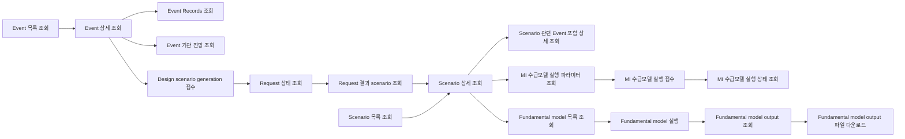

# MI Scenario Workbench - Backend Feature Spec

> 목적
> - MI Scenario Workbench를 endpoint 목록이 아니라 backend 기능 단위로 정리한다.
> - 하나의 기능이 여러 단계의 API 호출로 구성될 수 있음을 전제로, 화면 기준 user flow와 backend 호출 순서를 함께 정의한다.
>
> 문서 역할
> - 본 문서는 backend 기능 명세의 canonical feature spec이다.
> - 화면 evidence와 UI 목적은 [mi-scenario-workbench-design.md](/Users/hoduhomil/source/mip/backend/docs/feature-specs/mi-scenario-workbench-design.md) 를 따른다.
> - 개별 endpoint의 상세 request/response draft는 [mi-scenario-workbench-api.md](/Users/hoduhomil/source/mip/backend/docs/feature-specs/mi-scenario-workbench-api.md) 를 working reference로 삼는다.
> - 단, `design scenario generation` slice는 본 문서의 `F3` 가 canonical이며, 기존 direct scenario create 초안보다 우선한다.

## 0. Implementation Review Snapshot

- 본 스냅샷은 `7d1ba27a` 이후 커밋(`7b03c74e`, `c70d0278`, `d51b4bae`, `39284376`, `c066a4f9`)을 기준으로 2026-05-06에 재검토했다.
- 추가로 Notion 페이지 `2️⃣ Events` (`https://www.notion.so/34b263ff004c8016a6c2ebec824d14d5`) 에 기록된 팀 업데이트를 2026-05-06 기준으로 대조했다.
- 2026-05-11 기준 추가로 `ad6aeeee` (`feat: design 도메인 mocking`) 커밋을 검토했다.
- 아래 상태는 설계 의도보다 현재 코드 기준의 개발 현황을 우선한다.

| 기능 | 현재 상태 | 비고 |
|---|---|---|
| Event 목록 조회 | 일부 DB 연동 완료 | `EventController#getEvents`, DB 조회 동작 |
| Event 상세 조회 | 일부 DB 연동 완료 | impact analysis, AI insights, driver tree scoreboard 는 조회 가능 |
| Event Records 조회 | 일부 DB 연동 완료 | 별도 pagination endpoint |
| Event 기관 전망 조회 | 일부 DB 연동 완료 | 별도 pagination endpoint |
| Event 상세 > Fundamental Deep-dive | 보류 | 관련 테이블/컬럼 미확정 |
| Event 상세 > 관련 이벤트 및 시나리오 | 보류 | `relatedEventScenario`, Event-Scenario 매핑 스키마 미확정 |
| Scenario 목록 조회 | Mock만 제공 | `mock` 프로필에서는 정상, `!mock` 에서는 미구현 예외 |
| Scenario 상세 조회 | Mock만 제공 | `mock` 프로필에서는 정상, `!mock` 에서는 미구현 예외 |
| Scenario 관련 Event 재조회 | 미구현 | 별도 endpoint 없음 |
| Design 이벤트 목록 조회 | Mock만 제공 | `DesignController#getDesignEvents`, 별도 `/design/events` path |
| Design scenario generation 접수 | Mock만 제공 | `POST /design/generate`, 현재 `BaseResponse 200` |
| Design scenario generation 상태 조회 | Mock만 제공 | `GET /design/generate/status?requestIds=...`, 현재 batch polling |
| Design scenario generation 결과 조회 | Mock만 제공 | `GET /design/generate/{requestId}/scenarios` |
| Design scenario generation callback | Mock만 제공 | `POST /design/callback`, body는 `requestId/success/scenarioIds/...` |
| Scenario 생성 / MI 수급모델 실행 / Fundamental model | 미구현 | 본 문서의 설계 범위만 유지 |

### 0.1 Design Mock API Drift Note

`ad6aeeee` 커밋은 design 전용 mock API를 실제 코드에 추가했다. 다만 이 구현은 현재 문서의 canonical contract와 완전히 같지는 않다.

- 현재 mock path:
  - `GET /api/v1/mi/scenario-workbench/design/events`
  - `POST /api/v1/mi/scenario-workbench/design/generate`
  - `GET /api/v1/mi/scenario-workbench/design/generate/status`
  - `GET /api/v1/mi/scenario-workbench/design/generate/{requestId}/scenarios`
  - `POST /api/v1/mi/scenario-workbench/design/callback`
- 현재 mock 상태 enum:
  - `READY | PROCESSING | COMPLETED`
- 현재 mock callback payload:
  - `requestId`
  - `success`
  - `scenarioIds`
  - `completedAt`
  - `failReason`

본 문서의 `F3` 는 여전히 canonical contract 기준을 유지한다. `ad6aeeee` 구현은 design mock API snapshot과 drift reference로만 해석한다.

### 0.2 2026-05 Scenario Group Restructuring Planning Note

2026-05-19 기준 고객 논의 중인 개편은 세부 화면/필드가 아직 확정되지 않았으므로 본 문서의 canonical endpoint contract로 승격하지 않는다. 다만 현재까지 확인된 scope boundary는 다음과 같다.

- `Overview`: 삭제 또는 비노출 예정. 신규 backend 기능 scope로 보지 않는다.
- `Events`: 동일 유지 예정.
- `Scenarios`: 변경 예정. 기존 flat scenario list에서 `scenarioGroupId` 기준 group hierarchy, group pagination, group detail URL/API, JKM/TTF/HH price comparison graph가 논의 중이다.
- `Design`: 변경 예정. 기존 event 선택 중심 generation flow에 user-editable generation input 추가가 논의 중이다.

상세 planning draft는 [mi-scenario-group-hierarchy-comparison-design.md](/Users/hoduhomil/source/mip/backend/docs/design-docs/gas/mi-scenario-group-hierarchy-comparison-design.md) 를 따른다. 최종 화면안, generation input field set, graph table/view schema가 확정되면 본 문서의 `F2`, `F3` contract와 endpoint response draft를 별도 업데이트한다.

## 1. Feature Goal

- 사용자는 `Events` 와 `Scenarios` 화면에서 시장 이벤트와 시나리오를 탐색한다.
- 사용자는 선택한 event를 기반으로 scenario를 생성할 수 있다.
- 사용자는 scenario 상세 화면에서 `MI 수급모델 실행` 버튼을 눌러 `MI 수급모델 실행 팝업`을 열고, baseline 파라미터를 참조로 확인한 뒤 입력 파일 3개를 업로드해 실행을 접수할 수 있다.
- backend는 이 흐름을 `기능 단위`로 나누어 계약을 제공한다. 하나의 기능은 1개 이상의 endpoint 호출로 구성될 수 있다.

## 2. Functional Slice

| 기능 ID | 기능명 | 주 사용자 | 성격 | 단계형 API 호출 |
|---|---|---|---|---|
| `F1` | Event 탐색 | Analyst/User | Read | 가능 |
| `F2` | Scenario 탐색 | Analyst/User | Read | 가능 |
| `F3` | Design Scenario Generation | Analyst/User | Mixed | 필수 |
| `F4` | Scenario MI 수급모델 실행 | Analyst/User | Mixed | 필수 |
| `F5` | Fundamental Model 실행 및 Output 관리 | Analyst/User | Mixed | 필수 |

## 2.1 기능별 필요 API 요약

### F1. Event 탐색

| Method | API 의미 |
|---|---|
| `GET` | Event 목록 조회 |
| `GET` | Event 상세 조회 |
| `GET` | Event Records 조회 |
| `GET` | Event 기관 전망 조회 |

### F2. Scenario 탐색

| Method | API 의미 |
|---|---|
| `GET` | Scenario 목록 조회 |
| `GET` | Scenario 상세 조회 |
| `GET` | Scenario 관련 Event 포함 상세 조회 |

### F3. Design Scenario Generation

| Method | API 의미 |
|---|---|
| `POST` | Design scenario generation 접수 |
| `GET` | Design scenario generation 상태 조회 |
| `GET` | Design scenario generation 결과 scenario 목록 조회 |
| `POST` | External callback 처리 |

### F4. Scenario MI 수급모델 실행

| Method | API 의미 |
|---|---|
| `GET` | MI 수급모델 실행 파라미터 조회 |
| `POST` | MI 수급모델 실행 접수 |
| `GET` | MI 수급모델 실행 상태 조회 |

### F5. Fundamental Model 실행 및 Output 관리

| Method | API 의미 |
|---|---|
| `GET` | Fundamental model 목록 조회 |
| `POST` | Fundamental model 실행 |
| `GET` | Fundamental model output 목록 조회 |
| `GET` | Fundamental model output 파일 다운로드 |

## 2.2 Workflow Diagram



### Diagram Reading Rule

- diagram은 사용자 기능 흐름 기준이다.
- 하나의 박스는 화면 액션 또는 backend 기능 단계 1개를 뜻한다.
- 실제 endpoint path, request/response shape는 아래 기능별 상세 섹션과 `mi-scenario-workbench-api.md` working reference를 따른다.
- `MI 수급모델 실행 상태 조회` 는 비동기 실행 리소스의 lifecycle 확인을 위한 단계다.

### Canonical Boundary

- `Event` 는 read-only aggregate로 본다.
- `Scenario` 는 생성 가능한 top-level aggregate로 본다.
- 현재 범위에서 `scenario 수정`은 범용 metadata update API를 의미하지 않는다.
- 현재 범위의 수정 행위는 `MI 수급모델 실행 전 입력 파일 3개 업로드 및 실행 접수` workflow로 한정한다.
- 별도 `PATCH /scenarios/{scenarioId}` 가 필요한 일반 수정 기능은 이번 범위에 포함하지 않는다.

## 3. Common Contract Rules

### 공통 Path Family

- `/api/v1/mi/scenario-workbench/events`
- `/api/v1/mi/scenario-workbench/scenarios`
- `/api/v1/mi/scenario-workbench/design/scenario-generations/*`
- `/api/v1/mi/scenario-workbench/scenarios/{scenarioId}/model-execution-parameters`
- `/api/v1/mi/scenario-workbench/scenarios/{scenarioId}/model-executions/*`
- `/api/v1/mi/scenario-workbench/fundamental-models/*`

### 공통 응답 규칙

- 모든 응답은 `BaseResponse<T>` 래퍼를 사용한다.
- 목록 조회는 page-number pagination을 기본안으로 둔다.
- 현재 구현 기준 `Event` / `Scenario` 목록 조회는 모두 1-based page-number pagination을 사용한다.
- `marketCategoryCode` 는 설계 공통 context였지만, 현재 구현된 Event/Scenario 조회 request에는 포함되지 않는다.

### 공통 접근제어 규칙

- MI Scenario Workbench 전체 API는 현재 인증 컨텍스트 기준 `cust_cpny_cd = 'SKGAS'` 또는 `Role = ADMIN` 인 경우 접근 가능하다.
- 위 조건을 만족하지 않는 사용자의 request/status/result 조회 또는 command 요청은 `REQ_FORBIDDEN` 처리한다.
- request header에는 별도 company scope 컬럼을 추가하지 않는다.
- 구현 단계에서는 `AuthorizationService` 로 현재 사용자의 company code와 Role을 확인하는 공통 guard를 둔다.

### 공통 실패 코드 방향

| 코드 후보 | 의미 |
|---|---|
| `REQ_INVALID_PARAMETER` | enum/query/body 값 오류 |
| `REQ_RESOURCE_NOT_FOUND` | `eventId`, `scenarioId`, `generationId`, `runId` 미존재 |
| `REQ_INVALID_STATE` | 허용되지 않는 상태에서 MI 수급모델 실행 접수 시도 |
| `REQ_CONFLICT` | 중복 생성 또는 동시성 충돌 |
| `REQ_FORBIDDEN` | 권한 없음 |

## 4. Feature 1 - Event 탐색

## 4.1 Feature Goal

- 사용자는 `Events` 탭에서 event 목록을 조회한다.
- 사용자는 특정 event를 선택해 상세 정보를 확인한다.
- 사용자는 상세 화면에서 records, 기관 전망, driver tree scoreboard를 확인한다.
- 사용자는 상세 화면에서 scenario 생성 진입 여부를 판단하지만, event 기반 related scenario read endpoint는 아직 구현되지 않았다.

## 4.2 API Sequence

### Flow A. 이벤트 목록 진입

1. `GET /api/v1/mi/scenario-workbench/events`
2. 사용자는 목록에서 event를 탐색하고 상세 대상을 선택한다.

### Flow B. 이벤트 상세 조회

1. `GET /api/v1/mi/scenario-workbench/events/{eventId}`
2. 사용자는 impact 분석, AI insights, driver tree scoreboard를 확인한다.
3. 응답의 `relatedEventScenario.event` 에 현재 event 자체 요약이 포함된다.
4. 응답의 `relatedEventScenario.scenarios` 는 현재 빈 배열로 반환된다.
5. 사용자는 이후 `Scenario 생성` 기능으로 이동할 수 있다.

### Flow C. 이벤트 Records 조회

1. `GET /api/v1/mi/scenario-workbench/events/{eventId}/records`
2. 사용자는 event에 매핑된 record 목록을 페이지 단위로 확인한다.

### Flow D. 이벤트 기관 전망 조회

1. `GET /api/v1/mi/scenario-workbench/events/{eventId}/outlooks`
2. 사용자는 event 관련 기관 전망 목록을 페이지 단위로 확인한다.

## 4.3 Endpoint

### A. 이벤트 목록 조회

- Method: `GET`
- Path: `/api/v1/mi/scenario-workbench/events`
- Purpose: Events 탭 목록 렌더링

#### Request DTO draft

| 필드 | 타입 | 필수 | 설명 |
|---|---|---|---|
| `eventStatus` | `string` | N | `ALL | NEW | UPDATED` |
| `eventCategoryLv1` | `string[]` | N | 복수 선택 가능 |
| `period` | `string` | N | 기본 `SIX_MONTHS` |
| `startDate` | `date` | N | `period=CUSTOM` 일 때 시작일 |
| `endDate` | `date` | N | `period=CUSTOM` 일 때 종료일 |
| `sort` | `string` | N | `LATEST | OLDEST`, 기본 `LATEST` |
| `keyword` | `string` | N | 이벤트명 검색 |
| `page` | `number` | N | 기본 `1` |
| `size` | `number` | N | 기본 `20` |

#### Response DTO draft

- `appliedFilter`
- `events.totalPages`
- `events.totalElements`
- `events.currentPage`
- `events.numberOfElements`
- `events.content[]`
  - `eventId`
  - `eventName`
  - `status`
  - `statusLabel`
  - `eventCategoryLv1`
  - `eventCategoryLv1Label`
  - `createdAt`
  - `updatedAt`
  - `indexImpacts[]`
  - `scenarioGenerationStatus`
  - `scenarioGenerationRequestId`

#### 상태값 정의

| 필드 | 값 | 의미 |
|---|---|---|
| `scenarioGenerationStatus` | `NOT_CREATED` | 최신 request가 없거나, 최신 canonical request 상태가 `FAILED` 인 경우 |
| `scenarioGenerationStatus` | `GENERATING` | 최신 canonical request 상태가 `REQUESTED` 또는 `IN_PROGRESS` 인 경우 |
| `scenarioGenerationStatus` | `COMPLETED` | 최신 canonical request 상태가 `COMPLETED` 인 경우 |

#### 실패/충돌 케이스

- 지원하지 않는 `eventStatus`, `period`, `sort` 값은 `REQ_INVALID_PARAMETER`
- 결과가 없는 필터 조합은 정상 `200` 과 빈 `events.content`
- 본 API는 조회 API이므로 별도 write 충돌을 발생시키지 않는다.

#### 프론트 처리 규칙

- `scenarioGenerationStatus = NOT_CREATED` 이면 생성 버튼을 활성화한다. 이때 `scenarioGenerationRequestId` 존재 여부만으로 생성 차단 여부를 판단하지 않는다.
- `scenarioGenerationStatus = GENERATING` 이면 생성 버튼을 비활성화하고 `scenarioGenerationRequestId` 로 별도 status API를 polling 한다.
- `scenarioGenerationStatus = COMPLETED` 이면 `scenarioGenerationRequestId` 로 결과 scenario 목록 조회로 진입한다.
- `FAILED` 는 event 목록 projection에서 `NOT_CREATED` 로 흡수된다. 따라서 실패 여부를 구분해야 하는 화면은 event 목록 재조회가 아니라 request status API를 사용해야 한다.

### B. 이벤트 상세 조회

- Method: `GET`
- Path: `/api/v1/mi/scenario-workbench/events/{eventId}`
- Purpose: Event 상세 화면 렌더링

#### Response DTO draft

- `eventId`
- `eventName`
- `status`
- `statusLabel`
- `createdAt`
- `updatedAt`
- `impactAnalysis`
- `aiInsights`
- `fundamentalDeepdive`
- `driverTreeScoreboard[]`
- `relatedEventScenario`
  - `event`
  - `scenarios[]`

### C. 이벤트 Records 조회

- Method: `GET`
- Path: `/api/v1/mi/scenario-workbench/events/{eventId}/records`
- Purpose: Event 상세 화면의 record 목록 section 렌더링

#### Response DTO draft

- `totalPages`
- `totalElements`
- `content[]`
  - `publishedAt`
  - `title`
  - `summary`
  - `source`

### D. 이벤트 기관 전망 조회

- Method: `GET`
- Path: `/api/v1/mi/scenario-workbench/events/{eventId}/outlooks`
- Purpose: Event 상세 화면의 기관 전망 section 렌더링

#### Response DTO draft

- `totalPages`
- `totalElements`
- `content[]`
  - `publishedAt`
  - `institutionName`
  - `outlookSummary`

## 4.4 Representative Error Scenarios

- 지원하지 않는 `eventStatus`, `sort`, `period`
- 존재하지 않는 `eventId`
- 검색 결과 없음: `200 + empty list`
- records/outlooks 결과 없음: `200 + empty content`
- 상세는 존재하나 related scenario 없음: `200 + empty relatedEventScenario.scenarios`

## 4.5 Swagger Annotation Recommendation

- `summary`: `이벤트 목록 조회`
- `description`: `Events 탭 목록 화면에 필요한 applied filter, paged event rows를 조회합니다.`
- `summary`: `이벤트 상세 조회`
- `description`: `Event 상세 화면의 impact analysis, AI insights, driver tree scoreboard를 조회합니다.`
- `summary`: `이벤트 Records 조회`
- `description`: `Event 상세 화면에 연결된 record 목록을 페이지 단위로 조회합니다.`
- `summary`: `이벤트 기관 전망 조회`
- `description`: `Event 상세 화면에 연결된 기관 전망 목록을 페이지 단위로 조회합니다.`

## 4.6 Data / Model Impact

- 현재 구현은 `MIEvent`, `Impact`, `ImpactResult`, `QualitativeImpact`, `MiEventKeyBullet`, `MiEventSourceMap`, `MiRecord` 기반 read projection을 사용한다.
- record 목록과 기관 전망은 모두 `MiEventSourceMap -> MiRecord` 연결을 따라 별도 조회한다.
- event 상세에서 scenario를 역방향으로 보여주는 read projection은 아직 구현되지 않았다.
- `fundamentalDeepdive` 는 관련 테이블 미준비로 현재 `null` 반환이다.

## 4.7 Recommended Data Access Approach

- 현재 구현: `QueryDSL + JPA Repository + 일부 native query`
- 이유: 목록/상세는 QueryDSL projection 조합을 사용하고, records/outlooks 는 native query 페이지 조회를 사용한다.

## 4.8 Implementation Touch Points

- `src/main/java/com/sk/domain/mi/controller/scenarioworkbench/EventController.java`
- `src/main/java/com/sk/domain/mi/service/scenarioworkbench/EventServiceImpl.java`
- `src/main/java/com/sk/domain/mi/service/scenarioworkbench/mock/EventMockService.java`
- `src/main/java/com/sk/domain/shared/repository/master/tmm/MiEventRepository.java`
- `src/main/java/com/sk/domain/shared/repository/master/tmm/custom/CustomMiEventRepositoryImpl.java`

## 4.9 Risks / Open Questions

- `eventStatus` 는 현재 `createDt == modifyDt` 기준으로 계산되며, Slack 메모 기준 향후 변경 가능성이 코드에 TODO로 남아 있다.
- Event 관련 Scenario endpoint가 없어서 상세 응답의 `relatedEventScenario.scenarios` 가 빈 배열에 머문다.
- `fundamentalDeepdive` 는 계약은 있으나 실제 데이터가 없어 null 반환이다.
- 기관 전망 query는 native SQL로 구현되어 있어 DBA 검토 전 alias/join 정합성 재확인이 필요하다.
- Notion evidence 기준으로도 `Fundamental Deep-dive` 와 `시나리오 ↔ 이벤트 매핑` 은 미확인사항으로 남아 있으므로, 이 두 항목은 구현 완료로 간주하면 안 된다.

## 4.10 Exit Criteria / Handoff

- event 목록/상세/records/outlooks read contract는 현재 코드 기준으로 정리되었다.
- Event related scenario read와 fundamental deep-dive는 후속 구현 대상으로 별도 추적해야 한다.

## 5. Feature 2 - Scenario 탐색

## 5.1 Feature Goal

- 사용자는 `Scenarios` 탭에서 scenario 목록을 조회한다.
- 사용자는 scenario 상세 화면에서 관련 이벤트, 요약, assumptions, signposts를 확인한다.
- 현재 구현 상태는 `mock` 프로필 기준 API 시연이 가능하고, 실제 DB 연동은 미완료다.

## 5.2 API Sequence

### Flow A. 시나리오 목록 진입

1. `GET /api/v1/mi/scenario-workbench/scenarios`
2. `mock` 프로필에서는 mock JSON 기반 목록이 반환된다.
3. `!mock` 프로필에서는 미구현 예외가 발생한다.

### Flow B. 시나리오 상세 진입

1. `GET /api/v1/mi/scenario-workbench/scenarios/{scenarioId}`
2. `mock` 프로필에서는 header/status/tabs 데이터가 모두 포함된 상세 응답이 반환된다.
3. `!mock` 프로필에서는 미구현 예외가 발생한다.

## 5.3 Endpoint

### A. 시나리오 목록 조회

- Method: `GET`
- Path: `/api/v1/mi/scenario-workbench/scenarios`
- Purpose: Scenarios 탭 목록 렌더링

#### Request DTO draft

| 필드 | 타입 | 필수 | 설명 |
|---|---|---|---|
| `scenarioStatus` | `string` | N | `ALL | NEW | UPDATED` |
| `period` | `string` | N | 기본 `SIX_MONTHS` |
| `startDate` | `date` | N | `period=CUSTOM` 일 때 시작일 |
| `endDate` | `date` | N | `period=CUSTOM` 일 때 종료일 |
| `sort` | `string` | N | `LATEST | OLDEST`, 기본 `LATEST` |
| `keyword` | `string` | N | 시나리오명 검색 |
| `page` | `number` | N | 기본 `1` |
| `size` | `number` | N | 기본 `20` |

#### Response DTO draft

- `appliedFilter`
- `scenarios.totalPages`
- `scenarios.totalElements`
- `scenarios.currentPage`
- `scenarios.content[]`
  - `scenarioId`
  - `scenarioName`
  - `status`
  - `statusLabel`
  - `createdAt`
  - `updatedAt`
  - `indexImpacts[]`
  - `probability`

### B. 시나리오 상세 조회

- Method: `GET`
- Path: `/api/v1/mi/scenario-workbench/scenarios/{scenarioId}`
- Purpose: Scenario 상세 화면 렌더링

#### Response DTO draft

- `scenarioId`
- `scenarioName`
- `status`
- `statusLabel`
- `tags[]`
- `createdAt`
- `updatedAt`
- `summary`
- `assumptions[]`
- `signposts[]`
- `relatedEventScenario`
  - `event`
  - `scenarios[]`

## 5.4 Representative Error Scenarios

- 지원하지 않는 `scenarioStatus`, `sort`, `period`
- 존재하지 않는 `scenarioId`
- `!mock` 프로필에서 목록/상세 조회 시 `RSC_NOT_FOUND` 예외 발생
- 별도 related event 재조회 endpoint는 현재 없음

## 5.5 Swagger Annotation Recommendation

- `summary`: `시나리오 목록 조회`
- `description`: `Scenarios 탭 목록 화면에 필요한 applied filter, paged scenario rows를 조회합니다. (현재 mock 프로필에서만 정상 동작)`
- `summary`: `시나리오 상세 조회`
- `description`: `Scenario 상세 화면의 status, summary, assumptions, signposts, related event/scenario 정보를 조회합니다. (현재 mock 프로필에서만 정상 동작)`

## 5.6 Data / Model Impact

- 현재 구현은 `src/main/resources/mock/scenarios/*.json` 기반 mock read model이다.
- 실제 DB 연동 단계에서는 최소 `Scenario`, `Scenario-Event relation`, `Scenario summary snapshot`, `Scenario assumption`, `Signpost` aggregate 경계가 필요하다.
- 과거 draft의 `modelExecutionAction` metadata는 현재 DTO에서 제거되어 있다.

## 5.7 Recommended Data Access Approach

- 현재 구현: `mock` 프로필 JSON 로딩, `!mock` 프로필 미구현
- 후속 권장안: projection 중심 read model 설계 후 QueryDSL 또는 MyBatis 중 실제 테이블 구조에 맞는 접근 선택

## 5.8 Implementation Touch Points

- `src/main/java/com/sk/domain/mi/controller/scenarioworkbench/ScenarioController.java`
- `src/main/java/com/sk/domain/mi/service/scenarioworkbench/ScenarioServiceImpl.java`
- `src/main/java/com/sk/domain/mi/service/scenarioworkbench/mock/ScenarioMockService.java`
- `src/main/resources/mock/scenarios/scenario-list.json`
- `src/main/resources/mock/scenarios/scenario-detail.json`

## 5.9 Risks / Open Questions

- 실제 DB 연동이 없어 `mock` 이외 환경에서는 API 계약 검증이 불가능하다.
- 별도 Scenario related event endpoint가 없어, 관련 이벤트는 상세 payload에 포함되는 shape만 유지 중이다.
- `probability`, `indexImpacts`, `summary.priceForecast`, `relatedEventScenario` 의 canonical source-of-truth가 아직 설계 단계에 머물러 있다.

## 5.10 Exit Criteria / Handoff

- Scenario 목록/상세의 mock contract는 현재 코드와 일치하도록 정리되었다.
- 실제 DB 연동 전에는 feature spec의 F2를 `mock validated / production not implemented` 상태로 취급해야 한다.

## 6. Feature 3 - Design Scenario Generation

## 6.1 Feature Goal

- 사용자는 Event 목록 또는 Event 상세에서 선택한 event를 기준으로 `design scenario generation` 을 접수한다.
- backend는 외부 API 비동기 처리 기준으로 request lifecycle을 관리한다.
- 프론트는 request 상태를 polling 으로 확인하고, 완료 후 request ID 기준으로 생성 결과 scenario 목록을 조회한다.
- Phase 1에서는 event 1건만 선택 가능하지만 request contract shape는 다건 확장 가능 구조를 유지한다.

### 6.1.1 Current Mock Implementation Note

`ad6aeeee` 기준 현재 mock 구현은 아래처럼 동작한다.

- design 목록 API를 기존 events 목록 재사용 대신 별도 `/design/events` 로 분리했다.
- 상태값은 `NOT_CREATED | GENERATING | COMPLETED` 대신 `READY | PROCESSING | COMPLETED` 를 사용한다.
- status polling은 단건 `GET /design/scenario-generations/{generationId}` 가 아니라 `GET /design/generate/status?requestIds=...` 배치 조회다.
- callback은 `generatedScenarioIds[]` 최소 payload가 아니라 `requestId/success/scenarioIds/completedAt/failReason` shape를 사용한다.
- 추가로 callback 결과 단위도 canonical `scenarioGroupId` 가 아니라 mock용 `scenarioIds[]` 다.

이 구현은 mock/demo 목적의 현재 코드 snapshot으로 기록한다. canonical contract 변경 여부는 후속 합의가 필요하다.

## 6.2 Resource Boundary Decision

### 판단 1. callback path 위치

- 후보 A: `scenarios/*` family 아래에 둔다.
  - 장점: 기존 `scenario model execution callback` 과 표면 구조가 비슷하다.
  - 단점: callback 시점에는 아직 canonical `scenario` 가 없을 수 있고, 생성 요청 상태 전이와 결과 pointer 저장의 주체가 흐려진다.
- 후보 B: `design/scenario-generations/*` family 아래에 둔다.
  - 장점: design 화면 전용 생성 slice라는 점과 생성 결과 확인 흐름을 함께 묶을 수 있다.
  - 단점: `design` 이 UI 명칭이라 문서에서 의미를 고정해둘 필요가 있다.
- 추천안: 후보 B. 이번 범위는 design 화면의 event 기반 scenario generation flow를 정리하는 것이므로 `design/scenario-generations` family가 가장 읽기 쉽다.

### 판단 2. status polling 방식

- 후보 A: event 목록 재조회만 사용한다.
  - 장점: API 개수가 적다.
  - 단점: `FAILED` canonical 상태를 볼 수 없고, request 단위 오류 정보와 완료 시각을 전달하기 어렵다.
- 후보 B: 별도 단건 status API를 둔다.
  - 장점: polling 목적이 명확하고, canonical request 상태 및 retry 가능 여부를 직접 표현할 수 있다.
  - 단점: endpoint가 1개 늘어난다.
- 추천안: 후보 B. 단, event 목록 조회 API 자체는 재사용하고, polling만 별도 단건 status API로 분리한다.

### 판단 3. 결과 scenario 조회 경계

- 후보 A: `design/scenario-generations/{generationId}` 하위로 둔다.
  - 장점: `request -> generated scenarios` 매핑 책임과 정확히 일치한다.
  - 단점: 별도 result endpoint를 관리해야 한다.
- 후보 B: 일반 scenario list projection으로 푼다.
  - 장점: 기존 `GET /scenarios` 와 표면상 통합된다.
  - 단점: request와 결과 사이의 결합이 약해지고, 완료 직후 특정 request 결과만 조회하기 어렵다.
- 추천안: 후보 A. 완료 후 바로 필요한 UX가 `generationId 기준 생성 결과 확인` 이므로 child resource가 canonical 하다.

## 6.3 API Sequence

### Flow A. design scenario generation 접수

1. 사용자는 Event 목록 또는 Event 상세에서 event를 선택한다.
2. `POST /api/v1/mi/scenario-workbench/design/scenario-generations`
3. backend는 request row를 생성하고 외부 API dispatch를 시도한다.
4. dispatch 수락 시 프론트는 `scenarioGenerationRequestId` 와 `statusEndpoint` 를 받는다.

### Flow B. request 상태 polling

1. 프론트는 `GET /api/v1/mi/scenario-workbench/design/scenario-generations/{generationId}` 를 polling 한다.
2. `requestStatus = REQUESTED | IN_PROGRESS` 이면 polling 을 유지한다.
3. `requestStatus = COMPLETED | FAILED` 이면 polling 을 중단한다.

### Flow C. request 완료 후 결과 scenario 조회

1. `requestStatus = COMPLETED` 이면 `GET /api/v1/mi/scenario-workbench/design/scenario-generations/{generationId}/scenarios`
2. 프론트는 반환된 scenario summary 목록으로 결과 화면 또는 상세 진입을 제공한다.

### Flow D. external callback 처리

1. 외부 API가 `POST /api/v1/mi/scenario-workbench/design/scenario-generations/{generationId}/callback` 을 호출한다.
2. backend는 request 상태를 `COMPLETED` 또는 `FAILED` 로 전이한다.
3. `COMPLETED` callback 이면 `scenarioGroupId` 를 request header에 기록하고 agent v0.2.5 `tmm_scenariom.scenario_group_id` 기반 결과 read path를 열어준다.
4. callback 이후 같은 `scenarioGroupId` 에 속한 scenario row 집합이 변하지 않는다는 전제를 기준으로, 별도 request-result snapshot row는 만들지 않는다.
5. 성공 callback은 `scenarioGroupId`, `requestStatus = COMPLETED`, `completedAt/processedAt` 반영을 같은 transaction 안에서 처리한다.
6. 이미 terminal 상태인 request는 callback payload로 overwrite하지 않는다.
7. 상태 코드 허용값과 header 상태/pointer invariant는 DB `CHECK` 가 아니라 callback service validation과 compare-and-set update로 보장한다.

### External Agent dispatch handoff draft

Platform이 호출할 Agent API URL/path/auth는 외부 API 담당자 확정이 필요하다. 전달용 초안은 아래를 기준으로 한다.

- Method: `POST`
- URL: `{AGENT_BASE_URL}{AGENT_SCENARIO_GENERATION_PATH}`
- Proposed path: `/api/v1/scenario-generations`
- Content-Type: `application/json`
- Auth: `Bearer token`, `HMAC signature`, `mTLS`, private network allowlist 중 외부 연동팀과 택1

Dispatch request:

```json
{
  "generationId": 10001,
  "sourceEventIds": [12345],
  "callbackUrl": "{PLATFORM_BASE_URL}/api/v1/mi/scenario-workbench/design/scenario-generations/10001/callback",
  "requestedAt": "2026-05-15T16:00:00+09:00"
}
```

Dispatch accept response:

```json
{
  "externalRequestId": "agent-req-20260515-000001",
  "acceptedAt": "2026-05-15T16:00:03+09:00",
  "status": "ACCEPTED"
}
```

- `generationId` 는 Platform canonical request id이며 callback path의 `{generationId}` 와 동일해야 한다.
- `sourceEventIds` 는 Phase 1에서 정확히 1건이다.
- `callbackUrl` 은 Agent가 완료/실패 시 호출할 Platform callback URL이다.
- `externalRequestId` 는 외부 Agent가 별도 request key를 제공하는 경우에만 Platform의 `extr_req_id` 에 저장한다.
- 외부 Agent가 `externalRequestId` 를 제공하지 않는 경우 `extr_req_id` 는 null로 두고 `generationId` 기반 callback lookup을 유지한다.
- `externalRequestId` 제공 모드에서는 callback 재전송 시 외부 Agent가 같은 `externalRequestId` 를 보내야 한다.
- `acceptedAt` 이 제공되면 `scnr_crt_bgn_dtm` 후보로 사용한다.

## 6.4 Endpoint

### A. design scenario generation 접수

- Method: `POST`
- Path: `/api/v1/mi/scenario-workbench/design/scenario-generations`
- Purpose: 선택한 event를 기준으로 scenario generation 비동기 request를 접수한다.

#### Request DTO draft

| 필드 | 타입 | 필수 | 설명 |
|---|---|---|---|
| `sourceEventIds` | `number[]` | Y | Phase 1에서는 정확히 1건, contract shape는 향후 다건 확장용 배열 유지 |

#### Validation

- `sourceEventIds` 는 빈 배열일 수 없다.
- Phase 1에서는 `sourceEventIds` 길이가 정확히 `1` 이어야 한다.
- 중복 `sourceEventIds` 는 허용하지 않는다.
- 존재하지 않는 event는 허용하지 않는다.
- latest request가 `REQUESTED`, `IN_PROGRESS`, `COMPLETED` 인 event는 재요청할 수 없다.
- latest request가 `FAILED` 이거나 request 이력이 없으면 생성 가능하다.

#### Response DTO draft

- `scenarioGenerationRequestId`
- `requestStatus` (`IN_PROGRESS`)
- `scenarioGenerationStatus` (`GENERATING`)
- `sourceEventIds`
- `requestedAt`
- `statusEndpoint`
- `resultScenarioEndpoint`

#### 상태값 정의

| 필드 | 값 | 의미 |
|---|---|---|
| `requestStatus` | `IN_PROGRESS` | 외부 API dispatch 수락 후 callback 대기 상태 |
| `scenarioGenerationStatus` | `GENERATING` | event 목록 projection용 화면 상태 |

#### 실패/충돌 케이스

- `sourceEventIds` 가 비어 있거나 2건 이상이면 `REQ_INVALID_PARAMETER`
- 존재하지 않는 `eventId` 포함 시 `REQ_RESOURCE_NOT_FOUND`
- latest request가 `REQUESTED`, `IN_PROGRESS`, `COMPLETED` 이면 `REQ_CONFLICT`
- 외부 API dispatch handshake 실패 시 `API_CALL_FAILED` 또는 `REQ_INVALID_STATE` 가 아니라 request를 `FAILED` 로 전이한 뒤 오류 응답

#### 프론트 처리 규칙

- 성공 응답을 받으면 같은 event에 대해 즉시 재요청하지 않는다.
- 성공 응답 후에는 `statusEndpoint` 를 polling 하고 event 목록 재조회만으로 terminal 상태를 판정하지 않는다.
- 접수 성공 직후 화면 상태는 `GENERATING` 으로 고정한다.

### B. design scenario generation 상태 조회

- Method: `GET`
- Path: `/api/v1/mi/scenario-workbench/design/scenario-generations/{generationId}`
- Purpose: request lifecycle의 canonical 상태와 polling 종료 조건을 조회한다.

#### Request field

- path variable `generationId`

#### Response DTO draft

- `scenarioGenerationRequestId`
- `requestStatus` (`REQUESTED | IN_PROGRESS | COMPLETED | FAILED`)
- `scenarioGenerationStatus` (`NOT_CREATED | GENERATING | COMPLETED`)
- `sourceEventIds`
- `requestedAt`
- `startedAt`
- `completedAt`
- `retryable`
- `errorMessage` (`FAILED` 시, `err_msg_cntt` 기반 단일 실패 메시지)

#### 상태값 정의

| 필드 | 값 | 의미 |
|---|---|---|
| `requestStatus` | `REQUESTED` | request row 생성 완료, 외부 API dispatch 직전/직후 |
| `requestStatus` | `IN_PROGRESS` | 외부 API가 수락했고 callback 대기 중 |
| `requestStatus` | `COMPLETED` | callback 성공, `scenarioGroupId` 저장과 결과 read path 개방 완료 |
| `requestStatus` | `FAILED` | dispatch 실패, callback 실패, timeout 등 terminal failure |
| `scenarioGenerationStatus` | `NOT_CREATED` | `requestStatus = FAILED` 를 화면 3상태로 투영한 결과 |
| `scenarioGenerationStatus` | `GENERATING` | `requestStatus = REQUESTED | IN_PROGRESS` 의 화면 투영 |
| `scenarioGenerationStatus` | `COMPLETED` | `requestStatus = COMPLETED` 의 화면 투영 |

#### 실패/충돌 케이스

- 존재하지 않는 `generationId` 는 `REQ_RESOURCE_NOT_FOUND`
- 현재 인증 컨텍스트가 공통 접근제어 규칙을 만족하지 않으면 `REQ_FORBIDDEN`

#### 프론트 처리 규칙

- `requestStatus = REQUESTED | IN_PROGRESS` 동안만 polling 한다.
- `requestStatus = COMPLETED` 이면 polling 을 중단하고 결과 scenario 목록 API를 호출한다.
- `requestStatus = FAILED` 이면 polling 을 중단하고 event 목록 재조회 또는 동일 event 재요청 UX로 전환한다.
- retry 가능 여부는 `scenarioGenerationStatus` 가 아니라 `retryable` 또는 `requestStatus = FAILED` 기준으로 판단한다.

### C. design scenario generation 결과 scenario 목록 조회

- Method: `GET`
- Path: `/api/v1/mi/scenario-workbench/design/scenario-generations/{generationId}/scenarios`
- Purpose: 완료된 request가 생성한 scenario summary 목록을 조회한다.

#### Request field

- path variable `generationId`

#### Response DTO draft

- `scenarioGenerationRequestId`
- `requestStatus` (`COMPLETED`)
- `scenarios[]`
  - `scenarioId`
  - `scenarioName`
  - `status`
  - `statusLabel`
  - `createdAt`
  - `updatedAt`
  - `probability`
  - `indexImpacts[]`
  - `detailEndpoint`

#### 상태값 정의

| 필드 | 값 | 의미 |
|---|---|---|
| `requestStatus` | `COMPLETED` | 결과 scenario 목록 조회가 허용되는 terminal success 상태 |

#### 실패/충돌 케이스

- 존재하지 않는 `generationId` 는 `REQ_RESOURCE_NOT_FOUND`
- 현재 인증 컨텍스트가 공통 접근제어 규칙을 만족하지 않으면 `REQ_FORBIDDEN`
- `requestStatus != COMPLETED` 인 request에 대한 호출은 `REQ_INVALID_STATE`
- callback 성공 payload에 `scenarioGroupId` 가 없으면 `REQ_INVALID_PARAMETER`

#### 프론트 처리 규칙

- 본 API는 `requestStatus = COMPLETED` 확인 후에만 호출한다.
- 반환된 `scenarios[]` 는 상세 진입용 결과 목록으로 사용하고, 전체 시나리오 브라우징 대체 용도로 사용하지 않는다.
- 결과 목록 조회 이후 개별 상세가 필요하면 `detailEndpoint` 또는 `GET /api/v1/mi/scenario-workbench/scenarios/{scenarioId}` 로 이동한다.
- backend는 `tmd_scnrcrth.scnr_grp_id` 를 기준으로 `tmm_scenariom.scenario_group_id` 를 조회한 뒤 `tmm_scenariom` projection을 조합해 응답을 구성한다.

### D. external callback API

- Method: `POST`
- Path: `/api/v1/mi/scenario-workbench/design/scenario-generations/{generationId}/callback`
- Purpose: 외부 scenario generation API의 terminal 결과를 수신해 request 상태와 결과 pointer 저장을 마감한다.

#### Request DTO draft

| 필드 | 타입 | 필수 | 설명 |
|---|---|---|---|
| `externalRequestId` | `string` | N | 외부 시스템이 별도 request key를 제공하는 경우 사용하는 보조 correlation key |
| `requestStatus` | `string` | Y | `COMPLETED | FAILED` 만 허용 |
| `completedAt` | `datetime` | Y | 외부 처리 완료 시각 |
| `errorMessage` | `string` | N | `FAILED` 일 때 `err_msg_cntt` 에 저장할 단일 실패 메시지 |
| `scenarioGroupId` | `string` | N | `COMPLETED` 일 때 필수. request당 정확히 하나의 결과 group을 가리키는 canonical pointer. agent v0.2.5 `tmm_scenariom.scenario_group_id` 값 |

#### Response DTO draft

- `scenarioGenerationRequestId`
- `requestStatus`
- `processedAt`

#### 상태값 정의

| 필드 | 값 | 의미 |
|---|---|---|
| `requestStatus` | `COMPLETED` | `scenarioGroupId` 저장과 request 완료 전이가 모두 끝난 상태 |
| `requestStatus` | `FAILED` | 결과 pointer 저장 없이 request 실패 전이만 수행된 상태 |

#### 실패/충돌 케이스

- 존재하지 않는 `generationId` 는 `REQ_RESOURCE_NOT_FOUND`
- `generationId` 는 backend가 발급한 canonical request identifier이며 내부 `scenarioGenerationRequestId` 와 1:1 매핑된다. callback path lookup은 `generationId` 를 기준으로 한다.
- `externalRequestId` 제공 모드이면 body의 `externalRequestId` 를 저장된 correlation key와 교차 검증한다.
- `externalRequestId` 미제공 모드이면 callback 인증/서명과 terminal payload idempotency로 정합성을 보장한다.
- 성공 callback은 `scenarioGroupId`, `requestStatus = COMPLETED`, `processedAt` 을 같은 transaction 안에서 저장한다.
- 이미 terminal 상태인 request에 대한 중복 callback은 상태를 바꾸지 않는 idempotent no-op을 기본안으로 둔다.
- 특히 scheduler timeout으로 `FAILED` 처리된 뒤 도착한 late callback은 `FAILED -> COMPLETED` 로 되돌리지 않고, 성공 ack를 반환한다.
- 이때 request 상태와 `scenarioGroupId` 는 변경하지 않고, `err_msg_cntt` 에 callback이 도착했지만 무시했다는 메시지를 append하는 방향을 권장한다.
- 동일 terminal payload 재전송은 idempotent 성공 처리하고, 다른 `scenarioGroupId` 등 상이 payload는 상태를 바꾸지 않은 채 mismatch 로그 또는 `REQ_CONFLICT` 후보로 본다.
- `requestStatus = COMPLETED` 인데 `scenarioGroupId` 가 비어 있으면 `REQ_INVALID_PARAMETER`
- `requestStatus = COMPLETED` 인데 전달된 `scenarioGroupId` 가 request에 이미 저장된 값과 다르면 `REQ_CONFLICT`
- `requestStatus = FAILED` 인데 `errorMessage` 가 비어 있으면 `REQ_INVALID_PARAMETER`

#### Application validation rules

- DDL은 `scnr_crt_stat_cd` 와 header 상태/pointer invariant에 DB `CHECK` 를 적용하지 않는다.
- callback DTO의 `requestStatus` 는 `COMPLETED | FAILED` 만 허용한다.
- success callback update는 `WHERE scnr_crt_id = ? AND del_yn = 'N' AND scnr_crt_stat_cd IN ('REQUESTED', 'IN_PROGRESS') AND scnr_grp_id IS NULL` 조건으로 compare-and-set 처리한다.
- failure callback update는 `WHERE scnr_crt_id = ? AND del_yn = 'N' AND scnr_crt_stat_cd IN ('REQUESTED', 'IN_PROGRESS') AND scnr_grp_id IS NULL` 조건으로 compare-and-set 처리한다.
- `COMPLETED` 저장은 `scenarioGroupId`, `requestStatus = COMPLETED`, `processedAt/completedAt` 을 같은 transaction에서 반영해야 한다.
- `FAILED` 저장은 `scenarioGroupId` 를 쓰지 않고 `errorMessage`, `requestStatus = FAILED`, `processedAt/completedAt` 을 같은 transaction에서 반영해야 한다.
- 이미 terminal 상태인 request는 상태와 `scenarioGroupId` 를 overwrite하지 않는다.
- 위 규칙은 callback service unit/integration test의 필수 검증 대상이다.

#### 프론트 처리 규칙

- 본 API는 외부 시스템 전용이므로 프론트가 직접 호출하지 않는다.
- 프론트는 callback 완료를 직접 감지하지 않고 status API polling 으로만 terminal 상태를 판정한다.

#### Count 처리 규칙

- `generatedScenarioCount` 는 별도 canonical response field로 제공하지 않는다.
- 결과 개수는 결과 scenario 목록 응답의 `scenarios[]` 길이로 해석한다.

## 6.5 Swagger Annotation Recommendation

- `summary`: `Design scenario generation 접수`
- `description`: `선택한 event를 기준으로 scenario generation 비동기 request를 접수합니다.`
- `summary`: `Design scenario generation 상태 조회`
- `description`: `Design scenario generation의 canonical lifecycle 상태를 polling 용도로 조회합니다.`
- `summary`: `Design scenario generation 결과 scenario 목록 조회`
- `description`: `완료된 design scenario generation이 생성한 scenario summary 목록을 조회합니다.`
- `summary`: `Design scenario generation callback`
- `description`: `외부 scenario generation API가 terminal 결과를 통보하면 request 상태와 결과 pointer 저장을 마감합니다.`

## 6.6 Data / Model Impact

- 신규 request aggregate 저장이 필요하다.
- `ScenarioGenerationRequest`, `ScenarioGenerationRequestEvent` 수준의 분리 저장 구조가 필요하다.
- request header에는 결과 pointer로 `scnr_grp_id` 가 추가되어야 한다.
- event 목록 조회는 latest request projection을 붙여 `scenarioGenerationStatus`, `scenarioGenerationRequestId` 를 계산해야 한다.
- `Scenario` aggregate 자체의 상세 컬럼 설계와 물리 DDL은 이번 범위 밖이며 ERD review에서 확정해야 한다.

## 6.7 Recommended Data Access Approach

- Primary: `JPA + QueryDSL`
- 이유:
  - request 접수, callback 상태 전이, `scnr_grp_id` pointer 저장은 transaction 경계가 중요한 write path라 `JPA` 가 적합하다.
  - event 목록에서 latest request projection을 붙이는 조회는 `QueryDSL` 또는 동등한 projection query가 적합하다.

## 6.8 Implementation Touch Points

- `EventController` / event list response DTO 확장
- 신규 `ScenarioGenerationRequestController`
- request accept/status/result/callback DTO
- request header / event mapping repository
- 외부 scenario generation client adapter

## 6.9 Risks / Open Questions

### 외부 확인 필요 항목

- callback 인증 방식과 서명 검증 규칙은 외부 연동팀 합의가 필요하다.
- 외부 Agent가 `externalRequestId` 를 제공할지, 제공한다면 재전송 시 동일값을 보장할지 확인이 필요하다.
- timeout 기준과 `FAILED` 전이 운영 정책은 외부 처리 SLA 확인 없이 고정하기 어렵다.

### 내부 후속 설계 가능 항목

- `generationId = scenarioGenerationRequestId = scnr_crt_id` 1:1 매핑 규칙을 canonical identifier rule로 유지한다.
- callback lookup은 path의 `generationId` 를 primary key로 사용한다.
- `externalRequestId` 는 외부 Agent가 제공하는 경우에만 correlation / audit / mismatch 검증 용도로 사용한다.
- callback `scenarioGroupId` 는 `tmm_scenariom.scenario_group_id` 와 같은 문자열 group key이며, `tmd_scnrcrth.scnr_grp_id` 에 저장한다.
- callback idempotency의 큰 원칙은 terminal overwrite 금지와 동일 terminal payload no-op이다. 남은 세부사항은 상이 payload 판정 범위와 응답 코드다.
- 결과 scenario 목록 조회는 agent v0.2.5 기준 `tmd_scnrcrth.scnr_grp_id -> tmm_scenariom.scenario_group_id -> tmm_scenariom` projection을 canonical read path로 유지한다.

### 다음 단계 체크리스트

- `generationId` 노출 방식이 외부 연동에 허용되는지 확인한다.
- callback 인증 방식 후보를 `HMAC signature`, `mTLS`, `private network allowlist` 중 무엇으로 둘지 정리한다.
- callback 재전송 시 상이 payload 판단 기준을 `requestStatus`, optional `externalRequestId`, `scenarioGroupId` 포함으로 확정한다.
- `scnr_grp_id` nullable/unique/index 전략과 `tmm_scenariom.scenario_group_id` join source를 ERD 단계에서 확정한다.

## 6.10 Exit Criteria / Handoff

- event 목록 projection 확장과 request accept/status/result/callback contract가 feature spec 기준으로 구현 가능한 수준까지 정리되었다.
- 외부 확인 전까지 확정하지 말아야 할 항목은 callback 인증과 `externalRequestId` 제공 여부/운용 방식이다.
- 다음 단계 `erd-change-review` handoff: `request header + request-event mapping + scnr_grp_id pointer` 구조, latest request 조회 전략, callback idempotency 제약, `generationId` 1:1 매핑 규칙을 검토한다.
- 다음 단계 `spring-api-implementation` prep handoff: callback 인증 훅 포인트, terminal 상태 compare-and-set, `scenarioGroupId` validation policy를 구현 전 체크리스트로 사용한다.

## 7. Feature 4 - Scenario MI 수급모델 실행

## 7.1 Feature Goal

- 사용자는 시나리오 그룹 상세 화면에서 시나리오 1개를 선택하고 입력 파일 3개를 업로드해 `MI 수급모델 실행`을 접수한다.
- 이 API는 `POST /api/v1/mi/fundamental-model/cases` 와 `POST /api/v1/mi/fundamental-model/cases/{caseId}/runs` 의 통합 흐름으로 본다.
- 차이는 `scenarioId` 가 path로 들어오고, 생성되는 `tmd_mdl_scnrcasem` row가 `exec_type_cd = 'SCENARIO'`, `scnr_id = :scenarioId` 를 가진다는 점이다.
- 실행 접수는 새 case row와 run history row를 생성하고 즉시 `RUNNING` 상태로 시작한다. 별도 `PENDING` 단계는 두지 않는다.
- 상태 조회와 callback은 backend 발급 `runId` 를 기준으로 한다.
- callback은 실행 상태 전이만 담당하며 scenario 상세조회용 결과 데이터 생성 또는 materialization은 담당하지 않는다.

## 7.2 API Sequence

### Flow A. MI 수급모델 실행 접수

1. 사용자가 시나리오 1개와 입력 파일 3개를 선택한다.
2. `POST /api/v1/mi/next-gen/scenarios/{scenarioId}/model-executions` 를 `multipart/form-data` 로 호출한다.
3. backend는 `scenarioId` 존재 여부와 실행 가능 여부를 확인한다.
4. backend는 동일 `scnr_id` 기준 `RUNNING` case가 있으면 중복 실행으로 거절한다.
5. backend는 입력 파일 3개를 검증하고 storage(S3)에 업로드한다. 업로드 실패 시 이미 올라간 파일을 보상 삭제한다.
6. backend는 `tmd_mdl_scnrcasem` 에 `exec_type_cd = 'SCENARIO'`, `scnr_id = :scenarioId`, `case_stat_cd = 'RUNNING'` row를 생성한다.
7. backend는 입력 파일을 `tcm_filel(file_rel_obj_spt_cd = 'SCNRCASE', file_rel_obj_dstg_no = case_id)` 로 연결한다.
8. backend는 `runId` 를 발급하고 `tmd_mdl_scnrcaseh` 에 `exec_stat_cd = 'RUNNING'` row를 생성한다.
9. backend는 `run_seq` 를 조회한 뒤 Kubernetes Job 또는 외부 모델 실행에 `caseId`, `runId`, `runSeq`, callback URL, 입력 파일 참조를 전달한다.
10. 응답은 `caseId`, `scenarioId`, `runId`, `status = RUNNING`, 업로드 파일 참조, 상태 조회 endpoint를 반환한다.

### Flow B. MI 수급모델 실행 상태 조회

1. `GET /api/v1/mi/next-gen/scenarios/{scenarioId}/model-executions/{runId}` 를 호출한다.
2. backend는 path의 `runId` 로 `tmd_mdl_scnrcaseh` 를 조회하고, 해당 run의 case가 path `scenarioId` 와 연결되는지 검증한다.
3. 응답은 `RUNNING`, `COMPLETED`, `FAILED` 중 하나를 반환한다.
4. 프론트는 `COMPLETED` 또는 `FAILED` 가 될 때까지 polling 할 수 있다.
5. 완료 상태가 되면 프론트는 시나리오 상세 조회를 다시 호출한다.

### Flow C. MI 수급모델 실행 완료 콜백

1. 외부 모델 실행 주체가 완료 또는 실패 시 기존 Fundamental Model Run callback을 호출한다.
2. `POST /api/v1/mi/fundamental-model/runs/{runId}/callback`
3. 외부 모델은 callback 호출 전에 scenario 상세조회에서 읽힐 결과 데이터를 먼저 생성해야 한다.
4. backend는 path의 `runId` 로 `tmd_mdl_scnrcaseh` 를 조회한다.
5. backend는 기존 Fundamental Model Run callback 구현의 terminal payload idempotency 정책을 따른다.
6. 대상 run이 `RUNNING` 이면 `COMPLETED` 또는 `FAILED` 로 전이한다.
7. 대상 run이 case의 latest run이면 같은 transaction 안에서 `tmd_mdl_scnrcasem.case_stat_cd` 도 같은 terminal 상태로 전이한다.
8. 이미 terminal 상태인 동일 terminal payload 재전송은 `200 OK` no-op으로 처리한다.
9. 이미 terminal 상태인데 상이한 terminal payload가 들어오면 상태를 바꾸지 않고 conflict/error로 처리한다.

## 7.2.1 Parameter Source Resolution Rule

- 2026-06-10 이후 `MI 수급모델 실행` 팝업의 parameter 조회는 현재 구현 scope에서 제외한다.
- 팝업은 시나리오 선택 드롭다운과 입력 파일 업로드 UI만 제공한다.
- 기존 `GET .../model-execution-parameters` 는 미래 확장 후보 또는 mock/과거 설계 호환용으로 남아 있을 수 있으나, 현재 F4 실DB 연결의 호출 대상이 아니다.
- 현재 `next-gen` Swagger/API slice에서는 `POST .../model-executions`, `GET .../model-executions/{runId}` 2개만 노출 대상으로 본다.
- 수급모델 실행 완료/실패 callback은 기존 `POST /api/v1/mi/fundamental-model/runs/{runId}/callback` 을 공유한다.

## 7.2.2 Execution Re-Submission Rule

- scenario 기준 active execution은 최대 1건만 허용한다.
- `scnr_id` 기준 `RUNNING` row가 있으면 새 접수를 거절한다.
- latest case가 `COMPLETED` 또는 `FAILED` 이면 새 접수를 허용한다.
- 재접수는 기존 row update가 아니라 새 입력 파일 3개 업로드 + 새 `tmd_mdl_scnrcasem` row + 새 `tmd_mdl_scnrcaseh` row insert다.
- 동시성 최후 방어선은 `actv_scnr_id` generated column + `UNIQUE (actv_scnr_id)` 이다.

## 7.2.3 Execution Status, Duplicate, And Timeout Rule

- execution lifecycle 상태 집합은 `RUNNING | COMPLETED | FAILED` 다.
- `RUNNING` 은 non-terminal 상태다.
- `COMPLETED`, `FAILED` 는 terminal 상태다.
- timeout은 polling API의 lazy 판정이 아니라 scheduler 또는 별도 background 정리 작업으로 처리한다.
- `RUNNING` timeout 대상 execution은 `FAILED` 로 전이하고, 실패 사유는 `TIMEOUT` 으로 저장한다.
- 별도 `PENDING` / `DISPATCH_TIMEOUT` 단계는 두지 않는다. Job dispatch 실패는 접수/dispatch 흐름에서 즉시 `FAILED` 로 전이한다.

## 7.2.4 Execution State Interpretation Rule

| 내부 상태 | 의미 | 화면 해석 상태 | 재접수 가능 여부 | 비고 |
|---|---|---|---|---|
| `RUNNING` | 외부 모델 실행 중 | `EXECUTING` | 불가 | active execution |
| `COMPLETED` | 실행 성공 terminal 상태 | `SUCCEEDED` | 가능 | 새 case/run 생성 방식으로 재실행 |
| `FAILED` + `EXTERNAL_ERROR` | 외부 실행 또는 callback 실패 | `FAILED` | 가능 | 새 case/run 생성 방식으로 재실행 |
| `FAILED` + `TIMEOUT` | callback 미도착으로 scheduler timeout 처리 | `FAILED` | 가능 | late callback은 상태를 되돌리지 않음 |
| `FAILED` + `JOB_SUBMIT_FAILED` | Job 생성 또는 dispatch 실패 | `FAILED` | 가능 | 접수/dispatch 흐름에서 즉시 terminal 처리 |
| `FAILED` + `UNKNOWN` | 분류되지 않은 실패 | `FAILED` | 가능 | 원인 추적 필요 |

### 해석 규칙

- 버튼 활성화는 latest execution의 내부 상태 기준으로 판단한다.
- latest execution이 `RUNNING` 이면 `MI 수급모델 실행` 버튼은 비활성이다.
- latest execution이 `COMPLETED` 또는 `FAILED` 이면 버튼은 활성이다.
- 화면 상태 badge 또는 polling 상태 표시는 `RUNNING -> EXECUTING`, `COMPLETED -> SUCCEEDED`, `FAILED -> FAILED` 로 해석한다.

## 7.2.5 Callback And Detail Read Boundary

- callback API의 책임은 execution lifecycle 상태를 terminal 상태로 전이하는 것에 한정한다.
- callback API는 scenario 상세조회에 노출되는 결과 데이터의 생성 또는 materialization 책임을 가지지 않는다.
- 외부 모델은 callback 호출 전에 scenario 상세조회용 결과 데이터를 먼저 생성해야 한다.
- scenario 상세조회는 저장된 결과 데이터가 있으면 이를 응답에 포함하고, 없으면 아직 생성되지 않았음을 나타내는 값으로 응답한다.

## 7.3 Endpoint

### A. MI 수급모델 실행 접수

- Method: `POST`
- Path: `/api/v1/mi/next-gen/scenarios/{scenarioId}/model-executions`
- Content-Type: `multipart/form-data`
- Purpose: 선택한 scenario에 대해 입력 파일 3개를 업로드하고 통합 case/run 실행을 `RUNNING` 으로 접수한다.

#### Request DTO draft

- `scenarioId` path variable
- `files` (`@RequestPart`) — 입력 파일 3개
- `requestedBy` 는 인증 컨텍스트에서 추출

#### Validation

- `scenarioId` 는 존재해야 한다.
- `files` 는 정확히 3개이고 각 파일은 비어 있지 않아야 한다.
- 파일명은 `DEMAND`, `SUPPLY`, `TRADE` 역할을 각각 1개씩 식별할 수 있어야 한다.
- 동일 `scnr_id` 기준 `RUNNING` row가 있으면 중복 접수로 거절한다.
- 업로드 실패 시 이미 올라간 파일을 보상 삭제한다.
- 동일 scenario의 active execution 중복 차단은 application validation과 DB unique helper로 함께 보장한다.

#### External model / Job handoff draft

```json
{
  "caseId": 101,
  "scenarioId": 10001,
  "runId": "20260619_143500_A1B2",
  "runSeq": 90001,
  "callbackUrl": "{PLATFORM_BASE_URL}/api/v1/mi/fundamental-model/runs/20260619_143500_A1B2/callback",
  "inputFiles": [
    { "fileNo": 1, "fileName": "DEMAND.xlsx", "storagePath": "s3://.../DEMAND.xlsx" },
    { "fileNo": 2, "fileName": "SUPPLY.xlsx", "storagePath": "s3://.../SUPPLY.xlsx" },
    { "fileNo": 3, "fileName": "TRADE.xlsx", "storagePath": "s3://.../TRADE.xlsx" }
  ]
}
```

- `runId` 는 Platform/backend가 발급한 canonical execution identifier이며 callback path의 `{runId}` 와 동일해야 한다.
- `callbackUrl` 은 외부 모델 실행 주체가 완료/실패 시 호출할 Platform callback URL이며, scenario 실행도 기존 Fundamental Model Run callback API를 공유한다.
- 별도 `externalRunId` / `ext_run_id` 는 저장하지 않는다.

#### Response DTO draft

- `caseId`
- `scenarioId`
- `runId`
- `status` (`RUNNING`) — 접수 직후 상태
- `files[]` (업로드된 입력 파일 참조: `fileNo`, `seq`, `fileName`, `contentType`, `size`)
- `requestedAt`
- `startedAt`
- `statusEndpoint`

### B. MI 수급모델 실행 상태 조회

- Method: `GET`
- Path: `/api/v1/mi/next-gen/scenarios/{scenarioId}/model-executions/{runId}`
- Purpose: `MI 수급모델 실행` 비동기 실행 리소스의 lifecycle 상태 조회

#### Response DTO draft

- `caseId`
- `scenarioId`
- `runId`
- `status` (`RUNNING | COMPLETED | FAILED`)
- `files[]` (업로드된 입력 파일 참조)
- `requestedAt`
- `startedAt`
- `finishedAt`
- `failureReason` (`TIMEOUT | EXTERNAL_ERROR | JOB_SUBMIT_FAILED | UNKNOWN`) (failed 시)
- `errorMessage` (failed 시)

### C. MI 수급모델 실행 완료 콜백

- Shared API: `POST /api/v1/mi/fundamental-model/runs/{runId}/callback`
- Purpose: 외부 모델 실행의 완료/실패 통보를 수신해 run/case 상태를 terminal 상태로 전이
- Scenario 실행 여부는 callback path가 아니라 `runId` 로 조회한 `tmd_mdl_scnrcaseh` -> `tmd_mdl_scnrcasem.exec_type_cd = 'SCENARIO'` 관계로 판정한다.

#### Callback Handling Rule

- callback은 execution 상태 전이만 수행한다.
- callback lookup은 path의 `runId` 를 primary key로 사용한다.
- 기존 Fundamental Model Run callback 구현의 terminal payload idempotency 정책을 정합성 방어선으로 사용한다.
- callback 처리 안에서 scenario summary 또는 기타 상세조회용 결과 데이터를 추가 생성하지 않는다.
- callback이 도착하기 전에 scheduler timeout으로 이미 terminal 처리된 execution은 상태를 되돌리지 않는 idempotent no-op 정책을 기본안으로 둔다.
- 식별자가 일치하는 late callback은 `200 OK` no-op으로 처리할 수 있지만 execution 상태는 `FAILED` 에서 `COMPLETED` 로 바꾸지 않는다.
- 이미 terminal 상태인 execution에 동일 terminal payload가 재전송되면 `200 OK` no-op으로 처리한다.
- 기존 terminal 상태와 상이한 terminal payload가 들어오면 상태를 바꾸지 않고 conflict/error로 처리한다.

## 7.4 Representative Error Scenarios

- 존재하지 않는 `scenarioId`
- `MI 수급모델 실행` 비활성 scenario
- 입력 파일 누락 또는 개수 불일치(3개 아님)
- 빈 파일 업로드
- 파일 역할(`DEMAND`/`SUPPLY`/`TRADE`) 식별 실패
- latest execution이 `RUNNING` 인 상태에서의 실행 중복 요청
- 존재하지 않는 `runId`
- path `scenarioId` 와 `runId` 의 case/scenario 연결 불일치
- 장시간 callback 미도착으로 timeout 처리된 execution

## 7.5 Swagger Annotation Recommendation

- `summary`: `MI 수급모델 실행 접수`
- `description`: `선택한 scenario에 입력 파일 3개를 업로드하고 통합 case/run 실행을 RUNNING 상태로 접수합니다.`
- `summary`: `MI 수급모델 실행 상태 조회`
- `description`: `runId 기준으로 MI 수급모델 실행 상태를 polling 용도로 조회합니다.`
- `next-gen` slice에는 별도 callback endpoint를 노출하지 않는다.
- callback은 `6-1. MI Fundamental Model Run API` 의 `POST /api/v1/mi/fundamental-model/runs/{runId}/callback` 을 공유한다.

## 7.6 Data / Model Impact

- `MI 수급모델 실행`은 별도 execution table을 만들지 않고 `tmd_mdl_scnrcasem` + `tmd_mdl_scnrcaseh` 를 재사용한다.
- submit 시 `tmd_mdl_scnrcasem.exec_type_cd = 'SCENARIO'`, `tmd_mdl_scnrcasem.scnr_id = :scenarioId`, `case_stat_cd = 'RUNNING'` 을 저장한다.
- `tmd_mdl_scnrcaseh.run_id` 는 backend가 발급한 `yyyymmdd_hhmmss_XXXX` 형식의 canonical run identifier다.
- 입력 파일 3개는 `tcm_filel` 의 `SCNRCASE + case_id` 관계로 보관한다.
- 공유 callback은 `tmd_mdl_scnrcaseh.exec_stat_cd` 와 latest run일 때 `tmd_mdl_scnrcasem.case_stat_cd` 를 terminal 상태로 갱신한다.
- scenario 상세조회용 결과 데이터는 execution status row와 분리된 read source를 가진다.

## 7.7 Recommended Data Access Approach

- Primary: `JPA`
- 이유: case/run 생성, 상태 변경, callback compare-and-set은 command와 lifecycle 관리가 핵심이다. 결과 데이터 조회는 별도 read source로 분리한다.

## 7.8 Implementation Touch Points

- `ScenarioModelExecutionController` (실행 접수는 `multipart/form-data`)
- `ScenarioModelExecutionService`
- `ModelExecutionAcceptRes`, `ModelExecutionStatusRes`
- `FundamentalModelRunDedicatedController` / `FundamentalModelRunCallbackReq` (공유 callback)
- `ScenarioCase`, `ScenarioCaseRunHistory`
- `ScenarioCaseRepository`, `ScenarioCaseRunHistoryRepository`
- 파일 업로드/보상 처리 (`FileService` 등 기존 업로드 경계 재사용)
- Kubernetes Job 또는 외부 모델 실행 adapter

## 7.9 Risks / Open Questions

- timeout 정책은 workflow canonical source를 따른다: DB `NOW()` 기준 10분, 30초 `fixedDelay`, `SCENARIO`/`INDEPENDENT` 대상. scheduler는 지정 dedicated namespace의 단일 Backend Deployment에만 enable property로 등록한다. 상세 운영 규칙은 [scenario-case-execution-workflow-design-draft.md](../design-docs/gas/scenario-case-execution-workflow-design-draft.md) §6을 따른다.
- Job dispatch 실패 시 transaction 경계와 파일 보상 범위
- callback 완료 전 결과 row 존재를 backend가 검증할지 여부

## 7.10 Exit Criteria / Handoff

- `model-executions` request/status contract와 공유 fundamental callback contract는 `runId`, `RUNNING/COMPLETED/FAILED`, 통합 case/run 저장소 기준으로 구현 가능하다.
- 스키마/DBA rollout 상세는 [scenario-case-execution-erd-ddl-draft.md](../design-docs/gas/scenario-case-execution-erd-ddl-draft.md)를 따른다.
- timeout scheduler는 실DB 구현 전 별도 확정이 필요하다.

## 8. Recommended Build Order

1. `F1 Event 탐색`
2. `F2 Scenario 탐색`
3. `F3 Design Scenario Generation`
4. `F4 Scenario MI 수급모델 실행`
5. `F5 Fundamental Model 실행 및 Output 관리`

이 순서를 추천하는 이유는 다음과 같다.

- `F1`, `F2` 는 read contract를 먼저 고정해 화면 연동 리스크를 줄인다.
- `F3` 는 비동기 request aggregate와 event 연계 경계를 조기에 확정한다.
- `F4` 는 가장 lifecycle이 길고 schema/open question이 많으므로 마지막에 붙이는 것이 안전하다.
- `F5` 는 별도 실행 이력, output metadata, 파일 다운로드 정책이 필요하므로 model execution contract 이후에 붙이는 것이 안전하다.

## 8.5 Feature 5 - Fundamental Model 실행 및 Output 관리

## 8.5.1 Feature Goal

- 사용자는 실행 가능한 `Fundamental model` 목록을 조회한다.
- 사용자는 특정 model 실행 조건을 확인하고 model을 실행한다.
- 사용자는 실행된 model의 output을 조회한다.
- 사용자는 생성된 output 파일을 다운로드한다.

## 8.5.2 API Sequence

### Flow A. Fundamental model 목록 진입

1. `GET /api/v1/mi/scenario-workbench/fundamental-models`
2. 사용자는 실행할 model을 선택한다.

### Flow B. Fundamental model 실행

1. 필요 시 클라이언트는 선택한 model의 최근 output 또는 실행 가능 상태를 확인한다.
2. `POST /api/v1/mi/scenario-workbench/fundamental-models/{modelId}/executions`
3. backend는 `executionId` 와 초기 상태를 반환한다.

### Flow C. Fundamental model output 조회

1. `GET /api/v1/mi/scenario-workbench/fundamental-models/{modelId}/outputs`
2. 필요 시 특정 실행 단위 또는 output 단위를 상세 조회한다.

### Flow D. Fundamental model output 파일 다운로드

1. `GET /api/v1/mi/scenario-workbench/fundamental-models/{modelId}/outputs/{outputId}/file`
2. backend는 다운로드 스트림 또는 signed URL redirect를 반환한다.

## 8.5.3 Endpoint

### A. Fundamental model 목록 조회

- Method: `GET`
- Path: `/api/v1/mi/scenario-workbench/fundamental-models`
- Purpose: 실행 가능한 fundamental model 목록과 상태 요약 조회

#### Request DTO draft

| 필드 | 타입 | 필수 | 설명 |
|---|---|---|---|
| `marketCategoryCode` | `string` | Y | 예: `GAS` |
| `activeOnly` | `boolean` | N | 기본 `true` |
| `page` | `number` | N | 기본 `1` |
| `size` | `number` | N | 기본 `20` |

#### Response DTO draft

- `models.totalPages`
- `models.totalElements`
- `models.detail[]`
  - `modelId`
  - `modelName`
  - `modelVersion`
  - `description`
  - `latestExecutionStatus`
  - `latestOutputAt`
  - `hasDownloadableOutput`

### B. Fundamental model 실행

- Method: `POST`
- Path: `/api/v1/mi/scenario-workbench/fundamental-models/{modelId}/executions`
- Purpose: 선택한 fundamental model 실행 요청

#### Request DTO draft

| 필드 | 타입 | 필수 | 설명 |
|---|---|---|---|
| `scenarioId` | `string` | N | scenario 연계 실행 시 사용 |
| `executionId` | `string` | N | MI 수급모델 실행 결과 연계 실행 시 사용 |
| `inputSnapshotId` | `string` | N | 고정 입력 스냅샷 실행 시 사용 |
| `runOptions` | `object` | N | 실행 옵션 |

#### Validation

- `modelId` 는 존재해야 한다.
- 실행에 필요한 upstream reference(`scenarioId`, `executionId`, `inputSnapshotId`) 조합 규칙을 만족해야 한다.
- 동일 model에 대해 중복 실행 제한 정책을 따른다.

#### Response DTO draft

- `executionId`
- `modelId`
- `status` (`QUEUED | RUNNING | SUCCEEDED | FAILED`)
- `requestedAt`
- `outputListEndpoint`

### C. Fundamental model output 목록 조회

- Method: `GET`
- Path: `/api/v1/mi/scenario-workbench/fundamental-models/{modelId}/outputs`
- Purpose: model 실행 결과 output 목록 조회

#### Request DTO draft

| 필드 | 타입 | 필수 | 설명 |
|---|---|---|---|
| `executionId` | `string` | N | 특정 실행 결과만 필터 |
| `page` | `number` | N | 기본 `1` |
| `size` | `number` | N | 기본 `20` |

#### Response DTO draft

- `modelId`
- `outputs.totalPages`
- `outputs.totalElements`
- `outputs.detail[]`
  - `outputId`
  - `executionId`
  - `outputName`
  - `outputType`
  - `createdAt`
  - `fileSize`
  - `downloadable`

### D. Fundamental model output 파일 다운로드

- Method: `GET`
- Path: `/api/v1/mi/scenario-workbench/fundamental-models/{modelId}/outputs/{outputId}/file`
- Purpose: output 파일 다운로드

#### Response draft

- binary stream 반환 또는 signed URL redirect
- response header 예시
  - `Content-Disposition`
  - `Content-Type`
  - `Content-Length`

## 8.5.4 Representative Error Scenarios

- 존재하지 않는 `modelId`
- 실행 불가 상태 model
- 존재하지 않는 `executionId`, `outputId`
- 다운로드 대상 파일 없음
- 접근 권한 없는 output 다운로드 요청

## 8.5.5 Swagger Annotation Recommendation

- `summary`: `Fundamental model 목록 조회`
- `description`: `실행 가능한 fundamental model 목록과 최근 실행 상태를 조회합니다.`
- `summary`: `Fundamental model 실행`
- `description`: `선택한 fundamental model 실행을 요청합니다.`
- `summary`: `Fundamental model output 목록 조회`
- `description`: `fundamental model 실행 결과 output 목록을 조회합니다.`
- `summary`: `Fundamental model output 파일 다운로드`
- `description`: `선택한 output 파일을 다운로드합니다.`

## 8.5.6 Data / Model Impact

- 신규 저장 후보
  - `FundamentalModel`
  - `FundamentalModelExecution`
  - `FundamentalModelOutput`
  - output file metadata
- output binary 자체는 object storage에 두고, DB에는 metadata/reference만 저장하는 방향이 유력하다.
- MI 수급모델 실행 결과와 fundamental model 입력 연결이 필요한지 schema level 검토가 필요하다.

## 8.5.7 Recommended Data Access Approach

- Read: `MyBatis`
- Command: `JPA`
- 이유: 목록/output 조회는 projection 중심이고, 실행/상태 변경은 lifecycle transaction 관리가 필요하다.

## 8.5.8 Implementation Touch Points

- `FundamentalModelController`
- `FundamentalModelQueryService`
- `FundamentalModelCommandService`
- model/output DTO
- execution repository
- output metadata repository
- file storage adapter

## 8.5.9 Risks / Open Questions

- `Fundamental model` 실행 입력의 canonical source
- model과 scenario/model execution 간 연결 방식
- output 조회를 단순 목록만 둘지 output 상세 조회를 별도 둘지 여부
- output 파일 다운로드를 binary stream으로 할지 signed URL 방식으로 할지 여부
- output retention 정책과 재다운로드 정책

## 8.5.10 Exit Criteria / Handoff

- 목록/실행/output 조회/파일 다운로드 contract는 구현 가능한 수준이다.
- execution/output/file metadata 저장 경계와 object storage 연계 방식은 ERD review가 필요하다.

## 9. ERD Review Handoff

`erd-change-review` 에서는 최소 아래를 확인해야 한다.

- `Scenario` 와 `MIEvent` relation cardinality
- `Scenario summary`, `assumption`, `signpost` 의 저장 경계
- `ScenarioModelExecution` 필요 여부
- execution input/result snapshot 보존 방식
- model execution 중복 방지와 상태 전이 모델
- model execution timeout scheduler와 timeout 후 callback 처리 정책
- `FundamentalModelExecution`, `FundamentalModelOutput`, file metadata 저장 경계
- model execution과 fundamental model execution 연결 필요 여부

## 10. Implementation Handoff

`spring-api-implementation` 은 아래 전제로 구현 가능하다.

- `F1`, `F2` 는 MyBatis 기반 read projection 우선
- `F3`, `F4` 는 command service + transaction 중심 구현
- `F5` 는 read/query와 execution/file download 책임을 분리 구현
- 모든 API는 `BaseResponse<T>` 래퍼 사용
- MI 수급모델 실행 workflow는 `입력 파일 3개 업로드 실행 접수 -> 실행 상태 조회 -> 실행 완료 콜백` 계약을 따른다.
- MI 수급모델 실행은 latest execution이 `RUNNING` 이면 중복 접수를 차단하고, terminal 상태면 새 case/run을 생성하는 규칙을 따른다.
- fundamental model workflow는 `목록 조회 -> 실행 -> output 조회 -> 파일 다운로드` 4단계 계약을 따른다.

## 11. Open Questions Summary

- `Scenario` 일반 수정 API가 필요한지 여부
- scenario 생성 시 summary/signpost를 즉시 materialize할지 여부
- MI 수급모델 실행 입력 파일 검증 규칙(형식/크기/개수)과 storage 저장 경계
- scenario 상세조회 결과 데이터의 canonical 저장 위치와 "미생성" 표현 방식
- MI 수급모델 실행 timeout 임계 시간과 timeout 후 callback 처리 정책
- fundamental model output 조회를 목록-only로 둘지, output 상세 조회를 별도 둘지 여부
- fundamental model output 파일 전달 방식을 binary stream으로 둘지 signed URL로 둘지 여부
- `Overview` 삭제/비노출 결정이 최종 확정되었는지 여부
- `Scenarios` group hierarchy와 `Design` generation input 변경을 어느 release slice로 나눌지 여부
