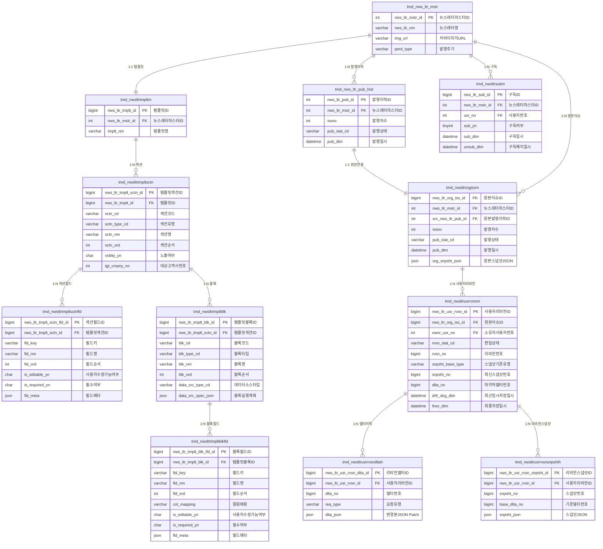

# 뉴스레터 v2 설계 개요
> 대상 독자: 기획, 프론트엔드, 운영
> 작성일: 2026-03-23
> 버전: v2-confluence-sync-2026-03-23

> 이 문서는 Confluence 공유용 요약본이다.
> API 계약 원본은 `docs/newsletter-v2-openapi.yaml`, 응답 shape 정본은 `docs/newsletter-snapshot-section-fields-api-contract.md`, 상태/전이 원본은 `docs/newsletter-v2-design.md`를 따른다.

---

## 1. 한 줄 요약

뉴스레터 v2는 **"템플릿(구조) → 발행 원본 스냅샷(동결) → 사용자 개인 리비전(delta + snapshot)"** 구조로 운영되며, 현재 canonical 응답은 **section-level field + block payload** 모델을 사용한다.

---

## 2. 핵심 개념 5가지

| 개념 | 한 줄 설명 | 언제 읽히나 |
|------|-----------|------------|
| **Template** | 뉴스레터 구조 정의. section / block / field와 블록별 `data_src_spec_json` 실행 계획을 가진다. | 관리자/백엔드가 템플릿을 구성할 때, preview 조립 시 |
| **Preview Snapshot** | `publishHistoryId`에 고정된 템플릿 버전과 실시간 데이터를 조합한 발행 전 미리보기 | 운영 검수, 발행 전 확인 |
| **Original Snapshot** | 발행 완료 시점에 동결된 원본 발행본 (`org_snpsht_json`) | 원본 상세 조회, 감사, 재현 |
| **User Revision** | 사용자별 개인 편집본. 원본 스냅샷 위에 delta를 누적하고 필요 시 revision snapshot을 저장한다. | 편집 화면, 임시저장/최종저장 |
| **Subscription** | 뉴스레터 마스터 단위 구독 상태. 오리지널 메일 발송 대상 결정에 사용된다. | 구독/구독해지, 발송 대상 조회 |

> 참고: 과거 issue state 물리 모델은 현재 활성 모델이 아니다. 로컬 테스트 DB 기준 `tmd_nwsltrorgisssctnstat`, `tmd_nwsltrorgissblkstat`는 제거되었고, 현재 구현은 template + publish context + resolved content 중심으로 동작한다.

---

## 3. 발행 흐름 (Publishing Flow)

```
[관리자 / 시스템]
    │
    ▼
① Template 정의
   └─ section / block / field 구조 + block별 data_src_spec_json 설정
    │
    ▼
② Preview Snapshot 조회
   └─ GET /publish-histories/{publishHistoryId}/snapshot
   └─ publishHistory에 고정된 template version + 실시간 데이터 조합
    │
    ▼
③ Publish
   └─ resolved content를 원본 스냅샷으로 동결 저장
   └─ newsletter_issue_original 생성/갱신
    │
    ▼
④ canonical 상세 조회
   └─ GET /{newsletterId}/{issueNo}?companyNo=
   └─ 내 revision이 있으면 revision snapshot, 없으면 original snapshot 반환
    │
    ▼
⑤ 원본 스냅샷 조회
   └─ GET /{newsletterId}/{issueNo}/original-snapshot?companyNo=
   └─ org_snpsht_json 원본만 고정 반환
```

---

## 4. 조회 모드 3가지

### 4-1. canonical 상세 조회
- **엔드포인트**: `GET /{newsletterId}/{issueNo}?companyNo=`
- **응답 타입**: `NewsletterDetailV2Res`
- **companyNo 용도**: 접근 제어와 tenant resolution
- **선택 규칙**: 요청 `companyNo` 기준 접근 검증 후, `ownerUserNo = actorUser.userNo`인 revision이 있으면 revision, 없으면 original 반환
- **snapshot 의미**: 응답의 `snapshot`은 "현재 사용자가 실제로 보게 되는 최신 본문"이다.
- **revision 상태 표현**: revision 정보는 `revision` 객체로 내려오며, `revisionId`, `editStatus`, `currentRevisionNo`, `hasDraft`, `draftRevisionNo`를 포함한다.

### 4-2. 원본 상세 조회 (Original Published View)
- **엔드포인트**: `GET /{newsletterId}/{issueNo}/original-snapshot?companyNo=`
- **응답 타입**: `NewsletterIssueOriginalSnapshotRes`
- **데이터 원천**: `org_snpsht_json`
- **목적**: 발행 이력 재현, 메일 원본 확인, 감사
- **특징**: 템플릿이나 원천 데이터가 바뀌어도 과거 발행본은 항상 동일하게 재현된다.

### 4-3. Preview Snapshot 조회
- **엔드포인트**: `GET /publish-histories/{publishHistoryId}/snapshot`
- **응답 타입**: `NewsletterIssuePreviewRes`
- **데이터 원천**: `publishHistory.nws_ltr_tmplt_id`에 고정된 template version + 실시간 데이터 동적 조합
- **목적**: 발행 전 검수, 운영 미리보기
- **특징**: 발행 전 상태이므로 데이터가 실시간으로 반영된다.

---

## 5. 블록 실행 모델 (Block Execution)

### 5-1. 블록 데이터 소스 타입 (`data_src_type_cd`)

| 타입 | 설명 | 예시 블록 |
|------|------|-----------|
| `STATIC` | 외부 DB 조회 없이 publish context 또는 master 값을 사용 | COVER_INFO, DATE_ISSUE_INFO, SUMMARY_BODY, FOOTER_NOTICE |
| `DYNAMIC_QUERY` | preference table 기준으로 표/본문 데이터 조회 | REFERENCE_TABLE |
| `CHART_SERIES` | 차트 데이터 조회 | NEWS_FLOW_CHART, REFERENCE_CHART |
| `NEWS_EVENT` | 발행 기준 뉴스 이벤트 조회 | NEWS_ITEM |

### 5-2. `data_src_spec_json` 구조

각 block은 `data_src_spec_json`에 실행 계획을 가진다. top-level key는 다음 5개로 고정한다.

```
locator         → 어디서 데이터를 가져올지
query           → 기본 조회 파라미터
assign          → resolver 결과를 어떤 fieldKey로 매핑할지
transform       → 결과 데이터 변환 규칙
overridePolicy  → 허용된 override 정책 메타
```

**`locator.kind` 허용값**

| kind | 설명 | 사용 타입 |
|------|------|----------|
| `INLINE` | 소스 조회 없음, 편집 입력만 사용 | STATIC |
| `PUBLISH_CONTEXT` | 발행 메타 값 참조 | STATIC |
| `PREFERENCE_TABLE` | preference table master 조회 | DYNAMIC_QUERY |
| `MAIN_CHART` | 메인 차트 조회 | CHART_SERIES |
| `DEDICATED_CHART` | 전용 차트 master 조회 | CHART_SERIES |
| `COLLECTION_CHART` | 수집 차트 master 조회 | CHART_SERIES |
| `NEWS_EVENT` | issue 기준 뉴스 이벤트 조회 | NEWS_EVENT |

### 5-3. 반복 block

- `NEWS_ITEM`은 template에는 1개 block 정의만 두고,
- preview / publish 시 `NEWS_EVENT` 조회 결과 개수만큼 snapshot block을 runtime-expanded 형태로 생성한다.
- 즉 템플릿은 block definition 1건, snapshot은 rendered block N건이 될 수 있다.

---

## 6. 현재 canonical section / block 구조

현재 응답 계약은 `section.name + section.fields + section.fieldDefs + blocks` 구조를 기본으로 사용한다.

```
COVER
  └─ blocks
     ├─ COVER_IMAGE_CARD  : imageBase64, showImage
     └─ COVER_INFO        : publishCycle, newsletterName, newsletterDescription

DATE_ISSUE
  └─ blocks
     └─ DATE_ISSUE_INFO   : publishDate, issueNo

TITLE_SPECIALIZED
  └─ blocks
     └─ TITLE_MAIN_SPECIALIZED : title, subtitle, priceChange 등

SUMMARY
  └─ blocks
     └─ SUMMARY_BODY      : summaryText

NEWS_FLOW
  ├─ section fields       : title, aggregationTime
  └─ blocks
     ├─ NEWS_FLOW_CHART   : timestamps, series
     └─ NEWS_ITEM[*]      : newsId, title, content, timestamp, source, originalUrl, showInChart, trend

REFERENCE1
  ├─ section fields       : title, description
  └─ blocks
     ├─ REFERENCE_CHART   : timestamps, series
     └─ REFERENCE_CONTENT : content

REFERENCE2
  ├─ section fields       : title, description
  └─ blocks
     ├─ REFERENCE_CHART   : timestamps, series
     └─ REFERENCE_CONTENT : content

REFERENCE3
  ├─ section fields       : title, description
  └─ blocks
     ├─ REFERENCE_TABLE   : rows / columns 등 table payload
     └─ REFERENCE_CONTENT : content

REFERENCE4
  ├─ section fields       : title, description
  └─ blocks
     ├─ REFERENCE_CHART   : timestamps, series
     └─ REFERENCE_CONTENT : content

FOOTER
  ├─ section fields       : footerContent
  └─ blocks
     └─ FOOTER_NOTICE     : showLogo 등 footer rendering 옵션
```

핵심 포인트:
- `COVER`는 예외적으로 section field로 올리지 않고 `2 block + 4 field` 구조를 유지한다.
- `NEWS_FLOW.title`, `NEWS_FLOW.aggregationTime`은 더 이상 chart block content가 아니라 section field다.
- `REFERENCE1~4`는 `REFERENCE_HEADER` block 대신 section fields(`title`, `description`)를 사용한다.
- `FOOTER.footerContent`도 section field로 본다.

---

## 7. 필드 값 우선순위

최종 렌더링 값은 아래 우선순위로 해석한다.

```
1순위: 사용자 revision snapshot / delta replay 결과
2순위: original snapshot에 동결된 값
3순위: preview 조립 시 template + publish context + live source에서 계산된 값
```

| 필드 예시 | 1순위 | 2순위 | 3순위 |
|-----------|-------|-------|-------|
| `NEWS_ITEM.originalUrl` | 사용자 수정본 | 발행 원본 snapshot | preview 시 NEWS_EVENT source |
| `SUMMARY.summaryText` | 사용자 수정본 | 발행 원본 snapshot | publish history AI 요약 기본값 |
| `NEWS_FLOW.fields.title` | 사용자 수정본 | 발행 원본 snapshot | section default / 운영 입력 |
| `DATE_ISSUE.publishDate` | 사용자 수정 없음 | 발행 원본 snapshot | publish context 발행일 |
| `COVER.imageBase64` | 사용자 수정 없음 | 발행 원본 snapshot | master 이미지 인코딩 |

---

## 8. 사용자 편집본 구조 (User Revision)

사용자는 원본 스냅샷을 기반으로 개인 편집본을 가진다. 정책은 **사용자별/이슈별 1개 revision**이다.

```
Original Snapshot
    │
    └─▶ User Revision (1인 1본)
             │
             ├─ Delta append (임시저장 / 최종저장 요청마다 누적)
             ├─ Draft 조회 시 snapshot + delta replay
             └─ 필요 시 Revision Snapshot 생성
```

저장 규칙:
- `PUT /revisions/draft`
  - revision이 없으면 자동 생성
  - `deltas`를 append 저장
  - 상태는 `EDIT_DRAFT`
- `PUT /revisions/save`
  - revision이 없으면 자동 생성
  - `deltas`를 append 저장
  - 상태는 `EDIT_SAVED`
  - `snapshotPayload`가 있을 때만 revision snapshot 저장

조회 규칙:
- `GET /revisions/draft`는 현재 사용자 기준 draft 최신 상태를 반환한다.
- `GET /revisions/{revisionId}/changes`와 `GET /revisions/{revisionId}/changes/{seq}`는 변경 이력 조회용이다.
- 충돌 제어는 `revisionNo` 기반 낙관적 락 규칙을 따른다.

---

## 9. 구독 및 메일 발송

### 9-1. 구독
- 뉴스레터 마스터 단위로 구독/구독해지
- 1인 1구독 레코드
- 재구독 시 row를 새로 만들지 않고 `sub_yn`, `sub_dtm`, `unsub_dtm`을 갱신한다.

### 9-2. 메일 발송
- 오리지널 발행 메일은 `POST /{newsletterId}/{issueNo}/trigger-mail`로 비동기 트리거한다.
- 현재 컨트롤러 기준 응답은 `202 Accepted`다.
- 편집본 메일 발송 `send-mail` 계약은 OpenAPI 요약에 존재하지만, 실제 운영 경로 정합성은 별도 구현 상태를 확인해야 한다.

---

## 10. API 엔드포인트 요약

기본 prefix: `/api/v1/mi/newsletter`

| 기능 | Method | 경로 | 설명 |
|------|--------|------|------|
| 상세 v2 조회 | GET | `/{newsletterId}/{issueNo}?companyNo=` | canonical 상세 조회, 응답은 `NewsletterDetailV2Res` |
| 원본 스냅샷 조회 | GET | `/{newsletterId}/{issueNo}/original-snapshot?companyNo=` | `org_snpsht_json` 원본 고정 조회 |
| preview snapshot 조회 | GET | `/publish-histories/{publishHistoryId}/snapshot` | 발행 전 미리보기 snapshot |
| revision flow 가이드 | GET | `/{newsletterId}/{issueNo}/revisions/flow` | FE 연동용 저장/조회 플로우 안내 |
| 수정 이력 목록 | GET | `/{newsletterId}/{issueNo}/revisions/{revisionId}/changes` | revision 변경 이력 목록 |
| 특정 수정 이력 조회 | GET | `/{newsletterId}/{issueNo}/revisions/{revisionId}/changes/{seq}` | 특정 seq replay 기준 조회 |
| draft 조회 | GET | `/{newsletterId}/{issueNo}/revisions/draft` | 내 임시저장 최신본 조회 |
| draft 저장 | PUT | `/{newsletterId}/{issueNo}/revisions/draft` | delta append + `EDIT_DRAFT` |
| 최종 저장 | PUT | `/{newsletterId}/{issueNo}/revisions/save` | delta append + `EDIT_SAVED`, 선택적으로 snapshot 저장 |
| 구독 | PUT | `/{newsletterId}/subscription` | 현재 사용자 구독 |
| 구독해지 | DELETE | `/{newsletterId}/subscription` | 현재 사용자 구독 해지 |
| 내 구독 상태 조회 | GET | `/{newsletterId}/subscription` | 현재 사용자 구독 상태 |
| 오리지널 메일 발송 트리거 | POST | `/{newsletterId}/{issueNo}/trigger-mail` | 비동기 메일 발송 시작, `202 Accepted` |

> 상세 request / response 스키마는 `docs/newsletter-v2-openapi.yaml`을 우선한다.

---

## 11. 기획자를 위한 데이터 책임 경계

| 질문 | 답변 |
|------|------|
| 발행 후 원본 데이터가 DB에서 바뀌면? | 발행 당시 original snapshot이 있으므로 원본 뷰는 영향 없다. |
| 템플릿 구조가 바뀌면 과거 발행본도 바뀌나? | 아니다. 과거 발행본은 snapshot으로 동결된다. |
| 사용자 편집본은 다른 사람도 볼 수 있나? | 아니다. revision은 사용자 개인 소유다. |
| revision은 여러 개 생기나? | 현재 정책은 `(original issue, owner user)` 기준 1인 1 revision이다. |
| NEWS_FLOW 제목/집계시간은 어디에 있나? | 현재 canonical 응답에서는 `NEWS_FLOW.section.fields`에 있다. |
| REFERENCE 제목/설명은 어디에 있나? | `REFERENCE1~4.section.fields.title`, `description`에 있다. |
| 구독 취소 후 재구독 시 이력이 남나? | 예. `sub_dtm`, `unsub_dtm`으로 시점 이력을 유지한다. |
| 편집 불가 필드는? | 차트 시계열, 원본 발행 메타, 일부 master 파생값 등 source-derived 필드가 기본적으로 이에 해당한다. |

---

## 12. 테이블 그룹 요약

```
[기존]
tmd_nws_ltr_mstr            ← 뉴스레터 마스터
tmd_nws_ltr_pub_hist        ← 기존 발행 이력

[Template 그룹]
tmd_nwsltrtmpltm            ← 템플릿 기본
tmd_nwsltrtmpltsctn         ← 템플릿 섹션
tmd_nwsltrtmpltsctnfld      ← 템플릿 섹션 필드
tmd_nwsltrtmpltblk          ← 템플릿 블록
tmd_nwsltrtmpltblkfld       ← 템플릿 블록 필드

[Original Issue 그룹]
tmd_nwsltrorgissm           ← 원본 이슈 마스터 (org_snpsht_json 보관)

[Legacy reference only - removed from current local DB]
tmd_nwsltrorgisssctnstat    ← 이슈 섹션 상태 초안 테이블
tmd_nwsltrorgissblkstat     ← 이슈 블록 상태 초안 테이블

[User Revision 그룹]
tmd_nwsltrusrrvsnm          ← 사용자 리비전 마스터
tmd_nwsltrusrrvsndltah      ← 리비전 델타 이력
tmd_nwsltrusrrvsnsnpshth    ← 리비전 스냅샷 이력

[Subscription]
tmd_nwsltrsubm              ← 구독 마스터
```

---

## 13. ERD (Entity Relationship Diagram)

아래 다이어그램을 Confluence Mermaid 매크로에 붙여넣으면 렌더링된다.



---

## 참고 문서

| 문서 | 위치 | 용도 |
|------|------|------|
| API 스펙 | `docs/newsletter-v2-openapi.yaml` | FE 연동, endpoint / schema 정본 |
| snapshot section field 계약 | `docs/newsletter-snapshot-section-fields-api-contract.md` | 응답 shape 정본 |
| Section / Block / Field 모델링 가이드 | `docs/newsletter-section-block-field-modeling-guide.md` | 화면 요소 배치 기준 |
| 물리 DDL 원본 세트 | `docs/newsletter-v2-ddl-canonical-index.md` | DB 반영 |
| 블록 실행 계획 스펙 | `docs/newsletter-v2-data-src-spec-contract.md` | block data source 계약 |
| 필드 ownership 매트릭스 | `docs/newsletter-template-v2-field-ownership-matrix.md` | 기본값 / 편집 가능 여부 |
| 상태값 / 에러코드 원본 | `docs/newsletter-v2-design.md` | 도메인 계약 원본 |
