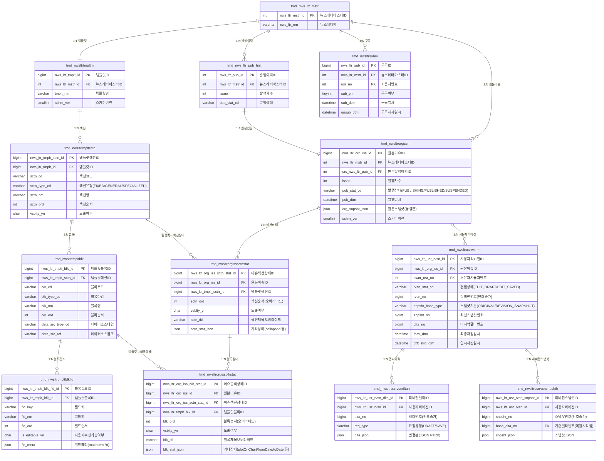

# 뉴스레터 v2 설계 개요
> 대상 독자: 기획, 프론트엔드
> 작성일: 2026-03-16
> 버전: v2-design-2026-03-16

---

## 1. 한 줄 요약

뉴스레터 v2는 **"템플릿(구조) → 발행 원본(동결) → 사용자 수정본(개인)"** 3계층으로 분리된 구조입니다.

---

## 2. 핵심 개념 4가지

| 개념 | 한 줄 설명 | 언제 읽히나 |
|------|-----------|------------|
| **Template** | 뉴스레터의 구조 설계도 (섹션/블록 배치, 데이터 소스 정책) | 관리자가 수정할 때, 발행 Preview 시 |
| **Issue State** | 이번 발행호에만 적용되는 가변 값 (노출 여부, 순서, 기간 파라미터 등) | 발행 전 Preview 조립 시 |
| **Original Snapshot** | 발행 완료 시점에 동결된 원본 완성본 (JSON 1건) | 원본 상세 조회 시 |
| **User Revision** | 사용자가 개인적으로 수정한 편집본 (임시저장/최종저장) | 사용자 편집 화면 |

> **핵심 규칙**: 발행된 원본을 보여줄 때는 **항상 Snapshot만** 읽습니다. Issue State는 발행 전 Preview에서만 사용합니다.

---

## 3. 발행 흐름 (Publishing Flow)

```
[관리자]
    │
    ▼
① Template 정의
   └─ 섹션 배치 / 블록 구성 / 데이터 소스 참조 설정
    │
    ▼
② Issue State 설정 (발행호별 가변값 입력)
   └─ 이번 호 노출 여부, 순서, 조회 기간(fromDate/toDate), 시장코드 등
    │
    ▼
③ Preview (동적 조합)
   └─ Template + Issue State + 실시간 데이터 → 미리보기 화면
    │
    ▼
④ 발행 (Publish)
   └─ Template + Issue State + 실제 데이터 → Original Snapshot 생성 및 동결
    │
    ▼
⑤ 원본 조회
   └─ Original Snapshot JSON만 읽음 (Template/State 불필요)
```

---

## 4. 조회 모드 2가지

### 4-1. 원본 상세 조회 (Original Published View)
- **데이터 원천**: `org_snpsht_json` (발행 완료 동결본)
- **목적**: 발행 이력 재현, 메일 원본 확인, 감사
- **특징**: 이후 템플릿이나 DB 원천 데이터가 바뀌어도 과거 발행본은 항상 동일하게 재현 가능

### 4-2. Preview / 편집 미리보기 (Issue Preview View)
- **데이터 원천**: Template + Issue State + 실시간 데이터 동적 조합
- **목적**: 발행 전 검수, 운영 미리보기
- **특징**: 발행 전 상태이므로 데이터가 실시간으로 반영됨

---

## 5. 사용자 편집본 구조 (User Revision)

사용자가 원본을 기반으로 개인 편집본을 만들 수 있습니다.

```
Original Snapshot (원본)
    │
    └─▶ User Revision (사용자 편집본, 1인 1본)
             │
             ├─ Delta 1 (임시저장)   ← JSON Patch 방식으로 변경분만 저장
             ├─ Delta 2 (임시저장)
             ├─ Delta 3 (최종저장)  ← 스냅샷 생성 시점
             │    └─ Revision Snapshot (복원 기준점)
             └─ Delta 4 (임시저장)
```

**저장 방식:**
- `DRAFT` (임시저장): Delta만 추가 (가벼운 저장)
- `SAVE` (최종저장): Delta 추가 + Revision Snapshot 생성 (복원 기준점 확보)

**복원 로직:**
1. 가장 최근 Revision Snapshot 로드
2. 그 이후 Delta를 순서대로 재적용 (JSON Patch replay)

---

## 6. 구독 기능

- 뉴스레터 마스터 단위로 구독/구독해지
- 구독자 목록은 발행 시 메일 발송 수신자로 활용
- 1인 1구독 레코드 (재구독 시 `sub_yn` 값만 변경, 이력은 `sub_dtm` / `unsub_dtm`으로 관리)

---

## 7. 프론트엔드 개발자를 위한 API 경로 요약

| 기능 | HTTP Method | 설명 |
|------|-------------|------|
| 원본 상세 조회 | `GET /api/v1/mi/newsletter/{issueId}/original` | Snapshot 기반 |
| 발행 전 Preview | `GET /api/v1/mi/newsletter/{issueId}/preview` | 동적 조합 |
| 사용자 편집본 조회 | `GET /api/v1/mi/newsletter/{issueId}/revision` | 내 편집본 |
| 임시저장 | `POST /api/v1/mi/newsletter/{issueId}/revision/draft` | Delta 저장 |
| 최종저장 | `POST /api/v1/mi/newsletter/{issueId}/revision/save` | Delta + Snapshot |
| 구독 | `POST /api/v1/mi/newsletter/{masterId}/subscribe` | |
| 구독해지 | `POST /api/v1/mi/newsletter/{masterId}/unsubscribe` | |

> 상세 Request/Response 스키마는 OpenAPI 문서(`docs/newsletter-v2-openapi.yaml`) 참고

---

## 8. 기획자를 위한 데이터 책임 경계

| 질문 | 답변 |
|------|------|
| 발행 후 원본 데이터가 DB에서 바뀌면? | 발행 당시 Snapshot이 있으므로 원본 뷰는 영향 없음 |
| 템플릿 구조가 바뀌면 과거 발행본도 바뀌나? | 아니요. 과거 발행본은 Snapshot으로 동결됨 |
| 사용자 편집본은 다른 사람도 볼 수 있나? | 아니요. 편집본은 1인 1본 개인 소유 |
| 구독 취소 후 재구독 시 이력이 남나? | 예. `sub_dtm`, `unsub_dtm`으로 시점 이력 보존 |
| Issue State는 언제 입력하나? | 발행 담당자가 발행 전 각 섹션/블록별로 입력 |
| `plotOnChart`는 무엇? | 특정 블록의 데이터를 차트 변곡점으로 표시할지 여부 |

---

## 9. 테이블 그룹 요약

```
[기존]
tmd_nws_ltr_mstr            ← 뉴스레터 마스터 (변경 없음)
tmd_nws_ltr_pub_hist        ← 기존 발행 이력 (유지, 신규 원본 마스터로 연결)

[신규 - Template 그룹]
tmd_nwsltrtmpltm            ← 템플릿 기본
tmd_nwsltrtmpltsctn         ← 템플릿 섹션
tmd_nwsltrtmpltblk          ← 템플릿 블록
tmd_nwsltrtmpltblkfld       ← 템플릿 블록 필드

[신규 - Original Issue 그룹]
tmd_nwsltrorgissm           ← 원본 이슈 마스터 (org_snpsht_json 보관)
tmd_nwsltrorgisssctnstat    ← 이슈 섹션 상태 (발행호별 섹션 가변값)
tmd_nwsltrorgissblkstat     ← 이슈 블록 상태 (발행호별 블록 가변값)

[신규 - User Revision 그룹]
tmd_nwsltrusrrvsnm          ← 사용자 리비전 마스터 (1인 1본)
tmd_nwsltrusrrvsndltah      ← 리비전 델타 이력 (변경분 누적)
tmd_nwsltrusrrvsnsnpshth    ← 리비전 스냅샷 (복원 기준점)

[신규 - Subscription]
tmd_nwsltrsubm              ← 구독 마스터
```

---

## 10. ERD (Entity Relationship Diagram)

아래 다이어그램을 Confluence Mermaid 매크로에 붙여넣기 하면 렌더링됩니다.



---

## 11. Issue State의 역할 (기획/FE 관점 요약)

```
발행 담당자가 설정하는 값들
────────────────────────────────────────
섹션 레벨:
  - 이번 호에서 이 섹션을 보여줄까? (vsblty_yn)
  - 섹션 순서를 바꿀까? (sctn_ord)
  - 섹션 제목을 다르게 쓸까? (sctn_titl)

블록 레벨:
  - 이번 호에서 이 블록을 보여줄까? (vsblty_yn)
  - 조회 기간은? (fromDate / toDate → blk_stat_json)
  - 시장 코드는? (market → blk_stat_json)
  - 차트에 변곡점 표시할까? (plotOnChart → blk_stat_json)
  - 최대 몇 건까지 보여줄까? (maxItems → blk_stat_json)
────────────────────────────────────────
이 값들 + 템플릿 구조 + 실제 데이터 → Preview / Snapshot 생성
```

---

## 참고 문서

| 문서 | 위치 | 용도 |
|------|------|------|
| API 스펙 (Request/Response 상세) | `docs/newsletter-v2-openapi.yaml` | FE 연동 |
| 물리 DDL 원본 세트 | `docs/newsletter-v2-ddl-canonical-index.md` | DB 반영 |
| 블록 Meta/Field 가이드 | `docs/newsletter-v2-block-meta-field-guideline.md` | 블록 구조 이해 |
| 상태값 상세 / 에러코드 | `docs/newsletter-v2-design.md` | 도메인 계약 원본 |
