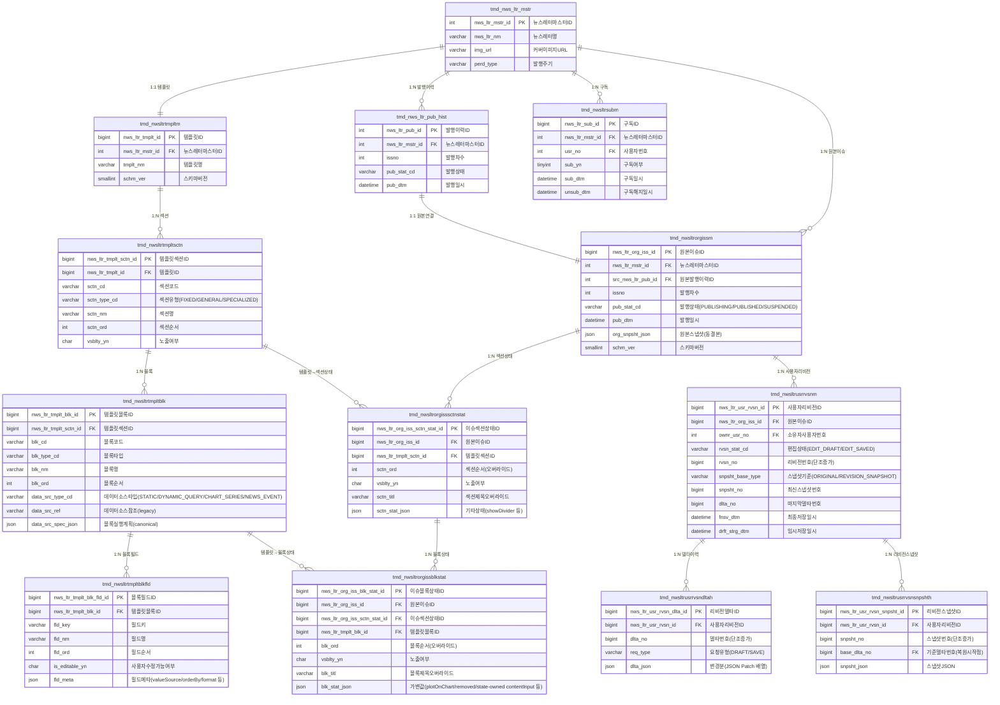

# 뉴스레터 v2 설계 개요
> 대상 독자: 기획, 프론트엔드
> 작성일: 2026-03-18
> 버전: v2-design-2026-03-18

---

## 1. 한 줄 요약

뉴스레터 v2는 **"템플릿(구조) → 발행 원본(동결) → 사용자 수정본(개인)"** 3계층으로 분리된 구조입니다.

---

## 2. 핵심 개념 4가지

| 개념 | 한 줄 설명 | 언제 읽히나 |
|------|-----------|------------|
| **Template** | 뉴스레터의 구조 설계도 (섹션/블록 배치, 데이터 소스 실행 스펙) | 관리자가 수정할 때, Preview 동적 조립 시 |
| **Issue State** | 이번 발행호에만 적용되는 가변 값 (노출 여부, 순서, 기간 파라미터 등) | 발행 전 Preview 조립 시, issue-state 저장 API |
| **Original Snapshot** | 발행 완료 시점에 동결된 원본 완성본 (JSON 1건) | 원본 상세 조회 시 |
| **User Revision** | 사용자가 개인적으로 수정한 편집본 (임시저장/최종저장) | 사용자 편집 화면 |

> **핵심 규칙**: 발행된 원본을 보여줄 때는 **항상 Snapshot만** 읽습니다. Issue State는 발행 전 Preview에서만 사용합니다.

---

## 3. 발행 흐름 (Publishing Flow)

```
[관리자]
    │
    ▼
① Template 정의
   └─ 섹션/블록 구성 + 블록별 data_src_spec_json 설정 (데이터 소스 실행 계획)
    │
    ▼
② Issue State 저장  PUT /{newsletterId}/{issueNo}/issue-state
   └─ 이번 호 노출 여부, 순서, 조회 기간(fromDate/toDate), state-owned 입력값 등
    │
    ▼
③ Preview 조회  GET /{newsletterId}/{issueNo}/preview
   └─ Template + Issue State + 실시간 데이터 → 미리보기 화면
    │
    ▼
④ 발행 (Publish)
   └─ Template + Issue State + 실제 데이터 → Original Snapshot 생성 및 동결
    │
    ▼
⑤ 원본 조회  GET /{newsletterId}/{issueNo}/original-snapshot
   └─ org_snpsht_json 만 반환 (Template/State 불필요)
```

---

## 4. 조회 모드 2가지

### 4-1. 원본 상세 조회 (Original Published View)
- **엔드포인트**: `GET /{newsletterId}/{issueNo}/original-snapshot`
- **데이터 원천**: `org_snpsht_json` (발행 완료 동결본)
- **목적**: 발행 이력 재현, 메일 원본 확인, 감사
- **특징**: 이후 템플릿이나 DB 원천 데이터가 바뀌어도 과거 발행본은 항상 동일하게 재현 가능

### 4-2. Preview (Issue Preview View)
- **엔드포인트**: `GET /{newsletterId}/{issueNo}/preview`
- **데이터 원천**: Template + Issue State + 실시간 데이터 동적 조합
- **목적**: 발행 전 검수, 운영 미리보기
- **특징**: 발행 전 상태이므로 데이터가 실시간으로 반영됨

---

## 5. 블록 실행 모델 (Block Execution)

### 5-1. 블록 타입 4종 (`data_src_type_cd`)

| 타입 | 설명 | 예시 블록 |
|------|------|-----------|
| `STATIC` | 외부 DB 조회 없이 publish context 또는 편집 입력만 사용 | COVER_INFO, DATE_ISSUE_INFO, SUMMARY_BODY, REFERENCE_HEADER |
| `DYNAMIC_QUERY` | preference table 기준으로 쿼리 실행 | REFERENCE_TABLE |
| `CHART_SERIES` | 차트 데이터 조회 | NEWS_FLOW_CHART, REFERENCE_CHART |
| `NEWS_EVENT` | 발행 기준 뉴스 이벤트 조회 | NEWS_ITEM |

### 5-2. `data_src_spec_json` 구조 (블록 실행 계획)

각 블록은 `data_src_spec_json`에 실행 계획을 가집니다. top-level key는 다음 5개로 고정됩니다.

```
locator    → 어디서 데이터를 가져올지 (데이터 소스 종류)
query      → 기본 조회 파라미터 (fromDate, toDate 등)
assign     → resolver 결과를 어떤 fieldKey로 매핑할지
transform  → 결과 데이터에 적용할 변환 규칙
overridePolicy → Issue State가 override 가능한 값의 whitelist
```

**`locator.kind` 허용값:**

| kind | 설명 | 사용 타입 |
|------|------|----------|
| `INLINE` | 소스 조회 없음, 편집 입력만 사용 | STATIC |
| `PUBLISH_CONTEXT` | 발행 메타 값 참조 (발행일, 차수 등) | STATIC |
| `PREFERENCE_TABLE` | preference table master 조회 | DYNAMIC_QUERY |
| `MAIN_CHART` | 메인 차트 조회 | CHART_SERIES |
| `DEDICATED_CHART` | 전용 차트 master 조회 | CHART_SERIES |
| `COLLECTION_CHART` | 수집 차트 master 조회 | CHART_SERIES |
| `NEWS_EVENT` | issue 기준 뉴스 이벤트 조회 | NEWS_EVENT |

**예시 (NEWS_ITEM 블록):**
```json
{
  "locator": { "kind": "NEWS_EVENT" },
  "query": {},
  "assign": {
    "fields": [
      { "fieldKey": "newsId", "sourcePath": "newsId", "required": false },
      { "fieldKey": "title", "sourcePath": "title", "required": true },
      { "fieldKey": "content", "sourcePath": "content", "required": true },
      { "fieldKey": "timestamp", "sourcePath": "timestamp", "required": false },
      { "fieldKey": "createdDate", "sourcePath": "createdDate", "required": true },
      { "fieldKey": "createTime", "sourcePath": "createTime", "required": false },
      { "fieldKey": "source", "sourcePath": "source", "required": false },
      { "fieldKey": "originalUrl", "sourcePath": "originalUrl", "required": false },
      { "fieldKey": "showInChart", "sourcePath": "showInChart", "required": false },
      { "fieldKey": "trend", "sourcePath": "trend", "required": false }
    ]
  },
  "transform": [],
  "overridePolicy": {
    "issueState": {
      "query": [],
      "state": [],
      "contentInput": []
    }
  }
}
```

### 5-3. `overridePolicy`의 의미 (기획/FE 관점)

Issue State에서 설정 가능한 값의 범위는 **template의 `overridePolicy`가 허용한 것만** 가능합니다.

| 구분 | 의미 |
|------|------|
| `issueState.query` | 이번 호 조회 파라미터 override 가능 목록 (fromDate, toDate 등) |
| `issueState.state` | 블록 옵션 override 가능 목록 (plotOnChart, removed 등) |
| `issueState.contentInput` | state가 직접 소유하는 editable field subset 목록 |

`NEWS_ITEM`은 예외적으로 issue state override를 사용하지 않고, `NEWS_EVENT` 조회 결과를 runtime-expanded snapshot block으로 직접 확장합니다. `originalUrl`도 issue state가 아니라 snapshot/revision edit 대상입니다.

---

## 6. 실제 섹션/블록 구조

현재 확정된 뉴스레터 섹션 구성입니다.

```
COVER
  └─ COVER_IMAGE_CARD   : 커버 이미지 (master 이미지 자동 로드, showImage 편집 가능)
  └─ COVER_INFO         : 뉴스레터 기본 정보 (발행 주기, 이름, 설명 — master 기반, 수정 불가)

DATE_ISSUE
  └─ DATE_ISSUE_INFO    : 발행일, 발행 차수 (publish context 기반, 수정 불가)

TITLE_SPECIALIZED
  └─ TITLE_MAIN_SPECIALIZED : 제목, 부제목, 가격 변동 (편집 가능)

SUMMARY
  └─ SUMMARY_BODY       : AI 요약문 (기본값: AI 생성, 편집 가능)

NEWS_FLOW
  └─ NEWS_FLOW_CHART    : Brent 유가 추이 차트 (차트 자동, title/aggregationTime 편집 가능)
  └─ NEWS_ITEM          : 뉴스 이벤트 목록 (반복 블록, 1..N개)

REFERENCE1
  └─ REFERENCE_HEADER   : 참조1 헤더 (제목/설명 편집 가능)
  └─ REFERENCE_CHART    : WTI·달러인덱스 차트 (차트 자동, timestamps/series 출력)
  └─ REFERENCE_CONTENT  : 참조1 본문 (편집 가능, 기본값 없음)

REFERENCE2
  └─ REFERENCE_HEADER   : 참조2 헤더 (편집 가능)
  └─ REFERENCE_CHART    : WTI·S&P500 차트 (collection chart WTI_SNP500 기반, timestamps/series 출력)
  └─ REFERENCE_CONTENT  : 참조2 본문 (편집 가능)

REFERENCE3
  └─ REFERENCE_HEADER   : 참조3 헤더 (제목 기본값 "유가 추이", 편집 가능)
  └─ REFERENCE_TABLE    : 유가 추이 테이블 (preference table OIL_PRC_TRND 기반, 수정 불가)
  └─ REFERENCE_CONTENT  : 참조3 본문 (편집 가능)

REFERENCE4
  └─ REFERENCE_HEADER   : 참조4 헤더 (편집 가능)
  └─ REFERENCE_CHART    : 국채금리·스프레드 차트 (collection chart GOV10_2SPRD 기반, timestamps/series 출력)
  └─ REFERENCE_CONTENT  : 참조4 본문 (편집 가능)

FOOTER
  └─ FOOTER_NOTICE      : 풋터 (showLogo 편집 가능, footerContent 편집 가능)
```

> **반복 블록(Repeatable Block)**: `NEWS_ITEM`은 동일 template block 1건만 정의하고, preview/publish 시 `NEWS_EVENT` 조회 결과 개수만큼 snapshot block을 동적으로 생성합니다.

---

## 7. 필드 값 우선순위 3단계

모든 필드의 최종값은 아래 우선순위로 조립됩니다.

```
1순위: 사용자 편집 delta/snapshot 값
2순위: Issue State 값  (state 소유 필드에만 해당)
3순위: Template 기본값 또는 소스 파생값 (publish context, master 등)
```

| 필드 예시 | 1순위 | 2순위 | 3순위 |
|-----------|-------|-------|-------|
| NEWS_ITEM `originalUrl` | 사용자 수정 snapshot | — (issue state 비소유) | source 기본값 없음 |
| SUMMARY `summaryText` | 사용자 수정 | — (state 비소유) | publish history AI 요약 |
| DATE_ISSUE `publishDate` | — | — | publish context 발행일 (고정) |
| COVER `imageBase64` | — | — | master 이미지 자동 인코딩 (고정) |

---

## 8. 사용자 편집본 구조 (User Revision)

사용자가 원본을 기반으로 개인 편집본을 만들 수 있습니다.

```
Original Snapshot (원본)
    │
    └─▶ User Revision (사용자 편집본, 1인 1본)
             │
             ├─ Delta 1 (임시저장)   ← JSON Patch 방식으로 변경분만 저장
             ├─ Delta 2 (임시저장)
             ├─ Delta 3 (최종저장)  ← Revision Snapshot 생성 시점
             │    └─ Revision Snapshot (복원 기준점)
             └─ Delta 4 (임시저장)
```

**저장 방식:**
- `DRAFT` (임시저장): Delta만 추가 (가벼운 저장)
- `SAVE` (최종저장): Delta 추가 + Revision Snapshot 생성 (복원 기준점 확보)

**복원 로직:**
1. 가장 최근 Revision Snapshot 로드
2. 그 이후 Delta를 순서대로 재적용 (JSON Patch replay)

---

## 9. 구독 기능

- 뉴스레터 마스터 단위로 구독/구독해지
- 구독자 목록은 발행 시 메일 발송 수신자로 활용
- 1인 1구독 레코드 (재구독 시 `sub_yn` 값만 변경, 이력은 `sub_dtm` / `unsub_dtm`으로 보존)

---

## 10. API 엔드포인트 요약

| 기능 | Method | 경로 | 설명 |
|------|--------|------|------|
| 뉴스레터 상세 (v2) | GET | `/{newsletterId}/{issueNo}?companyNo=` | snapshot 기반 상세 조회 |
| 원본 스냅샷 조회 | GET | `/{newsletterId}/{issueNo}/original-snapshot?companyNo=` | `org_snpsht_json` 직접 반환 |
| Preview 조회 | GET | `/{newsletterId}/{issueNo}/preview` | Issue State 기반 동적 조합 |
| Issue State 저장 | PUT | `/{newsletterId}/{issueNo}/issue-state` | section/block state upsert |
| 사용자 편집본 조회 | GET | `/{issueId}/revision` | 내 편집본 |
| 임시저장 | POST | `/{issueId}/revision/draft` | Delta 저장 |
| 최종저장 | POST | `/{issueId}/revision/save` | Delta + Snapshot |
| 구독 | POST | `/{masterId}/subscribe` | |
| 구독해지 | POST | `/{masterId}/unsubscribe` | |

> 상세 Request/Response 스키마는 OpenAPI 문서(`docs/newsletter-v2-openapi.yaml`) 참고

기본 prefix: `/api/v1/mi/newsletter`

---

## 11. 기획자를 위한 데이터 책임 경계

| 질문 | 답변 |
|------|------|
| 발행 후 원본 데이터가 DB에서 바뀌면? | 발행 당시 Snapshot이 있으므로 원본 뷰는 영향 없음 |
| 템플릿 구조가 바뀌면 과거 발행본도 바뀌나? | 아니요. 과거 발행본은 Snapshot으로 동결됨 |
| 사용자 편집본은 다른 사람도 볼 수 있나? | 아니요. 편집본은 1인 1본 개인 소유 |
| 구독 취소 후 재구독 시 이력이 남나? | 예. `sub_dtm`, `unsub_dtm`으로 시점 이력 보존 |
| Issue State는 언제 입력하나? | 발행 담당자가 발행 전 issue-state API로 저장 |
| `plotOnChart`는 무엇? | 특정 블록의 데이터를 차트 변곡점으로 표시할지 여부 (NEWS_ITEM 블록 전용) |
| 관리자가 섹션/블록을 추가할 수 있나? | 템플릿 관리 API를 통해 가능. 섹션 타입: FIXED(시스템 고정) / GENERAL(기본) / SPECIALIZED(특화) |
| 편집 불가 필드는? | 커버 이미지, 발행일, 발행 차수, AI 요약 기본값, 차트 데이터 등 소스 파생값 |

---

## 12. 테이블 그룹 요약

```
[기존]
tmd_nws_ltr_mstr            ← 뉴스레터 마스터 (변경 없음)
tmd_nws_ltr_pub_hist        ← 기존 발행 이력 (유지, 신규 원본 마스터로 연결)

[신규 - Template 그룹]
tmd_nwsltrtmpltm            ← 템플릿 기본
tmd_nwsltrtmpltsctn         ← 템플릿 섹션 (sctn_type_cd: FIXED/GENERAL/SPECIALIZED)
tmd_nwsltrtmpltblk          ← 템플릿 블록 (data_src_type_cd + data_src_spec_json)
tmd_nwsltrtmpltblkfld       ← 템플릿 블록 필드 (is_editable_yn, fld_meta)

[신규 - Original Issue 그룹]
tmd_nwsltrorgissm           ← 원본 이슈 마스터 (org_snpsht_json 보관)
tmd_nwsltrorgisssctnstat    ← 이슈 섹션 상태 (발행호별 섹션 가변값)
tmd_nwsltrorgissblkstat     ← 이슈 블록 상태 (발행호별 블록 가변값, blk_stat_json)

[신규 - User Revision 그룹]
tmd_nwsltrusrrvsnm          ← 사용자 리비전 마스터 (1인 1본)
tmd_nwsltrusrrvsndltah      ← 리비전 델타 이력 (JSON Patch 누적)
tmd_nwsltrusrrvsnsnpshth    ← 리비전 스냅샷 (복원 기준점)

[신규 - Subscription]
tmd_nwsltrsubm              ← 구독 마스터
```

---

## 13. ERD (Entity Relationship Diagram)

아래 다이어그램을 Confluence Mermaid 매크로에 붙여넣기 하면 렌더링됩니다.



---

## 참고 문서

| 문서 | 위치 | 용도 |
|------|------|------|
| API 스펙 (Request/Response 상세) | `docs/newsletter-v2-openapi.yaml` | FE 연동 |
| 물리 DDL 원본 세트 | `docs/newsletter-v2-ddl-canonical-index.md` | DB 반영 |
| 블록 실행 계획 스펙 (`data_src_spec_json`) | `docs/newsletter-v2-data-src-spec-contract.md` | 블록 데이터 소스 계약 |
| 섹션/블록/필드 소유권 매트릭스 | `docs/newsletter-template-v2-field-ownership-matrix.md` | 필드별 기본값/편집 가능 여부 |
| 상태값 상세 / 에러코드 | `docs/newsletter-v2-design.md` | 도메인 계약 원본 |
