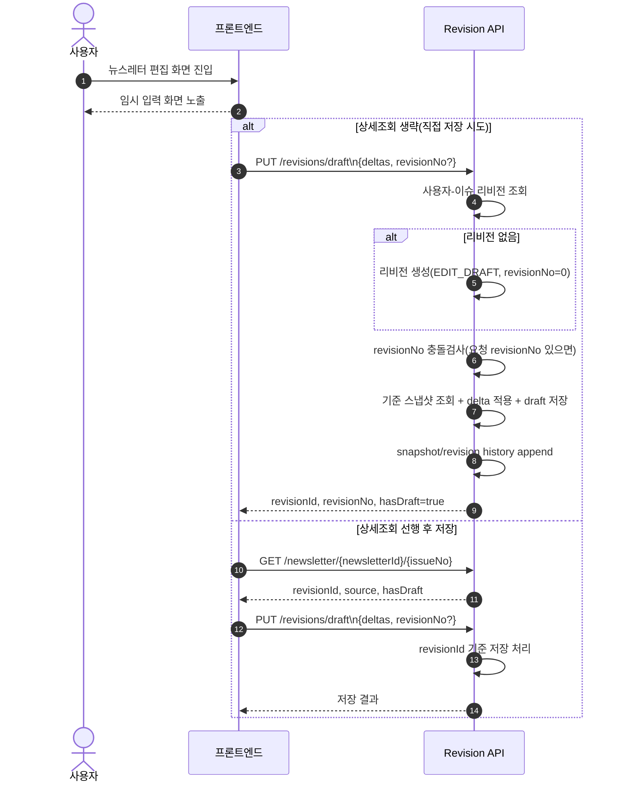

# Newsletter v2 설계 문서

## 문서 목적
- 본 문서는 `Newsletter v2`의 합의된 설계 결과를 정리한 공유 문서다.
- 대상 독자: 백엔드, 프론트엔드, 기획.
- 이 문서는 대화와 함께 계속 업데이트하는 Living Document로 사용한다.

## Contract Sync Checklist
- OpenAPI version: `1.0.0` (`docs/newsletter-v2-openapi.yaml`)
- Canonical DDL version: `ddl-canonical-2026-03-12-r2` (`docs/newsletter-v2-ddl-canonical-index.md`)
- Last synced at (KST): `2026-03-12 21:40`
- Sync owner: `BE`

## 배경
- 기존 뉴스레터 상세는 템플릿/타 테이블 데이터 조합 기반 조회 중심이었다.
- v2에서는 발행 시점 원본을 보존하고, 사용자 수정본과 수정 이력을 저장/조회하는 구조로 전환한다.

## 목표 범위
- 오리지널 발행 상태 관리
- 사용자 개인 리비전본(수정/임시저장/최종저장)
- 구독/구독해지
- 오리지널 구독자 메일 발송은 배치 처리
- 사용자 편집본 기반 메일 발송(필요 시 이미지 포함) 및 사용자 지정 수신자 발송
- 뉴스레터 구성 구조 고도화: Section/Block 기반 템플릿 편집 모델

## 실행 스레드 문서
- 스레드 1 (도메인/상태 확정): `docs/newsletter-v2-thread-1.md`
- 스레드 2 (DB 스키마/제약 확정): `docs/newsletter-v2-thread-2.md`
- 스레드 3 (구독/구독해지 API): `docs/newsletter-v2-thread-3.md`
- 스레드 4 (Revision 저장 플로우): `docs/newsletter-v2-thread-4.md`

## 문서 거버넌스 (Source of Truth)
| 계약 범주 | 원본 문서(SoT) | 하위/파생 문서 규칙 |
|---|---|---|
| 도메인 상태값/전이/에러코드 | `docs/newsletter-v2-design.md` | 요약 문서는 원문을 재정의하지 않고 참조 링크만 유지 |
| API 스펙/필드 타입/요청-응답 스키마 | `docs/newsletter-v2-openapi.yaml` | Living Doc/Thread에는 정책 설명만 두고 스키마는 OpenAPI를 참조 |
| 물리 스키마/DDL 반영 절차 | `docs/newsletter-v2-ddl-canonical-index.md` + DBA 반영 SQL(최종) | 설계 문서에는 테이블 책임/제약 의도만 유지 |
| 실행 단위 범위/검증/오픈이슈 | `docs/newsletter-v2-thread-*.md` | 계약 본문을 복제하지 않고 해당 스레드의 검증/결정 상태만 기록 |
| 구현 결과/리스크/후속 조치 | `docs/work-notes/YYYY/*.md` | Living Doc에는 완료 사실 링크만 남기고 상세 변경내역은 Work Note로 일원화 |

## 문서 역할 분리 원칙
- Living Doc: 무엇을 만들지(도메인 규칙/합의 계약)만 유지
- Thread Doc: 이번 실행 단위에서 무엇을 검증/결정할지와 게이트 상태를 유지
- OpenAPI: API 계약의 유일한 스키마 원본
- Work Note: 실제로 무엇을 바꿨는지/리스크/다음 액션을 기록
- 상세 거버넌스 규칙: `docs/conventions/newsletter-doc-governance.md`

## 용어 표준화 (Canonicalization)
- 명칭 매핑 단일 원본: `docs/newsletter-v2-field-mapping.md`
- `revisionSeq`는 구용어이며 신규 문서/구현에서 사용하지 않는다.
- API 계약 필드는 OpenAPI를 원본으로 하며, 내부 저장 키(`snpsht_no`, `base_dlta_no`, `dlta_no`)는 매핑 문서에서 관리한다.

## 뉴스레터 템플릿 구성 모델

### 기존 구성(참조)
- 제목 부분, 메인 영역, 참고 영역으로 나뉘어 표시
- 제목 부분: 프론트 고정 틀에서 텍스트/이미지를 응답값 기반으로 렌더링
- 메인 영역: 정해진 템플릿 틀에 응답값 기반 데이터 바인딩
- 참고 영역: `tmd_nws_ltr_tmplt`( `nws_ltr_tmplt_id` )의 `elementType` 등을 기반으로 차트/표를 동적으로 렌더링

### 신규 구성 모델 (v2)
- 구성 기본 단위: `Section` (오렌지)
  - 섹션은 뉴스레터 화면을 구성하는 상위 블록 단위
  - Collapse/Expand 지원
  - 필수값 미입력 시 실시간 경고(Live update) 노출
- 구성 하위 단위: `Block` (그린)
  - `Section` 내부에서 실제 데이터 렌더링을 담당
  - Collapse/Expand 지원
  - 필수값 미입력 시 실시간 경고(Live update) 노출

### Section 분류
- `FIXED`: 뉴스레터 커버/타이틀/일자/이슈/푸터 등 고정 구조 (Pre-defined)
- `GENERAL`: 관리자 커스텀으로 생성/운영되는 일반형
- `SPECIALIZED`: 특정 고객사 대상 특화형(예: SKE, SKHy)
  - `target` 속성에 대상 고객사 명시

### Block 분류
- `GENERAL`: 관리자 커스텀으로 생성되는 일반형 블록
- `SPECIALIZED`: 특정 고객사 대상 특화형 블록(예: SKE, SKHy)
  - `target` 속성에 대상 고객사 명시
- 형태(타입)는 향후 추가되는 방향으로 확장 가능

### Section/Block 생성 및 편집 규칙
- 섹션 추가: 화면 하단의 `섹션 추가` 액션으로 생성
- 블록 추가: 각 섹션의 `블록 추가` 액션으로 생성
- 기존 섹션/블록은 원칙적으로 수정/삭제 가능(운영/정책상 예외 허용)
- 에디터는 좌측 편집 영역에서 `Section`/`Block` 강조, 우측은 즉시 반영(참조)

### Section/Block Tool 기능(편집 툴)
- `Order`: 섹션 및 블록의 배치 순서를 사용자 지정 가능
- `Visibility`: 노출/비노출(`true/false`)을 항목별로 제어
- `Plot on Chart`: 블록이 차트 상단의 변곡점 표시를 갖는지 제어
- `Delete`: 해당 섹션 또는 블록 삭제

### 상태/권한 반영
- `Section`/`Block`의 생성/수정/삭제는 편집 API와 연결되어 리비전(`revisionId`) 저장 대상으로 취급
- 스냅샷(리비전) 저장 시 `Section` 트리와 `Block` 속성까지 함께 저장
- 오직 소유자(또는 권한자)만 편집 가능, 읽기/메일은 기존 리비전 가드(소유권 + 상태) 적용

## 콘텐츠 모델 상태
- `ORIGINAL`은 기존 회차 템플릿의 고정/동적 구성과 별개로 `Publish` 상태 관리와 동기화
- `REVISION`은 `Section`/`Block` 트리 단위로 저장/복원되어야 함
- `tmd_nws_ltr_tmplt` 기반 렌더링은 `SPECIALIZED` 또는 `GENERAL` 타입 매핑으로 대체/보완해 점진 이관

## 용어 정의
- Original: Airflow로 생성/발행되는 원본 뉴스레터 회차
- Revision: 사용자가 Original을 기반으로 만든 개인 수정본
- RevisionSnapshot: Revision 저장 시점 스냅샷 이력

## 상태 모델

### 1) Originals (`NewsletterPublishHistory.publishStatusCode` 재사용)
- `PUBLISHING`: 생성/발행 처리 중
- `PUBLISHED`: 발행 완료 (회차별 모두 조회 가능)
- `SUSPENDED`: 관리자 숨김/중단 (기본 목록 제외)

### 2) Revisions (신규)
- `EDIT_DRAFT`: 수정 중/임시저장 상태
- `EDIT_SAVED`: 최종 저장 상태 (send-mail 가능)
- 사용자별/이슈별 리비전은 1건(UNIQUE)만 유지한다. 임시저장은 반복 저장 시 기존 임시저장본을 덮어써서 최신 1개만 유지한다.

## 상태 전이 규칙

### Originals
- `PUBLISHING -> PUBLISHED`
- `PUBLISHED -> SUSPENDED` (선택적 관리자 액션)
- 필요 시 운영 정책으로 `SUSPENDED -> PUBLISHED` 복구 허용 가능

### Revisions
- `None -> EDIT_DRAFT`: 사용자 최초 저장(임시/최종) 시 개인 리비전 자동 생성
- `EDIT_DRAFT -> EDIT_DRAFT`: 임시저장 반복
- `EDIT_DRAFT -> EDIT_SAVED`: 최종 저장
- `EDIT_SAVED -> EDIT_DRAFT`: 저장 후 재수정 시작

## 스레드 1 상태 확정본 (도메인 기준 v1.0)

### 1) 상태값 정의
- Originals: `PUBLISHING`, `PUBLISHED`, `SUSPENDED`
- Revisions: `EDIT_DRAFT`, `EDIT_SAVED`

### 2) 상태 전이 허용표

#### Originals
| From | To | 조건 | 권한 |
|---|---|---|---|
| null(생성 전) | PUBLISHING | 발행 등록/생성 시 | 시스템/배치 |
| PUBLISHING | PUBLISHED | 발행 완료 이벤트 | 시스템/배치 |
| PUBLISHED | SUSPENDED | 관리자 운영 액션 | ADMIN |
| SUSPENDED | PUBLISHED | 운영 복구 액션 | ADMIN |

#### Revisions
| From | To | 조건 | 권한 |
|---|---|---|---|
| None | EDIT_DRAFT | 최초 임시저장/최종저장 호출 시 리비전 생성 | 소유자 |
| EDIT_DRAFT | EDIT_DRAFT | 임시저장 반복 | 소유자 |
| EDIT_DRAFT | EDIT_SAVED | 최종 저장 API | 소유자 |
| EDIT_SAVED | EDIT_DRAFT | 최종 저장 이후 추가 임시저장(재수정 시작) | 소유자 |

### 3) 상태 가드(동작 가능 조건)
- Originals
- Revisions
- 메일 발송: `EDIT_SAVED`만 허용
- 미허용 상태에서 호출 시 `REVISION_INVALID_STATE` + `422`

### 4) 접근 가드
- 리비전 조회/수정/발송은 `ownr_usr_no == actor_user_no`일 때만 허용
- 미일치 시 `REVISION_FORBIDDEN` + `403`
- 낙관적 락(`revisionNo`, 변경시퀀스) 불일치 시 `REVISION_VERSION_CONFLICT` + `409`

### 5) 상태/도메인 에러 매핑
- `NEWSLETTER_NOT_FOUND` (404): 원본마스터/이슈 없음
- `REVISION_NOT_FOUND` (404): 내 리비전이 존재하지 않음
- `REVISION_FORBIDDEN` (403): 타인 리비전 접근 또는 수정/발송
- `REVISION_INVALID_STATE` (422): `EDIT_SAVED` 이전 상태에서 저장본 메일 호출
- `REVISION_VERSION_CONFLICT` (409): 변경시퀀스(`revisionNo`) 충돌

## 핵심 도메인 규칙
- 리비전 소유권: 본인 외 조회/수정/발송 금지
- 상태 가드: 메일 발송은 `EDIT_SAVED`에서만 허용
- 충돌 제어: `revisionNo`(변경시퀀스) 기반 낙관적 락 (`409 Conflict`)
- 멱등 생성: `(nws_ltr_org_iss_id, ownr_usr_no)` 유니크로 1인 1리비전 보장

## 도메인 일관성 경계 (트랜잭션 경계)

### 1) NewsletterOriginal
- 책임: 회차별 발행 상태, 원본 콘텐츠 보존, 발행 시각

### 2) NewsletterRevision
- 책임: 개인 수정 콘텐츠, 임시/최종 저장 상태, 버전 관리, 수정 이력
- 제약: `ownr_usr_no` 기반 엄격한 접근 제어

### 3) NewsletterSubscription
- 책임: 사용자-뉴스레터마스터 기준 구독 여부 관리

## Revision 서브도메인 구현 단위 정리

- `RevisionCore`
  - 역할: 리비전 라이프사이클의 비즈니스 뇌
  - 책임
    - 리비전 생성/조회 시 고유 보장: `(nws_ltr_org_iss_id, ownr_usr_no)` 단일성 정책
    - 상태 전이: `EDIT_DRAFT`, `EDIT_SAVED` 허용 전이/차단
    - 소유권/권한 가드: `ownr_usr_no == actor_user_no`
    - 저장 가드: 요청 타입(`AUTOSAVE`/`FINAL`)별 제약 위반 여부 판단
    - 동시성 가드: 요청 `revisionNo` 검증을 통한 `REVISION_VERSION_CONFLICT` 판정
  - 입력/출력
    - 입력: `revisionId?`, `actorUserNo`, `revisionNo?`, `deltas`, 요청 타입(draft/save)
    - 출력: `revisionId`, `revisionNo`, `editStatus`, 스냅샷 저장 필요 여부

- `RevisionSnapshotStore`
  - 역할: 리비전 상태 및 스냅샷의 영속 책임 분리
  - 책임
    - `newsletter_user_revision` 테이블의 메타(`rvsn_no`, `rvsn_stat_cd`, 타임스탬프) 저장
    - `rvsn_no` 증가 정책(저장 시 +1) 및 반환 값 정합성 보장
    - `newsletter_user_revision_snapshot` 저장/조회(`AUTOSAVE`, `FINAL`)와 유일성 제약 관리
    - 조회 시 `is_deleted`/멱등성 조건 적용한 최신 상태 산출
  - 입력/출력
    - 입력: revisionId, patch 적용 결과, revisionNo, 요청 타입
    - 출력: 현재 리비전 상태, 최신 스냅샷, `isDeleted` 포함 메타

- `RevisionDiffService`
  - 역할: 델타 누적/재생성 규칙의 엔진
  - 책임
    - 요청 `deltas` 정규화/검증(JSON Patch 규격 준수)
    - 기준 스냅샷에 델타를 순차 적용해 신규 상태 계산
    - `GET .../changes/{seq}` 응답용 `baseSnapshot`, `histories`, `fromSeq/toSeq` 구성
    - `deltaCount`, `deltaChanges`, `recentHistoryFromSeq`, `nextHistorySeq` 계산
  - 입력/출력
    - 입력: 현재 본문, 변경 이력 범위, 기준 스냅샷
    - 출력: 반영된 본문, 변경량 구간, 재생성 규칙에 맞는 응답 DTO

- 호출 관계(권장)
  - API Controller -> `RevisionCore` -> (`RevisionSnapshotStore`, `RevisionDiffService`)
  - 저장 API는 `RevisionCore`에서 상태/권한/락 판정 후, `RevisionDiffService`로 델타 반영 및 `RevisionSnapshotStore`로 영속화
  - 조회 API는 `RevisionCore`에서 조회 권한/기본 상태 확인 후 `RevisionSnapshotStore`(현재 상태) + `RevisionDiffService`(변경량 계산)로 조합 응답

## 비즈니스 흐름

### A. 오리지널 발행
1. Airflow가 오리지널 생성/발행
2. 상태 전이: `PUBLISHING -> PUBLISHED`
3. 오리지널 콘텐츠를 이미지(PNG)로 생성
4. 구독자 대상 오리지널 메일 발송은 배치 처리로 분기

### B. 사용자 개인 수정/발송
1. 사용자가 오리지널 기반 편집 화면 진입
2. 임시저장 반복 (`EDIT_DRAFT`)
3. 최종 저장 (`EDIT_SAVED`)
4. 메일보내기 클릭 시 수신자 이메일 입력
5. 저장된 리비전본을 이미지(PNG)로 생성해 입력한 주소로 발송

## 데이터 스키마 초안

### 1) `newsletter_issue_original` (신규 권장)
- `id` (PK)
- `nws_ltr_mstr_id`
- `issno`
- `pub_stat_cd`
- `pub_dtm`
- `org_snpsht_json`
- `schm_ver`
- `created_at`, `updated_at`

### 2) `newsletter_user_revision`
- `id` (PK)
- `nws_ltr_org_iss_id` (FK)
- `ownr_usr_no`
- `rvsn_stat_cd` (`EDIT_DRAFT`, `EDIT_SAVED`)
- `rvsn_no` (변경시퀀스, 1회 저장시 증가)
- `drft_strg_dtm`
- `fnsv_dtm`
- `created_at`, `updated_at`, `is_deleted`
- 제약: `UNIQUE(nws_ltr_org_iss_id, ownr_usr_no)`
- 본문은 `newsletter_user_revision`에 단일 본문 컬럼으로 고정 저장하지 않고, `snapshot + delta` 조합으로 복원한다.

### 3) `newsletter_user_revision_snapshot`
- `id` (PK)
- `nws_ltr_usr_rvsn_id` (FK)
- `snpsht_no` (스냅샷 번호, 리비전 내 단조 증가)
- `base_dlta_no` (스냅샷 복원 기준 델타 번호)
- `snpsht_json`
- `change_summary` (optional)
- `edited_by`
- `edited_at`
- 제약: `UNIQUE(nws_ltr_usr_rvsn_id, snpsht_no)`
- 이력에는 저장 이력만 append되나, 프런트에서 실제 임시저장본 재구성은 `GET /revisions/draft`의 단일 최신 결과를 사용한다.

### 리비전 저장/조회 플로우 (요약)

#### A. 임시저장 및 최종저장 플로우(최초 진입 시 revisionId 미보유 가능)



- 핵심 규칙
  - `PUT /revisions/draft`는 `revisionId` 미보유 상태에서도 동작.
  - `revisionNo` 미입력은 충돌검사 생략, 있음 시 불일치시 `409`.
  - `revisionId`는 리비전 객체 식별자(PK)이며, `revisionNo`는 저장 시 증가하는 변경시퀀스로 충돌 제어용이다.
  - `hasDraft`는 임시저장 존재 여부만 표현.

#### B. 최종저장 + 메일 발송 후보 전환

```mermaid
sequenceDiagram
    autonumber
    actor User as 사용자
    participant UI as 프론트엔드
    participant API as Revision API
    participant Mail as 발송 API

    User->>UI: 최종저장 클릭
    UI->>API: PUT /revisions/save\n{deltas, revisionNo?, snapshotPayload?}
    API->>API: 리비전 없음 시 생성 + EDIT_SAVED 전환
    API->>API: revisionNo 충돌검사(요청 있는 경우)
    API->>API: patch 적용 + revision history append
    API->>API: snapshotPayload 있으면 snapshot 생성
    API-->>UI: revisionNo, editStatus=EDIT_SAVED

    opt snapshotPayload 생략
    UI->>Mail: send-mail(subject/htmlBody/recipientEmails)
    Mail-->>UI: 400 INVALID_RECIPIENT_EMAIL\n(유효주소 0건일 때)
```

- 최종저장에서는 `source`/`editStatus` 기준으로 이후 화면에서 편집본 표시 상태를 갱신.
- `revisions/save`는 저장과 동시에 리비전 상태를 `EDIT_SAVED`로 전환.

### 4) `newsletter_subscription`
- `id` (PK)
- `nws_ltr_mstr_id` (FK)
- `userNo` (physical: `usr_no`)
- `is_subscribed`
- `subscribed_at`
- `unsubscribed_at`
- `created_at`, `updated_at`, `is_deleted`
- 제약: `UNIQUE(nws_ltr_mstr_id, userNo)` (physical: `(nws_ltr_mstr_id, usr_no)`)

## API 설계 초안 (v2)

### Originals
- `GET /api/v1/mi/newsletter/{newsletterId}/{issueNo}`
  - canonical 상세 조회 (`NewsletterDetailV2Res`)
  - `companyNo`는 접근 제어와 tenant resolution 용도이며, actor 소속 회사와 요청 회사는 다를 수 있다.
  - 요청 `companyNo`로 접근 가능한 발행본을 먼저 검증한 뒤, `ownerUserNo = actorUser.userNo` 기준 수정본이 있으면 수정본을, 없으면 원본을 반환한다.
  - 상세조회 응답은 리비전이 존재하면 `revisionId`를 포함한다.
  - 리비전이 없으면 `revisionId` 미포함.
  - 리비전이 있으면 `changes` API 호출에 `revisionId`를 사용한다.
  - 응답에 동기화 데이터 포함
    - `source`: 현재 상세조회에서 반환된 본문 유형 (`ORIGINAL` | `REVISION`)
    - `hasDraft`: 임시저장 존재 여부 (`revisionType=AUTOSAVE` 최신 이력 존재 여부)
    - `originalSnapshot`: 원본 기준 기준점 스냅샷
    - `snapshot`: 현재 기준 최신 스냅샷(원본/편집본 기준, 내부 Java 필드명은 `latestSnapshot`)
    - `deltaChanges`: `snapshot` 대비 현재 콘텐츠의 변경사항 배열
    - `deltaCount`: `deltaChanges` 개수
  - `source`가 `REVISION`이면 편집본 반환, `ORIGINAL`이면 원본 반환.
  - `hasDraft`가 `true`이면 `GET /revisions/draft`로 최신 임시저장 데이터 조회
- `GET /api/v1/mi/newsletter/{newsletterId}/{issueNo}/original-snapshot`
  - 요청 `companyNo` 기준 접근 가능한 원본 발행본을 고정 조회한다.
  - 수정본 합성 없이 `org_snpsht_json` 원본만 반환한다.
- `POST /api/v1/mi/newsletter/{newsletterId}/{issueNo}/send-mail`
  - 편집본 기준 메일 발송
  - `EDIT_SAVED` 가드
- `recipientEmails` 미입력은 유효 주소 0개로 간주한다.
- `recipientEmails` 입력 시: 유효한 이메일 주소만 추출해 발송
- 유효한 수신자 주소가 1개도 없으면 `INVALID_RECIPIENT_EMAIL`(400) 에러

### Revisions
- `GET /api/v1/mi/newsletter/{newsletterId}/{issueNo}/revisions/draft`
  - 임시저장 최신본 조회 (`hasDraft=true` 상태에서 호출)
  - 임시저장 반복 시 기존 임시저장본을 덮어써서 최신 1건만 제공한다.
- `PUT /api/v1/mi/newsletter/{newsletterId}/{issueNo}/revisions/draft`
  - 임시저장 (`revisionNo` 선택, 최초 호출은 생략 가능)
  - revisionId가 없어도 동작. 최초 호출 시 사용자-이슈 기준 리비전 생성 후 `EDIT_DRAFT` 처리.
- `PUT /api/v1/mi/newsletter/{newsletterId}/{issueNo}/revisions/save`
  - 최종저장 (`revisionNo` 선택, 최초 호출은 생략 가능)
  - revisionId가 없어도 동작. 최초 호출 시 사용자-이슈 기준 리비전 생성 후 `EDIT_SAVED` 처리.
  - 임시저장/최종저장 요청 파라미터는 동일(`deltas` 형태 동일).
- `GET /api/v1/mi/newsletter/{newsletterId}/{issueNo}/revisions/{revisionId}/changes`
  - 수정 이력 목록 조회
- `GET /api/v1/mi/newsletter/{newsletterId}/{issueNo}/revisions/{revisionId}/changes/{seq}`
  - 특정 수정 이력 조회

### 리비전 응답 정합성(요청하신 포인트 반영)
- `GET /api/v1/mi/newsletter/{newsletterId}/{issueNo}/revisions/{revisionId}/changes/{seq}` 응답에서 `baseSnapshot.seq`는 **fromSeq** 의미로 사용한다.
  - 즉, 클라이언트는 `baseSnapshot` 상태에서 `histories` 배열의 `deltas`를 순차 적용해 현재 상태를 재생성한다.
  - 응답에는 `fromSeq`와 `toSeq`를 함께 내려 `현재 응답 구간`을 명시한다.
- `baseSnapshot`은 해당 구간의 시작 기준 상태를 담고, `histories`는 `fromSeq+1 ... toSeq`까지의 변경분(누적 적용 대상)이다.
- 재생성 규칙
  - `state = baseSnapshot.data`
  - `histories`를 `seq` 오름차순으로 정렬해 각 `deltas`를 순차 적용
  - 최종 결과를 `toSeq` 상태로 간주
- `GET /revisions/{revisionId}/changes`는 프론트에서 페이징 UI를 제공하지 않으므로 **최대 20건**만 반환한다(최신 내림차순 기준).

예시(리비전 조회/저장 응답)
```json
{
  "newsletterId": 1,
  "issueNo": 22,
  "schemaVersion": 2,
  "revisionId": 101,
  "editStatus": "EDIT_DRAFT",
  "revisionNo": 4,
  "source": "REVISION",
  "hasDraft": true,
  "latestDraftRevisionNo": 6,
  "subscribed": true,
  "originalSnapshot": {
    "revisionNo": 0,
    "data": {
      "title": "초안 기획서",
      "status": "draft",
      "content": "초기 내용입니다."
    }
  },
  "snapshot": {
    "revisionNo": 2,
    "data": {
      "title": "초안 기획서",
      "status": "draft",
      "content": "초기 내용입니다."
    }
  },
  "deltaCount": 3,
  "deltaChanges": [
    { "op": "replace", "path": "/title", "value": "1차 수정 기획서" },
    { "op": "replace", "path": "/status", "value": "review" },
    { "op": "replace", "path": "/content", "value": "내용이 업데이트 되었습니다." }
  ],
  "sections": []
}
```
예시(개념: histories/{seq} 응답)
```json
{
  "baseSnapshot": {
    "seq": 2,
    "data": { "title": "초안 기획서", "status": "draft", "content": "초기 내용입니다." }
  },
  "fromSeq": 2,
  "toSeq": 6,
  "histories": [
    { "seq": 3, "deltas": [ { "op": "replace", "path": "/title", "value": "1차 수정 기획서" } ] },
    { "seq": 6, "deltas": [ { "op": "replace", "path": "/status", "value": "review" } ] }
  ]
}
```

### 리비전 저장 규칙 (요청 파라미터 동형 + 스냅샷 선택)
- `/histories` 전용 저장 API는 제거한다.
- `PUT /revisions/draft`, `PUT /revisions/save`는 요청 파라미터 형태가 동일하다.
- 두 API 모두 `deltas` 기반으로 변경분을 누적 append한다.
- 서버는 클라이언트가 보낸 현재 상태보다 과거 상태를 신뢰하지 않으며, 마지막 수락 상태 기준으로 델타를 적용한다.
- `PUT /api/v1/mi/newsletter/{newsletterId}/{issueNo}/revisions/draft`
  - 임시저장 전용
  - 요청 바디: `deltas` + (선택) `revisionNo`
  - 동작: 기준 스냅샷 + 델타 적용 결과 기준으로 revision 메타/이력 기록(`revision_type=AUTOSAVE`)
  - 저장 시 최신 임시저장본(`revision_type=AUTOSAVE`)은 overwrite 정책 적용(1건 유지)
- `PUT /api/v1/mi/newsletter/{newsletterId}/{issueNo}/revisions/save`
  - 최종 저장 전용
  - 기본 동작: `EDIT_DRAFT -> EDIT_SAVED` 전환
  - 기본 동작: `deltas`(현재 상태 대비 상대 변경분) + (선택) `snapshotPayload`
  - `snapshotPayload`가 있으면 해당 payload 기준으로 snapshot 저장, 없으면 snapshot 저장 생략
- 상세조회 응답은 `snapshot` + `deltaChanges`/`deltaCount`를 항상 내려, 프론트는 임계치(클라이언트 정책)에 따라 `PUT /revisions/save`에 `snapshotPayload`를 포함할지 판단한다.

요청 예시
```json
// PUT /api/v1/mi/newsletter/{newsletterId}/{issueNo}/revisions/draft
{
  "revisionNo": 3,
  "deltas": [
    { "op": "replace", "path": "/sections/0/title", "value": "1차 수정 기획서" },
    { "op": "replace", "path": "/status", "value": "review" }
  ]
}
```

```json
// PUT /api/v1/mi/newsletter/{newsletterId}/{issueNo}/revisions/save
{
  "revisionNo": 7,
  "deltas": [
    { "op": "replace", "path": "/status", "value": "final" }
  ],
  "snapshotPayload": {
    "title": "초안 기획서",
    "status": "review",
    "content": "내용이 업데이트 되었습니다."
  }
}
```

응답 예시 (비계약, 계약은 `docs/newsletter-v2-openapi.yaml` 기준)
```json
{
  "status": true,
  "code": "SUC-000",
  "message": "Success.",
  "data": {
    "revisionId": 203,
    "revisionNo": 6,
    "editStatus": "EDIT_SAVED",
    "savedAt": "2026-03-06T09:30:00+09:00",
    "lastAutoSavedAt": "2026-03-06T09:20:00+09:00",
    "snapshotSaved": true
  }
}
```

운영 기준
- 동일 세션 다중 탭/중복 전송 방지는 `idempotencyKey` 또는 `clientMutationId`를 사용해 보완.
- `snapshot`은 별도 히스토리 저장 API에서 수신하지 않으며, 서버가 저장 타이밍에 맞춰 계산·보관한다.

### 스냅샷 생성 정책(클라이언트 결정)
- `GET /api/v1/mi/newsletter/{newsletterId}/{issueNo}` 응답의 `deltaCount`를 기반으로, 프론트는 임계치 초과 시 `PUT /revisions/save`에 `snapshotPayload`를 포함해 스냅샷 저장을 요청한다.
- 백엔드는 `snapshotPayload`가 전달된 경우에만 스냅샷을 저장/갱신한다.
- 서버는 스냅샷 생성을 강제하지 않으며, 클라이언트가 보낸 `snapshotPayload` 존재 여부만 반영한다.
- 권장 초기 임계치: `deltaCount > 8`
- 운영 조정 범위: `6~10`
- 조정 기준: 상세조회 리플레이 `p95` 응답시간(예: 목표 `<120ms`)을 기준으로 상/하향 조정한다.

### Subscriptions
- `PUT /api/v1/mi/newsletter/{newsletterId}/subscription`
  - 구독 (멱등)
- `DELETE /api/v1/mi/newsletter/{newsletterId}/subscription`
  - 구독해지 (멱등)
- `GET /api/v1/mi/newsletter/{newsletterId}/subscription` (권장)
  - 내 구독 상태 조회

## Section/Block JSON 스키마 (v1.0)

### Revision 콘텐츠 기본형
- 최상위 구조: `NewsletterRevisionContent`
  - `sections` (array[Section], **필수, 최소 1개**)
- Section은 Section/Block를 모두 포함하는 편집 단위

### 필드 정의
- `Section`
  - `id` (string): 클라이언트/백엔드 식별자, 필수
  - `type` (enum): `FIXED | GENERAL | SPECIALIZED`, 필수
  - `title` (string): 섹션 라벨, 필수(미입력 시 저장 경고)
  - `order` (integer, 0 이상): 표시 순서, 필수
  - `visibility` (boolean): 노출 여부, 기본값 `true`
  - `target` (string, nullable): `type=SPECIALIZED`일 때 대상 고객사 코드(예: `SKE`, `SKHy`)
  - `blocks` (array[Block], 최소 1개): 하위 블록 목록, 필수
- `Block`
  - `id` (string): 블록 식별자, 필수
  - `type` (string): 블록 타입(문자, 이미지, 차트, 표 등), 확장 가능
  - `format` (enum): `GENERAL | SPECIALIZED`, 필수
  - `order` (integer, 0 이상): 표시 순서, 필수
  - `visibility` (boolean): 노출 여부, 기본값 `true`
  - `title` (string): 블록 라벨, 필수(미입력 시 저장 경고)
  - `plotOnChart` (boolean): `차트 블록`에서만 사용되는 issue-level 상태값. template은 지원 여부만 가진다.
  - `target` (string, nullable): `format=SPECIALIZED`일 때 대상 고객사 코드
  - `content` (object): 렌더링 데이터, 형식은 type별로 상이
    - TEXT: `{"text":"..."}`
    - IMAGE: `{"url":"...","alt":"..."}`
    - TABLE: `{"columns":[...], "rows":[...]}`
    - CHART: `{"chartType":"line|bar|...", "dataRef":"...", ...}`

### 제약/유효성 규칙
- `Section.type=FIXED`는 `target`을 가질 수 없고, `title`은 시스템 기본 라벨을 사용
- `Section.type` 또는 `Block.format`이 `SPECIALIZED`면 `target`은 필수
- 동일 레벨에서 `order` 중복 불가 (`order` 정규화 후 중복 존재 시 충돌 처리 또는 보정)
- `plotOnChart`는 template이 해당 옵션 구조를 지원하는 `CHART` block에서만 허용
- `visibility=false`인 항목은 상세 응답에 포함되더라도 렌더링에서 숨김
- 삭제 처리(`DELETE`)는 soft-delete 형태로 리비전 추적을 권장

### 라이브 필수값 경고 규칙
- `title`, `type`, `content` 등 필수 항목 미입력 시 항시 경고 표시
- 경고 상태에서 `EDIT_DRAFT` 저장은 허용, `EDIT_SAVED`는 차단

### 최소 예시
```json
{
  "sections": [
    {
      "id": "sec-001",
      "type": "FIXED",
      "title": "뉴스레터 헤더",
      "order": 0,
      "visibility": true,
      "target": null,
      "blocks": [
        {
          "id": "blk-001",
          "type": "TITLE",
          "format": "GENERAL",
          "order": 0,
          "visibility": true,
          "title": "타이틀",
          "plotOnChart": false,
          "target": null,
          "content": {
            "text": "Market Update"
          }
        }
      ]
    }
  ]
}
```

## 요청 검증/권한/충돌 처리
- 소유권 검증: `ownr_usr_no == actor_user_no`
- 상태 검증: 메일 발송 시 `rvsn_stat_cd == EDIT_SAVED`
- 오리지널 배치 발송 처리: 배치 운영 규칙 준수
- 충돌 검증: 저장 API는 기본적으로 `revisionNo` 없이도 처리 가능. `revisionNo` 제공 시에만 기존 이력과 비교해 불일치 시 `409`
- 리비전 생성: `(nws_ltr_org_iss_id, ownr_usr_no)` 유니크 기반 멱등

### 리비전 목록 정책(요약 뷰)
- `GET /revisions/{revisionId}/changes`는 한 번에 **최대 20건**만 반환한다.
- 정렬은 기본적으로 `seq` 내림차순(최신순)이다.
- 사용자 단말에 페이지/커서 UI가 없으므로 더 오래된 목록은 향후 관리자/운영 조회 API로 분리 관리한다.

### 히스토리 저장 충돌 정책 (운영 가정 반영)
- [최종 확정] 버전 충돌 규칙(단일 사용자 편집 기준):
  - 요청 본문 `revisionNo`는 선택값이다.
  - `revisionNo` 미입력이면 충돌 검사를 수행하지 않고 저장한다.
  - `revisionNo` 입력 + 현재 리비전 존재 + `revisionNo` 불일치 시 `409 REVISION_VERSION_CONFLICT`를 반환한다.
  - 리비전 미존재 시 `revisionNo`에 관계없이 새 리비전본을 생성하고 응답 `revisionNo`를 `1`로 시작해 증가시킨다.
- 실무에서는 `revisionId` 존재 시 상세조회 기반으로 재사용하고, 없을 때는 `revisions/draft` 또는 `revisions/save`로 생성형 저장을 수행하는 플로우로 둔다.

### 리비전 모델 확정안 (v1.0, 2026-03-12)
- 본문 저장 모델: `content_json` 단일 컬럼 미사용, `snapshot + delta` 복원 모델 사용
- 리비전 버전 키: `rvsn_no` (API `revisionNo`)는 저장 성공 시 증가, 최초 생성 후 첫 저장 결과는 `1`
- 스냅샷 키: `snpsht_no` + `base_dlta_no` 조합으로 시점/복원 기준 관리
- 낙관적 락: 요청 `revisionNo`가 있을 때만 충돌 검사, 불일치 시 `409 REVISION_VERSION_CONFLICT`
- 상세 매핑 원본: `docs/newsletter-v2-field-mapping.md`

## 스레드 5 결정안: 메일/이미지 정책 (2026-03-04)
- 메일 본문(`htmlBody`)과 인라인 이미지(`images`)는 API 요청에서 전달받는다.
- 요청 포맷은 `multipart/form-data`를 사용한다.
- 수신자 파라미터는 `recipientEmails`로 전달한다. (multipart 반복 키, 필수)
- `scheduledAt`은 ISO-8601 문자열(예: `2026-03-07T10:30:00+09:00`, `2026-03-07T10:30:00`)을 받는다.
- 오리지널 발송은 별도 배치 파이프라인에서 구독자 목록 기반으로 처리한다.
- `recipientEmails` 미입력은 현재 API에서 실패 처리한다.
- `recipientEmails`가 전달된 경우, 유효한 이메일만 사용한다. 유효 주소가 1개도 없으면 `INVALID_RECIPIENT_EMAIL`(400).
- `INVALID_RECIPIENT_EMAIL`(400): `recipientEmails`가 비어있거나 유효하지 않아 1건 이상 유효 주소로 정제되지 못한 경우
- `cid`는 `images` 각 파일명에서 확장자를 제거한 값으로 자동 생성한다. (파일명은 UUID 권장)
- 중복 파일명은 `-1`, `-2` suffix를 붙여 고유 CID로 보정한다.
- 생성된 `cid`는 허용 문자(영문/숫자/`._@-`)만 사용하며, `htmlBody`의 `cid:` 참조와 양방향 일치 검증한다.
- 이미지 `Content-Type`은 `image/*`만 허용한다.
- 메일 전송 시 `helper.setText(htmlBody, true)`를 `addInline`보다 먼저 호출한다.
- 재시도 전송에서는 시도마다 `MimeMessage`를 새로 생성한다. (멀티파트 상태 오염 방지)
- `subject`, `htmlBody`, `recipientEmails`, `scheduledAt`는 URL query가 아닌 `multipart/form-data` 본문으로 전달한다.
- `send-mail` 요청은 flat multipart 필드 구조를 사용한다. (`subject`, `htmlBody`, `recipientEmails`, `scheduledAt`, `images`)
- JSON `request` 파트는 사용하지 않는다.

### 스레드 5 API 요청 시그니처(초안)
- `POST /api/v1/mi/newsletter/{newsletterId}/{issueNo}/send-mail` (`multipart/form-data`)
  - `subject` (required)
  - `htmlBody` (required)
  - `recipientEmails` (required, 반복 키)
  - `scheduledAt` (optional, ISO-8601)
  - `images` (optional, 반복 키)

## 발송 이력 / 예약 발송 확장
- 오리지널/에디션 발송 요청은 모두 `newsletter_send_history` 레코드 생성 후 처리한다.
- 오리지널 구독 발송도 수신자 기준(`recipient_type=SUBSCRIBER`)으로 이력을 생성한다.
- 사용자 수동 발송도 수신자 기준(`recipient_type=MANUAL`)으로 이력을 생성한다.
- Airflow 등 외부 트리거 기반 발송은 발송 이력과 별도로 `trigger 멱등/상태` 테이블을 같이 설계한다.
- `scheduledAt`을 받아 미래 시각이면 예약 상태로 생성, 과거/미입력은 즉시 발송 대상으로 취급한다.
- 스케줄러는 `scheduled_at <= NOW` 및 `status in (PENDING, SCHEDULED)` 기준으로 이력을 처리한다.
- 상태 전이 기본값은 `PENDING -> PROCESSING -> SENT / FAILED`이다.
- 실패 시 `retry_count`를 증가시키고 재시도 정책을 적용한다.
- 예약 건은 실행 전 `CANCELLED`로 전환할 수 있다.

### 추천 테이블 `newsletter_send_trigger` (신규)
- 목적: trigger-mail API 중복 호출 방지, 비동기 처리 상태 추적
- `id` PK
- `idempotency_key` (UNIQUE)
- `newsletter_id`, `issno`
- `status` (`RECEIVED`, `PROCESSING`, `SUCCEEDED`, `FAILED`)
- `request_hash` (optional), `error_message` (optional)
- `requested_by` (SYSTEM/API role 식별값)
- `created_at`, `updated_at`

### trigger-mail API 처리 규칙
- API 진입 시 `idempotency_key` 기준으로 선검증한다.
- 동일 key가 `SUCCEEDED` 또는 `PROCESSING`이면 중복 요청으로 간주하고 재발송하지 않는다.
- 최초 key만 비동기 발송 작업으로 전달하고 상태를 갱신한다.
- 결론: `newsletter_send_history`는 "수신자/발송 결과 이력", `newsletter_send_trigger`는 "트리거 멱등/실행 상태" 책임으로 분리한다.

### 추천 테이블 `newsletter_send_history`
- `id` PK
- `target_type` (`ORIGINAL`, `EDITION`)
- `target_id` (FK)
- `requestUserNo`
- `recipient_type` (`SUBSCRIBER`, `MANUAL`)
- `recipient_email`
- `status` (`PENDING`, `SCHEDULED`, `PROCESSING`, `SENT`, `FAILED`, `CANCELLED`)
- `subject`, `message`
- `channel` (`EMAIL`)
- `scheduled_at`, `requested_at`, `started_at`, `finished_at`
- `retry_count`, `max_retry_count`, `last_error_code`, `last_error_message`
- `is_deleted`, `created_at`, `updated_at`

### send-mail API 확장
- `send-mail` 요청에 `scheduledAt`(optional) 추가
- 응답에 `sendHistoryId` 또는 `sendHistoryGroupId` 반환
- `recipientEmails`가 여러 개여도 메일 요청 1회로 다중 수신자 전송이 가능하다. (수신자 공개 여부는 To/Bcc 정책으로 분리)
- 후속 구현 메모: `MiNewsletterMailService.java`에 메일 발송 처리와 `newsletter_send_history` 이력 저장을 통합하는 로직을 추가한다.

### 발송 요청 식별/수신자 정책(최종 확정)
- 요청자 식별 필드는 `requestUserNo`를 사용한다. (시스템 `userNo`)
- 오리지널 발송: 구독자 대상(`recipient_type=SUBSCRIBER`)으로 내부 수신자 목록을 확정하여 발송 이력을 생성한다.
- 사용자 편집본 발송: 수동 발송만 허용하며, 수신자 목록은 항상 `recipientEmails` 입력으로 받는다.
- 사용자 편집본은 `POST /api/v1/mi/newsletter/{newsletterId}/{issueNo}/send-mail`를 통해 발송한다. 해당 요청은 내부에서 사용자 최신 리비전(또는 요청 시 지정한 revision)을 대상 revision으로 사용하며, `recipientEmails`는 필수 입력이다. (빈 목록이면 `INVALID_RECIPIENT_EMAIL`)

### API(예정)
- `POST /api/v2/mi/newsletters/{newsletterId}/issues/{issueNo}/send-mail`
- `GET /api/v2/mi/newsletters/{newsletterId}/issues/{issueNo}/send-histories`
- `GET /api/v2/mi/newsletters/send-histories/{sendHistoryId}`
- `POST /api/v2/mi/newsletters/send-histories/{sendHistoryId}/cancel`
- `send-mail` 요청 필드: `recipientEmails`, `subject`, `message(optional)`, `scheduledAt(optional)`

## 에러 코드 초안
- `REVISION_FORBIDDEN` (`403`)
- `REVISION_NOT_FOUND` (`404`)
- `REVISION_VERSION_CONFLICT` (`409`)
- `REVISION_INVALID_STATE` (`422`)
- `NEWSLETTER_NOT_FOUND` (`404`)
- `INVALID_RECIPIENT_EMAIL` (`400`)

## 구현 단계 제안
1. Phase 0: API/상태/JSON 스키마 확정
2. Phase 1: DB DDL + 엔티티/리포지토리
3. Phase 2: 원본 스냅샷 저장 + 원본 상세 v2 조회
4. Phase 3: 리비전/리비전 저장 코어 + 낙관적 락 + 소유권 가드
5. Phase 4: 구독/구독해지 + 발행 후 구독 메일 발송
6. Phase 5: 사용자 수신자 메일 발송 구현(이미지 첨부 포함)
7. Phase 6: 전환/운영 안정화 + 기존 상세 조합 로직 축소

## 추가 확인 필요 사항
- 리비전 콘텐츠 블록 타입/필수 필드/길이 제한
- 메일 첨부/이미지 생성 정책(해상도, 동기/비동기)
- 메일 정책(첨부/inline, 수신자 제한)
- 과거 발행본 백필 범위
- 히스토리 저장 정책(확정)
  - `PUT /revisions/save`는 `deltas`를 유지하며, 최종저장 시점에 `snapshotPayload`가 있으면 스냅샷 저장
  - `revision_type` 분리는 응답/화면에서 `AUTOSAVE`/`FINAL` 구분을 유지

## 스레드 운영 가이드
아래 단위로 스레드를 분리해 논의/결정/산출물을 관리한다.
- 실행 템플릿: `docs/newsletter-v2-thread-template.md`

### 스레드 1: 도메인/상태 확정
- 범위: 상태 모델, 상태 전이, 권한 가드, 용어
- 산출물: 상태전이표 확정본
- 실행 문서: `docs/newsletter-v2-thread-1.md`

### 스레드 2: 데이터 모델/마이그레이션
- 범위: 테이블 구조, 키/인덱스/유니크, 백필 전략
- 산출물: DDL 초안, 마이그레이션 계획서

### 스레드 3: API 계약
- 범위: 엔드포인트, request/response, 에러코드, 멱등/락 규칙
- 산출물: OpenAPI 초안

### 스레드 4: 상세 콘텐츠 스키마
- 범위: 리비전 콘텐츠 블록 타입, 필수값, 검증 규칙
- 산출물: JSON Schema + 샘플 payload

### 스레드 5: 메일/이미지 정책
- 범위: 오리지널 구독 메일, 리비전 메일, PNG 생성 정책
- 산출물: 발송/실패처리/성능 기준 문서

### 스레드 6: 구현/테스트/릴리즈
- 범위: Phase별 구현 순서, 테스트 계획, 기능 플래그/전환
- 산출물: 실행 계획 + QA 체크리스트

## 변경 이력
- 2026-03-03: 초기 버전 작성 (본 대화 합의안 반영)
- 2026-03-04: 스레드 5 메일/이미지 정책 구체화 (선택 수신자, CID 검증, send-mail 시그니처)
